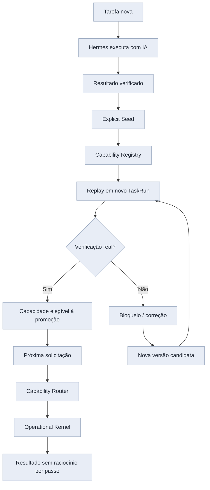

# Comparar diferenciais do Hermes Work

**User:** Anonymous  
**Created:** 10/16/2026 1:04:07  
**Updated:** 10/17/2026 16:20:41  
**Exported:** 10/17/2026 16:32:08  
**Link:** [https://chatgpt.com/c/6ad1a237-6b90-83e9-8131-3341556a37e9](https://chatgpt.com/c/6ad1a237-6b90-83e9-8131-3341556a37e9)  

## Prompt:
16/10/2026, 01:04:38

Sobre o Hermes Work, seja crítico e cínico, realmente tem algo que torna ele um diferencial para o Manus, para o ChatGPT, para o Claude?

## Response:
16/10/2026, 01:04:43 · gpt-6-thinking

Vou separar a proposta arquitetural do Hermes Work do que já está comprovadamente funcionando. Vou conferir o código e os testes do seu fork e comparar com o que Manus, ChatGPT e Claude oferecem hoje. O critério será diferencial real de produto, não quantidade de integrações ou sofisticação do roadmap.

Um achado importante: o próprio repositório distingue testes aprovados em ambientes isolados de funcionalidades qualificadas no produto real. Há evidências de engenharia séria, sobretudo no navegador e na recuperação de operações, mas também bloqueios explícitos de confiabilidade. Isso muda bastante a avaliação do que já é diferencial e do que ainda é promessa.

> **Consultou repositório GitHub, pull requests, compilabilidade e workstations**
>
> 
>
> **Pesquisou 6 sites**
>
> 
>
> **Consultou PRs recentes e documentação oficial do repositório**
>
> 
>
> **Pesquisou 3 sites**
>
> 
>
> **Avaliou a diferenciação e as evidências do Hermes Agent**
>
> 
>
> **Refinando a avaliação**
>
> Estou transformando a crítica em hipóteses mensuráveis, não em afirmações: comparar três fluxos repetidos, custo de tokens, precisão no percentil 95 e economia esperada. Também estou separando merges confirmados, documentação desatualizada e funcionalidades ainda não verificadas em execução.
>
> **Definindo o diferencial**
>
> Estou avaliando o diferencial comprovado como fraco, embora a tese seja promissora: aprendizado operacional persistente pode reduzir custos marginais com o uso. Minha recomendação é testar um fluxo repetível, mensurando precisão, recuperação, reinicialização e economia antes de ampliar integrações.
>
> **Refinou a avaliação e definiu o diferencial**
>
> 
>
> **Verificou PRs e avaliou evidências de monitoramento e automação**
>
> 
>
> Pensou por 2m 16s

# Hermes Work vs. Manus, ChatGPT e Claude: existe um diferencial real?

**Minha avaliação: o Hermes Work tem uma hipótese de diferenciação interessante, mas ainda não demonstrou uma vantagem competitiva sustentável sobre esses três produtos.**

E há uma distinção fundamental\:

- **Como projeto de engenharia\:** o Hermes Work tem componentes e decisões arquiteturais que merecem atenção.
- **Como produto utilizável\:** ainda apresenta falhas de confiabilidade que impedem considerá-lo equivalente aos concorrentes em vários fluxos.
- **Como conceito\:** o Experience Compiler é provavelmente sua aposta mais promissora, mas só será um diferencial se conseguir fazer algo substancialmente melhor do que simplesmente registrar e repetir procedimentos.

O problema não é faltar tecnologia. É que estamos construindo um sistema com uma arquitetura ambiciosa antes de demonstrar que ela entrega resultados melhores.

## 1\. Primeiro, vamos destruir os falsos diferenciais

| Capacidade | Isso diferencia o Hermes? | Por quê? |
|--------|--------|--------|
| Navegador controlado por IA | Não | Todos os três concorrentes já oferecem automação de navegador. |
| Controle de aplicativos e arquivos | Não, isoladamente | ChatGPT e Claude já operam em ambientes de trabalho e arquivos. |
| Automações recorrentes | Não | Manus, ChatGPT e Claude já agendam tarefas. |
| Integrações MCP e APIs | Não | São recursos consolidados no ecossistema. |
| Memória persistente e skills | Não, isoladamente | Já existem implementações concorrentes. |
| Kanban de tarefas | Não | É uma interface de gerenciamento, não uma inovação em inteligência. |
| Múltiplos agentes | Não | Orquestração de agentes já é uma abordagem conhecida. |
| Código aberto e controle local | Parcialmente | Pode diferenciar em propriedade, auditabilidade e personalização, não necessariamente em desempenho. |
| Experience Compiler | Potencialmente | Depende de comprovar aprendizado operacional, validação e reutilização econômica. |

Essa comparação não é hipotética. O Manus AI já divulga automações, navegador, projetos persistentes, skills e integrações. \[[Recursos do Manus: Criar, Produzir, Pesquisar e Automatizar](https://www.manus.im/pt-br/features); [Automação de Fluxo de Trabalho com IA com Agendamentos e Gatilhos](https://www.manus.im/pt-br/features/automations)\] O ChatGPT Work utiliza navegador na nuvem e navegador integrado ao desktop. \[[Using cloud browser in ChatGPT](https://help.openai.com/en/articles/20001280-using-cloud-browser-in-chatgpt); [Using the built-in browser in the ChatGPT desktop app](https://help.openai.com/en/articles/20001277-using-the-built-in-browser-in-the-chatgpt-desktop-app)\]

Mais importante: o Claude já permite gravar procedimentos realizados pelo usuário no Chrome para reutilização posterior, além de combinar conectores, navegador e controle do computador. \[[Comece com Claude no Chrome](https://support.claude.com/pt/articles/12012173-comece-com-claude-no-chrome); [Deixe Claude usar seu computador no Cowork](https://support.claude.com/pt/articles/14128542-deixe-claude-usar-seu-computador-no-cowork)\]

Portanto, dizer que o Hermes Work é diferente porque pode observar ações e posteriormente automatizá-las **não é suficiente**\.

A pergunta correta é: o que ele consegue aprender, executar e preservar que esses sistemas ainda não conseguem fazer tão bem?

## 2\. O que encontrei no seu Hermes Work

Consultei o repositório `kevynlucasprofissional-stack/hermes-agent`, incluindo o Experience Compiler, Operational Kernel, roadmap e os PRs recentes.

Há três componentes que considero tecnicamente relevantes.

### A. Experience Compiler + Laya + System-1

(Potencial alto, comprovação insuficiente)

O conceito mais interessante não é o Hermes executar automações. É ele transformar experiências anteriores em capacidades operacionais reutilizáveis.

O ciclo que poderia diferenciá-lo

**System-2 resolve uma tarefa nova**

Usando raciocínio, ferramentas e navegador

**Experience Compiler identifica um procedimento**

Extrai etapas, variáveis e condições de sucesso

**Valida e registra uma capacidade**

Com evidências, versionamento e limites de autorização

**Operational Kernel reutiliza a capacidade**

Execução determinística, sem raciocinar a cada passo

**Detecta alterações e solicita raciocínio quando necessário**

O procedimento pode evoluir sem repetir todo o aprendizado

Isso é conceitualmente mais interessante do que um gravador de macros porque envolve validação, parametrização, composição e recuperação diante de mudanças.

**Mas o código ainda não comprovou esse ciclo integralmente em uso real.**

O que encontrei\:

- O monitor de compilabilidade opera em `SHADOW` por padrão; o modo `DIRECT` exige qualificação.
- Existe um Operational Kernel determinístico que interpreta capacidades e verifica condições.
- A interface do Experience Compiler possui catálogo, funil de aprendizado e edição de rascunhos versionados.
- Um dos testes relevantes de reutilização via navegador permaneceu falhando e recorrendo ao provedor de IA.
- Não há benchmark comparativo demonstrando redução real de tokens, custo e tempo por tarefa concluída.

O [github.com](https://github.com/kevynlucasprofissional-stack/hermes-agent/pull/82) foi integrado em 13 de outubro, mas o próprio [github.com](https://github.com/kevynlucasprofissional-stack/hermes-agent/blob/main/workstation/context/EXPERIENCE_COMPILER_STUDIO_IMPL_2026-10-11.md) documenta os testes e limitações da implementação original.

**Veredito\:** existe engenharia real, não apenas documentação. Mas ainda não é possível afirmar que o Hermes aprenda sozinho e transforme consistentemente esse aprendizado em automações produtivas.

### B. Browser nativo e execução resiliente

Aqui há um trabalho mais concreto do que parece.

O Hermes possui mecanismos para\:

- Isolar sessões e identidades de execução.
- Transferir controle entre humano e agente.
- Registrar tentativas e resultados de operações.
- Evitar a repetição cega de uma ação cujo resultado ficou incerto.
- Recuperar determinados procedimentos depois da perda de um processo.

O [github.com](https://github.com/kevynlucasprofissional-stack/hermes-agent/pull/85) demonstrou, em ambiente experimental, recuperação após a interrupção de um worker sem duplicar um efeito externo.

Isso é um resultado técnico legítimo.

Só que há uma diferença enorme entre recuperar uma operação cuidadosamente preparada num teste e sobreviver a uma sessão real de 40 minutos envolvendo autenticação, múltiplas abas, formulários dinâmicos, mudanças de interface e intervenção humana.

O [github.com](https://github.com/kevynlucasprofissional-stack/hermes-agent/pull/88), por exemplo, registrou 91 testes Python passando, mas também uma falha no teste do executável Electron empacotado e pendências de handoff. Ele foi encerrado sem merge.

**Veredito\:** robustez transacional pode ser uma vantagem, mas não está demonstrada em condições suficientemente amplas.

### C. Controle local e arquitetura própria

Esse é o diferencial mais tangível em termos de propriedade do sistema.

Você pode inspecionar o código, modificar mecanismos de execução, escolher provedores, criar integrações profundas e conservar seus artefatos operacionais sem depender integralmente do produto de uma empresa.

Contudo, não confunda controle com superioridade.

Um software local com erros de inicialização, dependências frágeis e fluxos interrompidos pode ser menos útil que uma plataforma proprietária que simplesmente conclui a tarefa.

O [github.com](https://github.com/kevynlucasprofissional-stack/hermes-agent/pull/90), integrado em 15 de outubro, ainda descrevia testes reais de instalação Windows pendentes na qualificação original.

Ser dono de toda a infraestrutura significa também ser responsável por tudo que quebra.

---

## 3\. Quem é melhor hoje?

Minha avaliação qualitativa, sem fingir que executei benchmarks lado a lado\:

| Critério | Concorrente mais forte na prática | Posição do Hermes |
|--------|--------|--------|
| Delegar um trabalho complexo imediatamente | ChatGPT / Manus / Claude, conforme a tarefa | Ainda imaturo |
| Automação de navegador pronta para usar | Claude, ChatGPT e Manus | Em desenvolvimento |
| Produção de documentos e pesquisas | ChatGPT / Claude / Manus | Sem vantagem comprovada |
| Registro e repetição de fluxos | Claude já oferece gravação de workflows | Tem implementação experimental de compilação |
| Personalização do motor e das regras internas | Hermes | Vantagem estrutural |
| Execução determinística de procedimentos aprendidos | Não há vencedor demonstrado | Hipótese interessante |
| Confiabilidade de ponta a ponta | Nenhum é infalível; concorrentes oferecem experiências mais consolidadas | Ainda exige qualificação |
| Independência de fornecedor | Hermes, pela possibilidade de controlar o fork | Diferencial real, com custo de manutenção |

Um detalhe que torna a concorrência especialmente complicada: Claude já oferece gravação de workflows no navegador, controle de aplicativos no desktop e tarefas agendadas na nuvem. \[[Comece com Claude no Chrome](https://support.claude.com/pt/articles/12012173-comece-com-claude-no-chrome); [Deixe Claude usar seu computador no Cowork](https://support.claude.com/pt/articles/14128542-deixe-claude-usar-seu-computador-no-cowork); [Agendar tarefas recorrentes no Claude Cowork](https://support.claude.com/pt/articles/13854387-agendar-tarefas-recorrentes-no-claude-cowork)\]

A diferença precisa ir além de *aprender uma sequência de cliques*\.

## 4\. O principal problema estratégico do Hermes Work

O projeto está tentando avançar simultaneamente em muitas frentes\:

- Agente autônomo e raciocínio.
- Browser nativo.
- Kanban e orquestração.
- Experience Compiler.
- Laya e System-1.
- Creative Workstation.
- Integração de motores criativos.
- Controle de execução, segurança e recuperação.
- Instalação e distribuição.

Isso é uma superfície de manutenção enorme.

A minha crítica mais severa é a seguinte\:

**O Hermes pode estar se tornando muito bom em construir infraestrutura para funcionalidades que ainda não funcionam suficientemente bem para o usuário.**

É possível implementar centenas de testes, dezenas de contratos, novos registros de capacidades e várias camadas de autoridade sem aumentar proporcionalmente o número de tarefas concluídas.

E mais: a cada integração, surge uma nova classe de problemas de estado, compatibilidade e recuperação.

O risco é você construir uma infraestrutura de agentes mais sofisticada do que os concorrentes em determinados detalhes, mas que resolve menos problemas reais.

## 5\. Onde eu realmente apostaria

A ideia que você formulou anteriormente merece ser mantida\:

> O Hermes não precisa aprender sozinho antes de automatizar. Podemos automatizar primeiro e transformar gradualmente essas automações em capacidades que ele consiga aprender e reutilizar sozinho.

Mas eu acrescentaria uma condição: **a automação precisa ficar comprovadamente mais barata, confiável e independente do modelo à medida que é reutilizada.**

Imagine três solicitações\:

1. "Acesse o Trello, encontre cartões atrasados e prepare um relatório."
2. "Agora faça isso no outro quadro."
3. "Repita semanalmente para todos os meus projetos."

Na primeira vez, o Hermes raciocina e executa. Na segunda, deveria reconhecer o procedimento, substituir parâmetros e evitar reconstruir tudo. Na terceira, deveria conseguir operar a rotina com verificações e recorrer ao modelo apenas diante de exceções.

Se ele fizer isso repetidamente, sem manutenção manual do script, terá uma capacidade realmente valiosa.

Mas se precisar consultar o modelo para redescobrir os mesmos botões, reconstruir o contexto ou superar as mesmas dificuldades toda vez, o Experience Compiler virou apenas uma infraestrutura cara para armazenar histórico.

## 6\. O experimento que decidiria se o conceito presta

Eu interromperia temporariamente a expansão de integrações e faria uma qualificação focada, com o seguinte desenho\:

### Benchmark: o Hermes realmente aprende a automatizar?

Metas propostas de aceite, não resultados observados

# 5

Fluxos reais distintos

# 30+

Execuções monitoradas

# ≥95%

Conclusões verificadas

# ≥50%

Redução de custo de IA após compilação

---

**Condições essenciais\:** testar reinício do aplicativo, mudança de parâmetros, alterações controladas da interface, falhas injetadas e efeitos externos duplicados. Comparar custo e sucesso antes e depois da compilação e, depois, contra os concorrentes nos mesmos fluxos.

Se atingir essas metas sem intervenções frequentes, teremos evidência de um mecanismo útil de aquisição de habilidades operacionais.

Se não atingir, não adianta adicionar outras dez ferramentas.

## 7\. Meu veredito

Diferencial arquitetural potencial (Existe)

Diferencial demonstrado no produto (Insuficiente)

Vantagem atual sobre Manus/Claude/ChatGPT (Não comprovada)

Motivo para continuar desenvolvendo (Sim, com foco)

Eu não tentaria construir *um ChatGPT, Manus e Claude dentro do Hermes*\. Isso coloca o projeto numa disputa de amplitude de recursos, distribuição e capacidade de investimento na qual ele está em desvantagem.

Eu tentaria construir uma coisa muito específica\:

**Um agente que se torna progressivamente menos dependente de raciocínio caro para executar trabalhos que já sabe fazer, sem sacrificar segurança ou confiabilidade.**

Isso não exige que o Hermes desenvolva um modelo mais inteligente que os concorrentes. Exige que ele transforme experiências bem-sucedidas em competências executáveis que persistem entre sessões.

E existe uma sutileza fundamental: seria aprendizado operacional, não necessariamente aprendizado dos pesos do modelo. O Hermes passaria a possuir uma biblioteca crescente de procedimentos validados.

A arquitetura existente já aponta nessa direção. O que falta é comprovar o ciclo completo, medir os ganhos e fazê-lo funcionar consistentemente fora dos testes isolados.

**Minha conclusão é que o diferencial do Hermes Work ainda não é uma capacidade que ele oferece. É uma hipótese que o projeto está tentando provar.**

E, neste momento, provar essa hipótese vale muito mais do que qualquer nova integração.

## Prompt:
16/10/2026, 11:38:56

Contexto do outro chat e da análise nos anexos. Escuta, eu quero fazer isso que falou, concordo com tudo o que falou sobre as prioridades, então me ajuda a implementar isso o mais rápido possível, não temos tempo para hardening, soluções sofisticadas, vamos focar no 20% de esforço que vai gerar 80% do resultado nessa direção, já cria um plano para fazermos isso, como fazer, de que forma, usando que referência, implementando que código, em que ordem, focando em que arquitetura, preciso de um plano detalhado e técnico.

Se preciso inspecione o código no [$github](app://connector_76869538009648d5b282a4bb21c3d157) para fazer esse plano

[Attachment: ChatGPT-Branch · Planejamento Automação Instagram Newsletter-20261016-1134.md]

[Attachment: Texto colado(20261016-143826).txt]

## Response:
16/10/2026, 11:38:58 · gpt-6-thinking

Vou tratar isso como um MVP de aprendizado operacional dentro do Hermes Work, não como uma nova plataforma. Primeiro vou cruzar os anexos com a implementação atual do Experience Compiler, do Operational Kernel e do roteamento de tarefas; depois entrego a arquitetura mínima, os pontos exatos de integração, o código-base necessário e uma sequência de execução com critérios de aceite.

A direção dos anexos é consistente com o código: não precisamos criar outro executor, outro navegador ou outro sistema de memória. O atalho é acrescentar uma entrada explícita para transformar uma execução bem-sucedida em capacidade reutilizável, usando o registro de capacidades e o executor determinístico já existentes. Estou verificando agora os contratos de promoção, execução e roteamento para evitar um plano que dependa de interfaces imaginárias.

Encontrei um ponto crítico para o 80/20: `OperationalCapabilityRegistry.record_validation()` pode promover automaticamente algumas capacidades após duas validações, enquanto o caminho do Experience Compiler tem regras próprias de promoção. O MVP não deve herdar essa promoção por acidente. Vou separar deliberadamente “criar candidato”, “testar reutilização” e “habilitar execução automática”, sem adicionar um novo subsistema de autorização.

> **Planejando automação técnica do Instagram lulz**
>
>
> **Planejou automação técnica do Instagram e revisou o planejamento**
>
> 
>
> **Investigou arquitetura, interfaces, rotinas e integrações do Hermes Agent**
>
> 
>
> **Reformulando o fluxo seguro**
>
> Estou evitando qualquer autopromoção implícita. Proponho um fluxo mínimo somente leitura: registrar candidatos, validar resultados, exigir aprovação explícita e permitir execução apenas por um compilador de tarefas, sem acesso direto ao núcleo ou efeitos colaterais.
>
> **Reformulou o fluxo seguro**
>
> 
>
> **Implementada rota segura de execução e aprendizado operacional no Hermes**
>
> 
>
> **Estruturando a implementação**
>
> Vou transformar o pedido em um plano independente, começando por sementes explícitas somente leitura, validação verificável e replay autorizado. Também vou separar promoção, reparo, métricas e testes, sem aprendizado autônomo amplo no MVP.
>
> **Estruturou a implementação**
>
> 
>
> **Delimitando o MVP**
>
> Vou priorizar um vertical mínimo: sementes explícitas somente leitura, registro em estado descoberto, replay exclusivamente via executor existente, verificação por pós-condições e aprovação manual antes de qualquer promoção.
>
> **Delimitou o MVP**
>
> 
>
> **Inspecionou rotas e componentes, consultou armazenamento e planejou compilador e capacidades**
>
> 
>
> **Criando arquivos de código do OL-MVP**
>
>
> **Criou arquivos de código do OL-MVP**
>
> 
>
> **Criando plano técnico do HERMES MVP**
>
>
> **Criou plano técnico do MVP HERMES**
>
> 
>
> **Planejando implementação do MVP de aprendizado operacional**
>
>
> **Consolidando MVP seguro**
>
> Estou fechando o plano em torno de um fluxo incremental: registrar automações explícitas, executar somente capacidades permitidas, validar resultados observáveis e promover apenas após evidência suficiente e aprovação manual.
>
> **Planejado o MVP de aprendizado operacional**
>
> 
>
> Pensou por 10m 44s

# Plano técnico - Hermes Work: Operational Learning MVP

(Prioridade P0 · Estratégia 20/80)

**Decisão: concentrar o desenvolvimento em um único ciclo funcional: executar → verificar → salvar → reutilizar → melhorar.**

O Hermes Work não precisa de outra arquitetura de automação. Ele já possui grande parte das peças. O que falta é conectá-las numa experiência simples e demonstrar que a segunda execução de uma tarefa é realmente mais eficiente que a primeira.

Minha proposta é criar o **Operational Learning MVP (OL-MVP)** dentro do repositório existente, sem transplantar o Pauta 7, sem construir novos painéis complexos e sem começar por aprendizado autônomo irrestrito.

## 1\. O que precisa funcionar primeiro

EXPERIÊNCIA-ALVO DO MVP

1. **O usuário solicita uma tarefa**
   
   "Hermes, acesse este site, obtenha determinados dados e gere um relatório."
2. **O Hermes executa com as ferramentas existentes**
   
   Browser nativo, Python, Node.js ou APIs, conforme necessário.
3. **O usuário pede para transformar a execução em automação**
   
   O sistema identifica ações, parâmetros e uma condição verificável de sucesso.
4. **A automação é registrada e validada**
   
   Permanece persistente e pode ser executada novamente com outros parâmetros.
5. **Um novo TaskRun reutiliza o procedimento**
   
   Sem precisar reconstruir cada etapa com o modelo de linguagem.
6. **Se o procedimento falhar, o Hermes pode propor uma correção**
   
   A versão anterior é preservada; a correção só passa a valer após novo teste.

O primeiro sucesso do projeto não será "a IA aprendeu sozinha". Será\:

**O Hermes concluiu uma tarefa nova, registrou um procedimento, reutilizou-o em outra execução com parâmetros diferentes e economizou chamadas reais ao modelo.**

Depois disso, automatizar a descoberta e o aperfeiçoamento será uma evolução, e não uma dependência para começar.

## 2\. O que encontrei no GitHub

Inspecionei a `main` do repositório `kevynlucasprofissional-stack/hermes-agent`, no commit `d2ab172a43b1` \(15 de outubro de 2026), além dos contratos, implementações e testes relacionados.

| Componente existente | Arquivo principal | Decisão |
|--------|--------|--------|
| `OperationalCapabilityRegistry` | `workstation/operational_capabilities.py` | Reutilizar como catálogo |
| `OperationalKernel` | `workstation/operational_kernel.py` | Reutilizar como executor |
| `ExperienceCompiler` | `workstation/experience_compiler/compiler.py` | Reutilizar posteriormente para generalização |
| `ProceduralMemory` | `workstation/memory.py` | Manter para procedimentos web existentes |
| `DeterministicRoutineRunner` | `workstation/routines.py` | Aproveitar, sem duplicar execução |
| `CapabilityRouter` | `workstation/control_plane/router.py` | Manter como fronteira de autorização |
| `TaskCompiler` | `workstation/task_compiler.py` | Manter como coordenador de tarefas duráveis |
| Pre-LLM resolution | `workstation/integrations/hermes/operational_resolution.py` | Ponto de integração da reutilização |
| Laya/System-1 | `workstation/experience_compiler/compilability_monitor.py` | Não tornar obrigatório na primeira versão |

Há dois fatos arquiteturais que determinam o plano\:

O `OperationalCapabilityRegistry` já oferece `register()`, `get()`, `find_matching()` e persistência de capacidades. O `OperationalKernel` já interpreta passos parametrizados e possui `execute_capability()`\.

Também já existe uma fronteira para resolver operações antes de gastar uma chamada ao modelo: `workstation_operational_resolution()`\. Ela se integra com o `TaskCompiler` e com o dispatcher autorizado do Hermes.

Portanto, **não precisamos criar um novo motor de workflows**\. Precisamos criar uma interface estreita que faça as capacidades explícitas entrarem no fluxo existente.

Fontes: [github.com](https://github.com/kevynlucasprofissional-stack/hermes-agent/blob/main/workstation/operational_capabilities.py?utm_source=chatgpt.com), [github.com](https://github.com/kevynlucasprofissional-stack/hermes-agent/blob/main/workstation/operational_kernel.py?utm_source=chatgpt.com) e [github.com](https://github.com/kevynlucasprofissional-stack/hermes-agent/blob/main/workstation/integrations/hermes/operational_resolution.py?utm_source=chatgpt.com)\.

---

## 3\. Arquitetura proposta: apenas uma nova ponte



A novidade é o `Explicit Seed`\: uma forma direta de produzir candidatos a capacidades a partir de automações existentes.

O restante do ciclo usa componentes atuais.

Isso evita três erros de arquitetura: criar um segundo executor, armazenar scripts sem contratos e permitir que Laya se torne uma autoridade independente sobre operações.

## 4\. Ordem exata de implementação

### 01

**Registrar automações explícitas** (Começar aqui)

Criar `workstation/experience_compiler/explicit_seed.py`\. Receber passos, parâmetros, origem e escopo, convertendo-os em uma `OperationalCapability` com lifecycle `DISCOVERED`\.

**Aceite\:** o candidato sobrevive ao reinício, pode ser encontrado pelo registro, mas não executa nem se promove automaticamente.

---

### 02

**Executar e verificar em um TaskRun diferente**

Criar `workstation/experience_compiler/explicit_replay.py` como adaptador fino para o `TaskCompiler`, `CapabilityRouter` e dispatcher existentes.

**Aceite\:** mesma capacidade, dois TaskRuns, parâmetros diferentes, resultado verificado independentemente e sem chamadas intermediárias à LLM durante o replay.

---

### 03

**Resolver capacidades conhecidas antes da LLM**

Adaptar `workstation/integrations/hermes/operational_resolution.py` para consultar o registro quando houver uma intenção confiável e suficientemente específica.

**Aceite\:** uma solicitação conhecida pode produzir `EXECUTED` sem rodada de raciocínio; caso contrário, segue o fluxo normal. Operação incerta não é repetida.

---

### 04

**Medir economia real**

Persistir, por execução, chamadas ao provedor, tokens, custo conhecido, latência, versão da capacidade e resultado verificado.

**Aceite\:** comparar execuções adaptativas e determinísticas da mesma família de tarefas, sem confundir redução de chamadas de ferramentas com economia monetária.

---

### 05

**Reparar e versionar diante de mudanças**

Uma alteração observada produz um candidato de nova versão, mantendo a capacidade anterior intacta até a validação.

**Aceite\:** reconhecer drift, não declarar sucesso falso e demonstrar uma correção verificada.

A etapa 2 é o marco mais importante de todo o projeto. Se ela não funcionar, não vale avançar para a etapa 5.

## 5\. Código inicial preparado

Preparei um pequeno patch para começar pela primeira etapa. Ele usa diretamente as classes e métodos encontrados no repositório.

O novo arquivo `explicit_seed.py` faz, essencialmente, esta operação\:

```python
capability = OperationalCapability(
    id=capability_id,
    name=name,
    version="0.1.0",
    route=route,
    scope=scope,
    input_schema=input_schema,
    implementation={"steps": steps},
    lifecycle=CapabilityLifecycle.DISCOVERED,
    provenance={
        "source": "explicit_seed",
        "task_id": task_id,
        "run_id": run_id,
    },
    source_trace_refs=[source_trace_ref],
)

registry.register(capability, if_absent=True)
```

O arquivo completo inclui validação de primitivas, escopo inicial, geração de IDs estáveis e rejeição de operações fora do piloto.

Ele **não é ainda o fluxo completo de aprendizagem**\: não executa a capacidade, não atesta a verificação e não promove o candidato. Essas operações pertencem às etapas seguintes.

**Pacote de implementação OL-MVP**

Inclui plano, prompt implementador, código Python e testes iniciais.

[Baixar pacote ZIP]

Arquivos: `PLANO_TECNICO.md`, `PROMPT_IMPLEMENTADOR.md`, `explicit_seed.py`, `test_explicit_seed.py` e `README.md`\.

Também está disponível o [plano técnico completo em Markdown](sandbox:/mnt/data/HERMES_OL_MVP_PLANO_TECNICO.md)\.

Os arquivos Python passaram pela verificação de sintaxe. Ainda precisam ser integrados e testados no ambiente real do Hermes.

## 6\. Qual será nosso primeiro experimento?

Eu usaria três níveis, em ordem crescente de complexidade.

| Experimento | Por quê | Resultado esperado |
|--------|--------|--------|
| Leitura parametrizada de arquivos em ambiente isolado | Verificar persistência, registro, inputs e replay sem depender do navegador | Mesmo procedimento funciona com arquivos diferentes |
| Consulta a um site de teste pelo Browser nativo | Provar reaproveitamento operacional web, não apenas filesystem | Extrair novos dados em outro TaskRun sem reconstruir os passos |
| Mudança controlada na interface | Provar que a capacidade não continua cegamente depois de perder validade | Detectar desvio, interromper e propor correção |

Não começaria com Instagram, Gmail, WhatsApp ou Trello mutante. Esses casos adicionam autenticação, efeitos externos e problemas de duplicação antes de validarmos a hipótese central.

Depois de comprovar a reutilização, o fluxo do Pauta 7 pode fornecer um caso de automação mais complexo sem que seja necessário transplantar sua interface.

## 7\. Como saberemos que deu certo?

### Critérios do primeiro marco

Checklist de implementação - nenhum item presumido como concluído /

Somente depois desse marco eu ampliaria para cinco famílias de tarefas, pelo menos 30 execuções monitoradas e a meta experimental de redução de 50% no custo de IA por resultado verificado.

## 8\. O que fica deliberadamente fora

Não vamos implementar n8n, novos conectores, scheduler visual, outro navegador, novo sistema de memória, novos agentes especializados, editor visual de workflows ou novos motores de execução.

Também não vamos tentar resolver agora todo o problema de aprendizagem autônoma do Laya. O Experience Compiler continuará disponível, mas a criação explícita de capacidades será o caminho principal do MVP.

**Não fazer hardening extensivo é uma decisão de escopo. Não significa desabilitar a verificação real, a identidade do TaskRun, os controles de autorização ou a prevenção de efeitos duplicados.** Esses mecanismos já existem e devem ser reutilizados.

## 9\. Próximo passo de engenharia

A instrução mais eficiente para a IA implementadora é começar pelo pacote, executar a etapa 1 e avançar diretamente à etapa 2, sem refazer uma auditoria geral do Hermes.

O arquivo `PROMPT_IMPLEMENTADOR.md` contém a sequência de trabalho, os pontos de integração, os testes e as condições que impedem declarar um sucesso inexistente.

A prioridade fica congelada nesta ordem\:

**Registro explícito → Replay entre TaskRuns → Roteamento pré-LLM → Métricas reais → Reparação.**

O resultado que procuramos não é uma arquitetura nova e impressionante. É a primeira evidência de que o Hermes Work consegue transformar trabalho realizado em competência reutilizável, reduzindo de fato sua dependência de raciocínio repetitivo.

## Prompt:
16/10/2026, 11:57:03

Valida esse plano contra as sessões reais C:\Github\hermes-agent\workstation\dogfood\dados\Sessões Hermes

Procure, de acordo com o funcionamento real do Hermes, se realmente esse plano é o mais inteligente possível, e o mais focado no 80/20 possível.

## Response:
16/10/2026, 11:57:11 · gpt-6-thinking

Vou usar as sessões reais como critério principal, não o roadmap. Primeiro vou identificar os padrões de falha, desperdício de chamadas e tarefas repetidas nos registros locais; depois comparar com o OL-MVP e eliminar etapas que não resolvam esses problemas diretamente. Também vou conferir os pontos de integração no código atual antes de recomendar mudanças.

O computador vinculado ao Desktop Commander aparece **offline** \(última conexão há cerca de 13 horas), então não consigo ler diretamente `C:\Github\hermes-agent\workstation\dogfood\dados\Sessões Hermes` neste momento. Vou verificar se há cópias ou evidências dessas sessões nos arquivos acessíveis e no GitHub. Separarei claramente o que foi comprovado por registros reais do que for apenas revisão arquitetural.

Encontrei uma alternativa relevante: existe um snapshot histórico de **48 sessões reais** na branch `codex/dogfood-causal-closure-20261009`, em `dados/Sessões Hermes`\. Não é a mesma pasta local atual, mas permite validar os padrões anteriores sem inventar observações. O contraste já registrado é importante: algumas tarefas simples tiveram execução direta, enquanto outras consumiram dezenas de chamadas apenas para descobrir qual ferramenta usar. Vou usar esses casos para reordenar o plano.

> **Listou dispositivos e verificou arquivos locais**
>
> 
>
> **Verificando arquivos locais e referências disponíveis**
>
>
> **Verificados arquivos locais e lido o plano técnico do Hermes**
>
> 
>
> **Buscou arquivos de sessões na biblioteca**
>
> 
>
> **Inspecionando script de semente explícita**
>
>
> **Inspecionou script de semente explícita**
>
> 
>
> **Listou snapshots dogfood e documentação do Hermes e GitHub**
>
> 
>
> **Testando acesso à URL do GitHub**
>
>
> **Testou acesso à URL do GitHub**
>
> 
>
> **Reorientando a execução**
>
> Estou concluindo que a prioridade não é criar uma nova semente explícita, mas recuperar rotas funcionais, melhorar o roteamento pré-LLM e instrumentar provas. Vou verificar prefabs, integrações e testes recentes para validar fluxos como abrir Trello, Creative e ler um site.
>
> **Reorientou a execução**
>
> 
>
> **Analisou sessões Hermes, históricos sanitizados e fluxos pré-LLM determinísticos**
>
> 
>
> **Revisado o plano de roteamento e aprendizado**
>
> 
>
> **Revisou e fortaleceu o plano de auditoria do Hermes**
>
> 
>
> **Leu auditoria detalhada em 100 linhas**
>
> 
>
> **Auditou e revisou planos, riscos, artefatos e lacunas de aprendizado e automação**
>
> 
>
> **Criando revisão crítica do plano OL-MVP**
>
>
> **Refinando a validação**
>
> Estou evitando conclusões baseadas apenas em código histórico. Vou verificar se o aprendizado, os prefabs e o compilador estão realmente conectados aos fluxos atuais, distinguindo implementação existente de comportamento comprovado em sessões reais.
>
> **Refinou a validação**
>
> 
>
> **Criada revisão crítica do plano OL-MVP**
>
> 
>
> **Avaliou integração, arquitetura e lacunas de aprendizado dos workflows**
>
> 
>
> **Atualizando diagnóstico do caminho Hyperframe canônico**
>
>
> **Atualizado diagnóstico do caminho Hyperframe canônico**
>
> 
>
> Pensou por 8m 14s

# Auditoria do plano OL-MVP contra o uso real do Hermes Work

(Plano anterior precisa de revisão)

**Conclusão: o plano anterior está arquiteturalmente correto, mas não é a sequência de implementação mais eficiente para um verdadeiro 80/20. Eu mudaria as prioridades antes de executá-lo.**

A principal descoberta é que o Hermes já tem mecanismos de execução determinística, registro de capacidades, resolução pré-LLM e aprendizado operacional. O problema demonstrado nas sessões históricas não é apenas a ausência de novas capacidades. É a dificuldade de **selecionar, utilizar e concluir corretamente operações que o sistema já sabe executar**\.

### Escopo da validação

O Desktop Commander está offline, portanto não consegui acessar a versão atual da pasta `C:\Github\hermes-agent\workstation\dogfood\dados\Sessões Hermes`\.

Consegui, entretanto, localizar um snapshot histórico de 48 sessões reais na [github.com](https://github.com/kevynlucasprofissional-stack/hermes-agent/tree/codex/dogfood-causal-closure-20261009/dados/Sess%C3%B5es%20Hermes?utm_source=chatgpt.com), analisar diretamente diversos exports e consultar uma auditoria anterior baseada nas sessões completas do Trello e HyperFrames. Comparei esses achados com a `main` do Hermes e com o pacote OL-MVP que criamos.

**Isto valida o plano contra evidências reais históricas, mas não certifica que os mesmos problemas persistem no executável atual.**

## 1\. O que as sessões mostram

| Sessão | Evidência observada | Problema predominante |
|--------|--------|--------|
| Abrir Trello - 03/09 | 1 chamada `browser_navigate` | Exemplo de execução curta e direta |
| Abrir Browser - 21/09 | 55 mensagens, 6 consultas a skills, 7 buscas e 8 leituras de arquivos | Descoberta excessiva de ferramentas |
| Abrir Browser \#2 - 22/09 | 71 mensagens, 7 buscas e 8 leituras de arquivos | Rota operacional e continuidade |
| Abrir WhatsApp - 24/09 | 135 mensagens; 19 buscas de arquivos e 11 terminais | Exploração excessiva e bloqueios de autoridade |
| Open Trello - 09/10 | 837 mensagens, 163 chamadas `browser_console` | Execução fragmentada, efeitos incertos e verificações insuficientes |
| Abrir HyperFrames - 09/10 | 301 mensagens, 53 chamadas ao terminal | Redescoberta de uma operação já disponível |

As contagens são dos exports históricos; não são medições controladas de custo ou desempenho dos modelos.

A auditoria anterior também encontrou **37 retornos contendo `SUPERSEDED` e 19 contendo `handoff_requested`** na sessão Open Trello. Uma edição manual de um cartão foi sobrescrita durante a sincronização de descrições, evidenciando que a verificação utilizada não era suficiente para preservar alterações humanas. fileciteturn98file0

O diagnóstico é bastante específico\:

1. **Desperdício antes da execução\:** o Hermes pesquisa como executar uma operação que poderia ser resolvida diretamente.
2. **Desperdício durante a execução\:** ele fragmenta procedimentos repetitivos em muitas chamadas ao modelo e às ferramentas.
3. **Desperdício após erros\:** tenta recuperar operações sem ter uma confirmação suficientemente clara do estado anterior.
4. **Aprendizado sem benefício observável\:** não há prova consistente de que o sistema esteja transformando esses procedimentos em execuções mais econômicas nas próximas sessões.

Isso significa que criar mais uma forma de registrar capacidades, isoladamente, não resolve o gargalo principal.

## 2\. O que muda no plano anterior

| Prioridade anterior | Nova decisão |
|--------|--------|
| Criar `explicit_seed.py` primeiro | Adiar; aproveitar candidatos, prefabs e registros existentes |
| Começar com leitura de arquivos | Usar somente como teste de sanidade |
| Criar `explicit_replay.py` | Evitar inicialmente; tentar reaproveitar o `TaskCompiler` e o roteamento existentes |
| Integrar resolução pré-LLM na terceira etapa | **Tornar a primeira etapa funcional** |
| Medir custo depois da integração | Registrar baseline antes de qualquer alteração |
| Reparação automática na quinta etapa | Manter fora do primeiro marco |
| Criar capacidades a partir de receitas explícitas | Priorizar primeiro operações repetidas e comprovadas nas sessões |

Há ainda um motivo para não implementar tudo isso de novo: a `main` já contém `workstation/prefabs/`, com reconhecimento de solicitações como abrir Trello, WhatsApp, ChatGPT e Instagram, além do código de resolução antes da LLM.

Ou seja, algumas correções para os problemas observados já foram implementadas **depois das sessões que analisamos**\. A tarefa imediata é verificar se essas correções realmente funcionam numa sessão normal, não reconstruí-las com nomes diferentes.

---

## 3\. A falha arquitetural mais interessante que encontrei

O código atual oferece um exemplo concreto de por que priorizar integração pode ser mais útil que criar componentes.

Em `workstation/work_intent.py`, a função `recognize_current_command()` reconhece a solicitação **"Abre o Hyperframe"** e a associa à operação `creative.hyperframes.open`\.

Entretanto, na implementação de `workstation_operational_resolution()`\:

- O atalho inicial consulta os prefabs, mas o catálogo não possui uma entrada equivalente para abrir o HyperFrames pelo serviço criativo.
- O caminho seguinte exige uma tarefa canônica existente.
- `work_intent.py` classifica esse comando simples como `point_action`, que normalmente não cria um TaskRun.
- Sem essa tarefa, o resolver retorna `None` e deixa o modelo raciocinar.

Isso também aparece no teste `test_fresh_hyperframe_command_falls_back_safely_without_studio_capability`, que explicitamente espera fallback quando a capacidade criativa não está instalada.

**É uma lacuna plausível no roteamento atual, identificada diretamente no código.** Não é evidência de que o usuário atual ainda esteja enfrentando exatamente a mesma falha, porque não executei o aplicativo instalado.

A correção ideal não seria criar `explicit_seed.py` para aprender a abrir o HyperFrames. Seria permitir que a solicitação confiável chegasse ao serviço criativo existente, mantendo as verificações e autorizações apropriadas.

Esse é o tipo de mudança de baixo esforço e alto impacto que merece prioridade.

## 4\. Arquitetura 80/20 revisada

NOVA SEQUÊNCIA DE DESENVOLVIMENTO

**P0 - Roteamento operacional direto**

Usar imediatamente capacidades conhecidas, sem redescobrir ferramentas

**P1 - Execução parametrizada em lote**

Uma estratégia para vários itens equivalentes, usando executor existente

**P2 - Fechar o ciclo Experience Compiler**

Experiência verificada → candidato → novo TaskRun → reutilização

**P3 - Comparação real de desempenho**

Economia de IA, tempo e resultado verificado

| Etapa | Implementação mínima | Critério de avanço |
|--------|--------|--------|
| P0 | Testar e corrigir o uso dos prefabs e do roteamento atual | Abrir Trello e HyperFrames sem buscas desnecessárias |
| P1 | Reusar `TaskCompiler`, `DurableBatchRunner` e `browser_batch_actions` | Processar pelo menos três itens equivalentes sem replanejamento por item |
| P2 | Conectar as evidências ao Experience Compiler existente | Um procedimento reaproveitado em outro TaskRun, com parâmetros diferentes |
| P3 | Instrumentar comparação pareada | Ganho de chamadas, tokens ou custo comprovado sem perder confiabilidade |

**O ponto de maior retorno continua sendo P2, não P0.** P0 apenas remove um obstáculo que pode impedir o projeto de chegar lá. Não devemos passar semanas aperfeiçoando atalhos de abertura de sites.

## 5\. O que fazer com o patch anterior?

Eu **não aplicaria o ZIP OL-MVP anterior diretamente**\.

O módulo `explicit_seed.py` possui limitações concretas\:

Ele só aceita `browser_navigate`, `browser_snapshot` e `browser_extract_items` para operações web. Portanto, não consegue representar uma automação útil que precise clicar ou preencher campos.

Também obriga URLs literais, impedindo parametrizar destinos, e recebe uma referência de origem sem comprovar que ela corresponde a uma execução aceita.

Mais importante: seu `provenance.source = "explicit_seed"` não utiliza automaticamente o tratamento especializado do Experience Compiler. Existe o risco de usar a política genérica de promoção, que possui comportamento diferente.

Isso não torna o código inútil. Ele pode servir futuramente para importar procedimentos declarativos, mas **não é a solução mais curta para comprovar aprendizado operacional**\.

Eu aproveitaria, em vez disso, os arquivos já presentes\:

`workstation/procedure_trace.py` para capturar execuções, `workstation/experience_compiler/compiler.py` para construir candidatos, `workstation/operational_capabilities.py` para persistência e `workstation/integrations/hermes/operational_resolution.py` para reutilização pré-LLM.

O objetivo é identificar a primeira ligação que realmente falha, corrigi-la e repetir o teste. Não adicionar outra camada preventiva.

## 6\. Primeira implementação que eu autorizaria

A primeira entrega seria um PR pequeno, focado em um único cenário de execução real.

**Teste de referência A - Navegação direta.** Executar `Abre o Trello.` e `Abre o Hyperframe.` a partir de sessões normais do Hermes no Windows. Registrar o número de chamadas de LLM e ferramentas, o caminho do roteamento e a confirmação real da operação.

**Teste de referência B - Reutilização em lote.** Num quadro descartável ou serviço de teste, pedir ao Hermes que leia três itens semelhantes e produza resultados estruturados. Comparar a execução adaptativa com a execução determinística pelos mecanismos já presentes.

**Teste de referência C - Aprendizado entre sessões.** Repetir a família de operações num novo TaskRun com inputs distintos. O teste só passa quando o Hermes usa uma capacidade registrada, sem reconstruir seus passos via LLM, e confirma o resultado.

Os comandos iniciais de regressão seriam\:

```powershell
python -m pytest -q `
  workstation/tests/test_current_command_resolution.py `
  workstation/tests/test_e2e_operational_resolution.py `
  workstation/tests/test_h080b_native_browser_experience_loop.py `
  workstation/tests/test_in_flight_handoff.py
```

Esses testes exercitam partes críticas, mas não substituem uma sessão real com o Electron. Se houver falha antiga conhecida, a implementação deve registrar a causa e testar exclusivamente a correção necessária.

Para a questão do Trello, manteria um teste negativo obrigatório: **o agente não pode sobrescrever uma alteração humana nem repetir cegamente um efeito cujo resultado ficou incerto**\.

## 7\. Documento técnico revisado

Consolidei as descobertas, as falhas do plano anterior, os arquivos a modificar, as referências históricas e a nova sequência de implementação.

**Auditoria e Plano OL-MVP - Revisão 80/20**

Markdown · 16 de outubro de 2026

[Abrir documento técnico](sandbox:/mnt/data/HERMES_OL_MVP_REVISAO_80_20_DOGFOOD_2026-10-16.md)

A revisão também distingue o que já foi implementado depois dos incidentes históricos, para evitar que outra IA recrie recursos que estão na `main`\.

## Veredito final

Eu manteria o objetivo estratégico do OL-MVP, mas substituiria seu plano de execução.

**O Hermes Work precisa demonstrar três coisas, nesta ordem\:**

**Escolher corretamente** uma capacidade operacional que já possui; **executá-la repetidamente** sem reconstruir cada passo; e **aprender a reutilizar** novos procedimentos a partir de execuções realmente verificadas.

O registro de capacidades, o compilador e o executor já estão presentes. Construir mais código antes de demonstrar a integração desses componentes seria repetir precisamente o padrão de desenvolvimento que criticamos na análise original.

A única limitação importante desta auditoria é que a pasta local atual continua inacessível. Para uma conclusão definitiva sobre o estado de hoje, é necessário confrontar essas hipóteses com as sessões mais recentes dessa pasta, especialmente as posteriores às integrações de 11 a 15 de outubro.

## Prompt:
16/10/2026, 12:10:40

Leia os contextos e veja se de acordo com eles se o plano precisam ou não de ajuste:

Nesse diretório tem o HTML de páginas que uso muito e preciso de processos automáticos para usar essas páginas: C:\Github\hermes-agent\workstation\dogfood\dados\Páginas de sites

Nesse diretório tem arquivos de texto relacionados a sessões com IAs anteriores sobre decisões, hipóteses, planos e outros sobre a evolução do Hermes Work: C:\Github\hermes-agent\workstation\dogfood\dados\Contexto Hermes

De qualquer forma, as sessões reais do Hermes que você já leu são as provas máximas e as fontes com maior prioridade pois é o software funcionando de fato, estou falando dos arquivos do diretório: C:\Github\hermes-agent\workstation\dogfood\dados\Sessões Hermes

Inclusive, o [$remote-desktop-commander](app://asdk_app_6a057d268ebc81919918d37eec718425) agora está conectado, se quiser usar ele para ler as últimas sessões do Hermes que ainda não estão no github, pode usar, estou falando dos arquivos no diretório: C:\Github\hermes-agent\workstation\dogfood\dados\Sessões Hermes

## Response:
16/10/2026, 12:10:49 · gpt-6-thinking

Vou tratar as três pastas como fontes com pesos diferentes: **sessões reais primeiro**, HTMLs para entender os fluxos que precisam ser automatizados e documentos de contexto para recuperar decisões e hipóteses. Vou conferir também o código local, porque uma decisão antiga pode já ter sido implementada ou superada. O resultado será uma revisão técnica do plano 80/20, com prioridades mantidas, descartadas ou reordenadas.

Consegui acessar as três pastas locais. Há **sessões adicionais de 11 e 12 de outubro** que não estavam na amostra do GitHub, e elas reforçam o problema de execução: uma sessão “Abrir ChatGPT” tem 430 mensagens; “Acessar chat do ChatGPT”, 163; e uma investigação de persistência do Browser, 583. Estou distinguindo nesses registros o custo de uma operação comum do custo de uma sessão em que o agente foi solicitado a depurar o próprio software — misturar os dois distorceria a prioridade.

A revisão das sessões mais recentes trouxe uma distinção decisiva: **há casos de abertura simples que já funcionam com uma chamada**, mas as falhas de continuidade aparecem nos turnos seguintes. Na sessão “Abrir Google”, o primeiro pedido foi resolvido com uma navegação; ao pedir depois para abrir o YouTube, começaram os retornos `SUPERSEDED`, inclusive em ferramentas que não são do navegador. Portanto, não faz sentido investir o MVP inteiro em novos aliases de navegação. Precisamos provar continuidade entre turnos e, logo depois, reutilização de um procedimento completo.

> **Analisando o corpus**
>
> Estou revisando o corpus de forma eficiente, extraindo metadados e padrões agregados dos arquivos de sessão. Vou priorizar contagens, erros e estruturas gerais, evitando expor conteúdos pessoais ou detalhes internos de execução.
>
> **Analisado o corpus**
>
> 
>
> **Inspecionou contexto remoto e inventariou documentos, sessões e metadados**
>
> 
>
> **Mapeando a interface**
>
> Estou examinando a estrutura visual da interface, procurando elementos recorrentes como identificadores de componentes, papéis acessíveis, campos editáveis e formulários. Vou manter a análise agregada para destacar padrões sem expor conteúdo individual.
>
> **Mapeou a interface**
>
> 
>
> **Avaliando o plano**
>
> Estou comparando o plano com o estado atual do projeto e com os contextos mais relevantes. Vou separar ajustes indispensáveis de melhorias posteriores, priorizando um primeiro fluxo completo, observável e simples de validar.
>
> **Avaliou o plano**
>
> 
>
> **Analisou contexto, decisões e prioridades para ajustar automação browser**
>
> 
>
> **Definindo prioridades**
>
> Estou concluindo que o plano precisa de ajustes: primeiro devo validar um fluxo somente leitura, repetível e observável, usando uma única representação canônica. Depois, amplio para métricas e ações com efeitos externos, evitando complexidade prematura.
>
> **Definiu prioridades**
>
> 
>
> **Avaliou plano MVP, evidências, rotinas autônomas e cenário browser de alto ROI**
>
> 
>
> **Aguardando criação do plano revisado 80/20**
>
>
> **Aguardou a criação do plano revisado 80/20**
>
> 
>
> **Verificado arquivos, contagens e afirmações técnicas**
>
> 
>
> **Corrigindo referências de arquivos no plano Hermes**
>
>
> **Corrigiu referências de arquivos no plano Hermes**
>
> 
>
> Pensou por 10m 42s

# Validação do Hermes Work - sessões reais, HTMLs e contexto de engenharia

**Sim, o plano precisa de ajustes.** Os novos materiais reforçam a direção estratégica do Experience Compiler, mas indicam que podemos chegar ao resultado com menos código novo e uma escolha melhor do primeiro caso de uso.

Desta vez, consegui acessar diretamente as três pastas pelo Desktop Commander. Encontrei\:

# 56

Sessões reais do Hermes

# 10

Páginas HTML salvas

# 40

Arquivos de contexto

Os números representam o inventário das pastas, não 56 execuções independentes nem a leitura integral de todos os 40 documentos. Fiz análise estrutural das sessões JSON e dos dez HTMLs, além de leitura dirigida dos documentos mais pertinentes.

## 1\. O que os HTMLs acrescentam

Os arquivos salvos revelam uma oportunidade maior que criar atalhos para abrir páginas: **o Hermes precisa executar procedimentos completos sobre interfaces web que você efetivamente utiliza**\.

| Sistema | Evidência estrutural no HTML | Oportunidade operacional |
|--------|--------|--------|
| Trello - dois quadros | Centenas de cartões com `data-testid` e componentes ProseMirror | Ler, localizar, comparar e atualizar cartões por procedimento |
| WhatsApp Web | Estrutura de conversa e mensagens, com identificadores de interface | Localizar conversa, preparar mensagem e verificar ações autorizadas |
| Instagram | Páginas de perfil, feed e painel de insights | Extrair informações estruturadas; posteriormente preparar publicações |
| ChatGPT | Editor de texto rico e elementos de navegação | Abrir conversas, localizar conteúdo e operar o editor |
| Gemini Notebook | Home e página de notebook, com menos identificadores semânticos explícitos | Abrir notebooks e trabalhar com fontes, sujeito a descoberta de alvos em execução |

Um detalhe relevante: no HTML do quadro ACIRV + VCOM SCRUM encontrei 761 ocorrências do identificador `list-card`, e no Calendário Editorial, 539. Isso representa elementos de interface, **não** uma contagem certificada de cartões únicos.

Os snapshots do Trello oferecem candidatos a seletores estáveis. Em outros sites, os identificadores são menos explícitos; por isso, devemos preferir elementos semânticos e verificação do estado vivo, em vez de gravar coordenadas ou referências transitórias.

Esses HTMLs são excelentes **fixtures para desenvolver extratores, descobrir âncoras e testar reconhecimento de interfaces**\. Não devem ser tratados como retratos permanentes do DOM nem como prova de que uma operação futura terá autorização para agir.

## 2\. O princípio de arquitetura foi confirmado pelos contextos

Uma anotação de 15 de outubro sintetiza a intenção original\:

> “O Hermes não precisa aprender sozinho antes de automatizar, podemos ir automatizando até finalmente ele conseguir aprender sozinho.”

O histórico de desenvolvimento do Experience Compiler também defende a ordem: **automatizar → reutilizar → ensinar → aprender**\.

Essa sequência é mais apropriada do que exigir uma compilação autônoma completa antes de oferecer automações úteis.

Entretanto, há uma restrição essencial: **automatizar não significa reproduzir indiscriminadamente qualquer ação de navegador**\. O caso histórico do cartão 012 do Trello demonstrou uma sobrescrita indevida de edição humana. Transformar esse comportamento em procedimento reutilizável apenas tornaria o erro repetível.

Portanto, considero validadas duas decisões\:

- Não criar um novo produto de automação nem um clone do n8n dentro do Hermes.
- Reutilizar o Browser nativo, o executor determinístico e o registro de capacidades existentes para automatizar fluxos úteis agora, deixando a aprendizagem autônoma como evolução.

O que muda é a **ordem das intervenções e a escolha do primeiro experimento**\.

---

## 3\. O que as sessões mais recentes comprovam

As oito sessões adicionais, de 11 e 12 de outubro, permitem separar dois problemas que o plano anterior tratava como um só.

| Sessão | Evidência | Implicação |
|--------|--------|--------|
| **Abrir Google - 12/10** | Google abre com uma navegação; a solicitação posterior para abrir YouTube encontra 11 retornos `SUPERSEDED` naquele segmento | A continuidade entre turnos ainda era um bloqueio real naquela versão |
| **Abrir Creative Workstation - 12/10** | 116 mensagens; 35 buscas e 22 leituras de arquivos | O agente não chegava imediatamente à funcionalidade solicitada |
| **Abrir ChatGPT - 11/10** | Pedido inicial gerou 39 mensagens, incluindo 19 chamadas ao terminal | Custo excessivo para uma operação conhecida |
| **Coleta Instagram - 02/10** | 3.840 mensagens ao longo do export | Forte oportunidade de processamento em lote, mas o histórico inclui recuperação e tarefas auxiliares |

Uma ressalva importante: as sessões também contêm instruções de depuração, alterações de código e mensagens de sistema. **Não podemos atribuir todas as mensagens dessas conversas à operação original**, nem inferir diretamente quantos dólares foram gastos.

Também li a investigação de identidade do TaskRun, de 13 de outubro. Ela descreve uma causa comprovada em testes: o navegador recebia identificadores transitórios diferentes entre turnos, fragmentando uma conversa em múltiplos `BrowserTasks`\. A correção passou em testes Electron, mas o `SUPERSEDED` histórico não foi reproduzido integralmente e o teste do aplicativo empacotado terminou com uma falha de inicialização.

Esses fatos indicam que continuidade é um **gate de entrada do experimento**, não uma autorização para reabrir indefinidamente todo o hardening de Kanban e Browser.

## 4\. Descoberta decisiva no código: parte do nosso MVP já existe

Esta foi a descoberta mais relevante da inspeção local.

O método `TaskCompiler.execute()` já faz o seguinte\:

```python

# Lógica existente, resumida
if request.get("operation_fingerprint"):
    matched_cap = registry.find_matching(
        route=route,
        semantic_fingerprint=request["operation_fingerprint"],
        scope=request.get("recipe_scope"),
        promoted_only=True,
    )

    if matched_cap:
        return self._execute_capability(...)

# Depois das outras tentativas de correspondência:
if not recipe and not request.get("steps"):
    request = compiled_routine_request(
        request, ProceduralMemory()
    )
```

Além disso, os experimentos BAV documentam\:

- **BAV03\:** duas execuções parametrizadas pelo controlador nativo, 12 chamadas ao controlador, dois efeitos confirmados e nenhuma chamada à LLM no harness.
- **BAV05\:** persistência de um procedimento e reutilização por processos Python distintos, ainda dentro da mesma TaskRun de teste.
- **BAV04\:** recuperação experimental após interrupção do worker, sem duplicar o efeito no servidor de teste.

Isso já comprova parte da viabilidade técnica. Não comprova ainda que um usuário normal possa ensinar uma operação ao Hermes e reutilizá-la em outra TaskRun.

### Por que o aprendizado pode não estar acontecendo nos casos mais importantes?

Em `workstation/procedure_trace.py`, a função `candidate_steps()` rejeita sequências que contenham `browser_console`, classificadas como `opaque_adaptive_execution`\.

Esse detalhe se conecta diretamente às sessões: muitas operações reais foram realizadas com JavaScript improvisado pelo console. **O Hermes pode ter executado com sucesso um procedimento inteiro e, mesmo assim, não ter uma representação admissível para reutilizá-lo.**

Outro ponto que merece teste é o fechamento em `workstation/kanban.py`\: existe um caminho de criação de candidatos que só é usado sob condições específicas, inclusive um fallback dependente do estado do corpus. Precisamos identificar em qual fronteira a oportunidade deixa de progredir.

Minha decisão é não criar `explicit_replay.py` nem `explicit_seed.py` agora. O primeiro trabalho é conectar corretamente os caminhos que já existem.

## 5\. Plano definitivo - quatro entregas, uma única vertical primeiro

### P0

**Provar o caminho real de execução**

Confirmar, no aplicativo atual, que uma conversa consegue executar múltiplos turnos sem perder o BrowserTask correto. Reproduzir primeiro Google → YouTube e uma abertura conhecida de aplicativo.

Corrigir somente o bloqueio que aparecer no HEAD atual. Não reconstruir o Kanban nem expandir atalhos que já funcionam.

---

### P1

**Executar um workflow web útil sem redescobrir os passos**

Escolher o Trello, usando os dois HTMLs como referências de estrutura e um quadro de teste como ambiente de execução.

O procedimento inicial será somente leitura: abrir um quadro, localizar cartões, extrair campos e salvar resultados estruturados de três cartões. Reutilizar `browser_extract_items`, ações semânticas e o executor atual.

**Critério\:** três itens processados sem replanejamento via LLM a cada cartão.

---

### P2

**Persistir e reutilizar em outra TaskRun**

Capturar o procedimento pelo `procedure_trace.py`, produzir evidências aceitas, registrar um `WebProcedure` e reutilizar a seleção existente do `TaskCompiler`\.

O novo pedido deverá fornecer fingerprint, escopo e parâmetros compatíveis - diretamente por uma intenção estruturada confiável ou por uma única interpretação inicial do modelo.

**Critério\:** uma TaskRun nova executa a rotina com parâmetros diferentes, sem reconstruir os passos, e verifica independentemente a saída.

---

### P3

**Medir e decidir se vale generalizar**

Comparar uma execução adaptativa com uma execução reutilizada: chamadas reais de modelo, tokens, tempo, ferramentas e qualidade do resultado.

**Critério\:** demonstrar vantagem real, ou registrar explicitamente que o ganho ainda não existe. Somente então iniciar uma segunda vertical.

### Sequência de integrações

| Arquivo existente | Trabalho necessário |
|--------|--------|
| `workstation/procedure_trace.py` | Garantir captura de ações semânticas reutilizáveis |
| `workstation/kanban.py` | Confirmar a criação de candidato após aceitação real |
| `workstation/memory.py` | Persistir e recuperar `WebProcedure` |
| `workstation/routines.py` | Reutilizar a conversão para passos executáveis |
| `workstation/task_compiler.py` | Garantir que requests reais cheguem ao lookup existente |
| `workstation/integrations/hermes/operational_resolution.py` | Habilitar reutilização quando houver intenção confiável |
| `workstation/telemetry/` | Medir redução efetiva de custos e chamadas |

Nem todos esses arquivos precisarão ser modificados. Essa é a ordem para inspecionar e corrigir a primeira ligação comprovadamente defeituosa.

## 6\. Qual automação deve vir depois?

[](https://tryholo.ai/blog/how-to-grow-your-business-on-instagram)

**Minha segunda vertical seria coleta de métricas do Instagram.**

As sessões de coleta mensal são longas e repetitivas. Há potencial maior de economia absoluta que na abertura de sites. Eu utilizaria a API Graph oficial quando ela cobrir os dados necessários e o Browser nativo apenas para lacunas autorizadas.

Depois viriam edição de cartões do Trello com verificação de versões, operações autorizadas de WhatsApp e fluxos de publicação e newsletter.

**Não recomendo que o Browser substitua indiscriminadamente APIs, SMTP e serviços próprios.** A centralização deve acontecer na camada de orquestração do Hermes; o mecanismo de execução de cada capacidade deve continuar sendo aquele que apresentar menor custo e maior confiabilidade.

O Pauta 7 pode fornecer futuras capacidades reutilizáveis, mas não deve ser desmontado antes de comprovar equivalência operacional.

## 7\. O que fica de fora

| Proposta | Decisão |
|--------|--------|
| Novo `explicit_seed.py` | Não integrar por enquanto |
| Novo `explicit_replay.py` | Descartar se a ponte atual puder ser concluída |
| Editor visual de workflows | Adiar |
| Integração obrigatória do Playwright | Não |
| Laya em modo DIRECT generalizado | Adiar |
| Reparação autônoma complexa | Adiar |
| Transplantar todo o Pauta 7 | Não |
| Verificação de resultado e isolamento de autoridade | Preservar obrigatoriamente |

Os dados favorecem **terminar uma funcionalidade completa**, e não ampliar a quantidade de módulos.

## 8\. Plano técnico consolidado para implementação

**Hermes Work - Plano 80/20 validado pelo Dogfood**

Contém evidências, arquitetura escolhida, funções existentes, etapas, testes e critérios de parada.

[Baixar plano revisado em Markdown](sandbox:/mnt/data/HERMES_WORK_PLANO_80_20_VALIDADO_DOGFOOD_2026-10-16.md)

O arquivo é um novo plano de implementação. Não substituí nem modifiquei os documentos originais do seu computador.

Verifiquei também o checkout local: a branch ativa é `docs/oneclick-bootstrap-reliability-20261016`, no commit `73a1ca3792`, enquanto a `main` local está em `d2ab172a43`\. Existem alterações e arquivos não rastreados, inclusive na pasta de dogfood. Eles foram preservados.

## Decisão final

**O objetivo continua sendo construir um Hermes Work que transforma experiência em competência operacional reutilizável.**

Os materiais mudam a maneira de chegar lá\:

Antes, estávamos planejando adicionar componentes para que o Hermes pudesse registrar e executar capacidades.

Agora sabemos que **essas peças já existem, inclusive com experimentos bem-sucedidos em ambientes isolados**\. A oportunidade mais importante é fazer a execução real, a verificação, o registro e o replay atravessarem corretamente as fronteiras que já foram implementadas.

Eu começaria pelo procedimento completo de leitura de cartões do Trello, provaria sua reutilização em outra TaskRun e, assim que funcionasse, aplicaria o mesmo método à coleta de métricas do Instagram.

**Esse é o 20/80 que considero mais defensável após examinar as três fontes: menos infraestrutura, mais operações reais transformadas em capacidades permanentes.**

## Prompt:
16/10/2026, 12:28:37

Me interrogue

## Response:
16/10/2026, 12:28:53 · gpt-6-thinking

Vou te interrogar sobre o **Hermes Work e o Experience Compiler**, como numa revisão crítica de arquitetura e produto.

Uma pergunta por vez. Vou questionar suas premissas, identificar contradições e usar suas respostas para determinar o que realmente merece entrar no MVP 80/20.

### Pergunta 1 — O que você considera aprendizagem?

Imagine este cenário\:

Você pede ao Hermes para realizar uma tarefa no Trello. Ele executa, verifica o resultado e transforma o processo em uma automação reutilizável.

Na próxima vez, você solicita algo semelhante, com parâmetros diferentes. O Hermes reconhece a capacidade, executa sem precisar raciocinar novamente e verifica o resultado.

**Mas existe um detalhe\:** a transformação inicial em automação precisou ser solicitada explicitamente por você. O Hermes ainda não descobriu sozinho que deveria aprender aquele procedimento.

**Você consideraria isso uma primeira versão bem-sucedida do Experience Compiler ou apenas um sistema convencional de automações?**

Quero entender onde, para você, termina a simples automação e começa a verdadeira aprendizagem operacional.

## Prompt:
16/10/2026, 12:32:05

Não consideraria isso uma primeira versão bem sucedida do Experience Compiler o Experience Compiler precisa ser proativo e progressivo significa que não necessariamente o usuário pedir para ser criado uma automação que não seja esse o gatilho para automação ser criada que o experience compiler esteja continuamente procurando oportunidades de criar automações e de reduzir chamadas a LMs de tornar o processo determinístico de forma autônoma e proativa que sobre qualquer processo procedimento tarefa que o usuário deseja que o Ermes faça que ele faça sempre em duas frentes a primeira é realizar tarefa de forma objetiva e a segunda de automatizar aquela tarefa de preferência que da primeira vez que a tarefa seja entregue de forma objetiva já tenha mecanismos criados para na segunda vez aquela tarefa já ser feita de forma automática entendeu então em qualquer tarefa o hermes ele sempre vai estar explorando o caminho e criando o mapa ao mesmo tempo para que da segunda vez ele não precise explorar mais que ele consiga fazer o caminho de forma determinística entendeu sem chamadas llm

## Response:
16/10/2026, 12:32:18 · gpt-6-thinking

Entendi. Isso altera um ponto fundamental do plano anterior.

Para você, o **Experience Compiler não é uma ferramenta que transforma tarefas em automações quando solicitado. Ele é um mecanismo permanente de aprendizagem operacional, que funciona enquanto o Hermes trabalha.**

O Hermes deve atuar simultaneamente em duas frentes\:

1. **Execução\:** resolver a tarefa solicitada pelo usuário, com o mínimo de atrito possível.
2. **Compilação\:** observar o próprio trabalho, identificar padrões, registrar procedimentos, produzir mecanismos determinísticos e preparar sua reutilização.

A primeira execução deve, idealmente, produzir dois resultados: **a tarefa concluída e a capacidade de executá-la novamente sem precisar redescobrir o caminho.**

E a aprendizagem deve ser progressiva: mesmo quando não for possível automatizar tudo, o Hermes deve preservar o que já conseguiu tornar determinístico.

Isso é mais ambicioso que o MVP que propus. A automação manual pode existir como funcionalidade complementar, mas não satisfaz o conceito central.

### Pergunta 2 — Quanto risco o Hermes pode assumir para aprender?

Imagine que você solicita ao Hermes atualizar 30 cartões no Trello.

Ele executa a primeira vez, verifica os 30 resultados e, paralelamente, compila o procedimento.

Na segunda solicitação, ele identifica uma tarefa semelhante, mas encontra pequenas diferenças na interface e nos cartões.

Agora existem duas possibilidades\:

**A — Autonomia máxima\:** o Hermes tenta executar automaticamente tudo o que compilou, sem chamadas à LLM, interrompendo apenas quando detectar uma divergência.

**B — Autonomia progressiva\:** o Hermes executa deterministicamente somente os trechos cujas condições consegue verificar. Nas partes incertas, utiliza a LLM para explorar o caminho e tenta compilar também esses novos trechos.

**Qual comportamento você deseja como princípio fundamental do Experience Compiler: A ou B?**

A diferença é importante porque define se o compilador deve buscar principalmente **automatização integral o mais cedo possível** ou **redução progressiva do raciocínio sem sacrificar a confiabilidade**\.

## Prompt:
16/10/2026, 12:34:57

Então a própria situação já está meio errada por causa que se o ermos ele precisa atualizar trinta cartões ele tem que gastar o máximo de esforço para entender completamente como atualizar um e aí depois usar esse mesmo aprendizado que ele teve para atualizar um para atualizar os outros vinte e nove entendeu então na mesma run na mesma task ele já precisa aprender e aplicar o que ele aprendeu então nesse sentido a melhor possibilidade seria autonomia progressiva que no começo ele não vai ter conhecimento de nada na experiência de nada aí ele executa um pedaço na tarefa ele identifica que aquele pedaço pode ser compilado para ser utilizado nos outros pedaços da tarefa então ele tinha autonomia zero né aí depois ele passou a ter alguma autonomia por causa da experiência que ele já compilou no início e aí progressivamente ao longo das outras vinte e nove execuções ele vai aumentando a confiança até que chegue a autonomia máxima.

## Response:
16/10/2026, 12:35:11 · gpt-6-thinking

> **Definindo o próximo limite**
>
> Entendi: a primeira execução já compila e reutiliza evidências no mesmo fluxo, enquanto a confiança cresce progressivamente. Minha próxima pergunta é: qual validação mínima separa o primeiro sucesso verificado da autorização para mutações automáticas subsequentes?
>
> **Definiu o próximo limite**
>
> 
>
> Pensou por 16s

Essa correção é fundamental. Você está descrevendo algo mais sofisticado do que simplesmente automatizar uma tarefa concluída.

**O Hermes deve aprender durante a execução, não apenas depois dela.**

No exemplo dos 30 cartões, o comportamento esperado seria\:

Modelo conceitual: a capacidade nasce durante a tarefa e amadurece à medida que é reutilizada e verificada.

Isso estabelece três exigências para o Experience Compiler\:

- **Compilação durante a TaskRun\:** não esperar a conclusão dos 30 cartões para reconhecer um procedimento reutilizável.
- **Adoção imediata\:** a capacidade identificada no primeiro cartão já pode ser utilizada no segundo, desde que suas condições de execução sejam verificadas.
- **Aprendizagem cumulativa\:** cada execução fornece evidências para aumentar a confiança, identificar exceções e aperfeiçoar o procedimento, inclusive para futuras TaskRuns.

Há uma distinção técnica importante: confiança não é autorização. Mesmo após 29 sucessos, o Hermes não deve ignorar uma edição humana ou repetir uma mutação cujo resultado seja incerto.

Isso também evidencia uma lacuna no plano anterior: **não basta comprovar replay entre TaskRuns. Precisamos comprovar compilação e adoção progressiva dentro da mesma TaskRun.**

---

### Pergunta 3 — O aprendizado pode atrasar a tarefa?

Agora quero testar uma tensão na sua ideia.

Imagine que o Hermes consegue atualizar o primeiro cartão do Trello em 20 segundos. Mas, para compreender completamente o procedimento, generalizá-lo e construir uma automação robusta, ele pode precisar de dois minutos adicionais.

Temos duas estratégias\:

**A — Priorizar a aprendizagem.** O Hermes investe esse tempo antes de atualizar o segundo cartão, porque o conhecimento adquirido poderá acelerar os 28 seguintes e milhares de tarefas futuras.

**B — Aprendizagem não bloqueante.** O Hermes continua executando a tarefa enquanto o Experience Compiler trabalha paralelamente. Assim que houver uma capacidade suficientemente verificada, ela é adotada durante a execução, sem interromper desnecessariamente o trabalho.

**Qual comportamento você prefere? E, principalmente, existe um limite de esforço que o Hermes deveria gastar aprendendo antes de continuar executando?**

Essa decisão define se o Experience Compiler deve atuar como uma etapa obrigatória de execução ou como um mecanismo permanente que acompanha o trabalho sem se tornar seu gargalo.

## Prompt:
16/10/2026, 12:36:57

Sim, o aprendizado pode atrasar a tarefa com a condição que não apare a aprendizagem a gente precisa priorizar a aprendizagem não bloqueante significa que a gente prioriza a aprendizagem para gerar a automação e diminuir os custos com a inteligência artificial com o critério de que no final a tarefa seja concluída independente do tempo necessário para a aprendizagem.

## Response:
16/10/2026, 12:37:09 · gpt-6-thinking

> **Alinhando aprendizagem e conclusão**
>
> Entendi: a aprendizagem pode aumentar o tempo, mas não pode impedir a conclusão. Vou tratar execução e aprendizagem como processos paralelos, evitando otimização infinita. Para reutilizar uma descoberta na mesma tarefa, basta um teste bem-sucedido ou você prefere validação adicional?
>
> **Alinhou aprendizagem e conclusão**
>
> 
>
> Pensou por 11s

Entendi. Sua resposta estabelece uma prioridade importante para a arquitetura do Experience Compiler\:

**A aprendizagem deve ser contínua e prioritária, mas não pode impedir que a tarefa seja concluída.**

Isso significa que o Hermes deve trabalhar com duas atividades simultâneas\:

- **Executor operacional\:** continua realizando a tarefa e entregando resultados.
- **Experience Compiler\:** observa a execução, identifica oportunidades, constrói procedimentos determinísticos, verifica sua confiabilidade e os disponibiliza para reutilização assim que possível.

Você aceita que a aprendizagem aumente o tempo total de execução, desde que esse investimento produza autonomia e economia futura de chamadas às LLMs. O que você não quer é que o aprendizado seja interrompido simplesmente porque a tarefa terminou, nem que a busca por uma automação perfeita impeça a entrega.

Isso sugere uma separação interessante: **a tarefa tem um critério de conclusão; a aprendizagem tem um ciclo progressivo que pode continuar evoluindo.**

---

### Pergunta 4 — Quando o Hermes deve confiar no que acabou de aprender?

Voltemos aos 30 cartões do Trello.

O Hermes atualizou o primeiro cartão, verificou independentemente que o resultado está correto e compilou um procedimento determinístico.

Agora ele vai atualizar o segundo cartão.

Existem duas possibilidades\:

**A — Experimentação imediata**

Ele já executa o procedimento compilado no segundo cartão, com verificações de segurança e resultado. Se funcionar, aumenta a confiança e continua. Se falhar, retorna ao raciocínio com LLM para corrigir apenas o trecho problemático.

**B — Validação prévia mais rigorosa**

Antes de utilizar o procedimento no segundo cartão, o Hermes realiza testes adicionais ou simulações para aumentar a confiança de que ele funcionará. Isso pode consumir mais processamento, tempo e chamadas à LLM.

**Minha inclinação técnica é a alternativa A**, desde que a ação seja autorizada, verificável e os efeitos incertos não sejam repetidos automaticamente. Isso permite que o aprendizado amadureça durante o trabalho real, em vez de exigir uma certificação extensa antes de cada reutilização.

**Você concorda com essa abordagem ou considera que o Experience Compiler deve realizar uma validação mais profunda antes de usar uma capacidade recém-compilada pela primeira vez?**

## Prompt:
16/10/2026, 12:38:14

Minha escolha é:

Opção A - Experimentação Imediata

Ele já executa o procedimento compilado no segundo cartão, com verificações de segurança e resultado. Se funcionar, aumenta a confiança e continua. Se falhar, retorna ao raciocínio com LLM para corrigir apenas o trecho problemático.

## Response:
16/10/2026, 12:38:25 · gpt-6-thinking

> **Definindo generalização**
>
> Você quer observar toda tarefa, mas ainda preciso distinguir ações únicas de padrões reaproveitáveis. Para equilibrar proatividade e custo, devo compilar imediatamente cada passo ou promover apenas padrões semanticamente repetíveis?
>
> **Definiu generalização**
>
> 
>
> Pensou por 12s

Sua escolha estabelece um princípio central do Experience Compiler: **uma capacidade recém-aprendida não precisa estar perfeita para começar a ser reutilizada. Precisa estar suficientemente verificada para uma tentativa controlada.**

No exemplo dos 30 cartões, o primeiro produz a capacidade candidata, o segundo testa sua reutilização e os seguintes fornecem evidências para aperfeiçoá-la. Se houver uma divergência, o Hermes deve recorrer à LLM apenas para resolver a parte que deixou de ser determinística, preservando o restante do aprendizado.

Isso nos leva a outra decisão arquitetural.

### Pergunta 5 — O Hermes deve tentar compilar absolutamente tudo?

Imagine três tarefas\:

- **Tarefa 1\:** atualizar 30 cartões no Trello. A repetição é evidente.
- **Tarefa 2\:** pesquisar um assunto complexo e produzir um relatório. Algumas etapas são repetíveis; outras exigem raciocínio novo.
- **Tarefa 3\:** resolver um problema de programação completamente inédito. Talvez o procedimento nunca seja repetido.

Como o Experience Compiler deve se comportar?

**A — Compilação universal\:** tentar transformar todas as ações em capacidades, mesmo quando não houver sinais de reutilização futura.

**B — Compilação seletiva\:** observar todas as tarefas, mas compilar apenas procedimentos com potencial identificado de reutilização.

**C — Memória operacional universal e compilação progressiva\:** registrar um mapa operacional leve de todas as tarefas, identificar continuamente oportunidades e investir na compilação dos trechos promissores, sem descartar o restante da experiência.

[Confirmar resposta]

Minha preferência técnica é **C**, porque separa três atividades que não precisam ter o mesmo custo: observar, reconhecer uma oportunidade e efetivamente compilar.

Mas quero saber sua escolha, porque ela determina se o Experience Compiler deve gastar recursos construindo automações para qualquer experiência ou manter um registro contínuo e decidir dinamicamente onde investir esforço.

## Prompt:
16/10/2026, 12:40:27

Opção D — Memória Operacional Universal com Compilação Seletiva e Progressiva
O Hermes deve observar e registrar continuamente todas as tarefas executadas, construindo uma memória operacional universal, leve e cumulativa, sem descartar experiências, mesmo quando não apresentarem potencial imediato de automação.
Durante a execução, deve identificar oportunidades de reutilização, priorizando a compilação dos procedimentos mais promissores com base em sua recorrência, previsibilidade, estabilidade e potencial de economia de esforço computacional.
A compilação deve acontecer progressivamente, preferencialmente durante a própria tarefa, permitindo que o Hermes experimente imediatamente os procedimentos compilados em operações subsequentes, valide seus resultados e aumente gradualmente sua autonomia.
Princípio central: toda experiência alimenta a memória, mas apenas os procedimentos com potencial identificado recebem investimento de compilação. O que não for compilado permanece disponível para reconhecimento de padrões, reavaliação e aprendizado futuro.
Objetivo: transformar continuamente experiência em capacidade operacional reutilizável, reduzindo a dependência de raciocínio por LLM sem comprometer a conclusão das tarefas.

## Response:
16/10/2026, 12:40:41 · gpt-6-thinking

> **Definindo a memória**
>
> Estou explorando uma tensão importante: preservar toda experiência sem transformar o sistema em armazenamento ilimitado e sensível. A memória durável deve guardar registros brutos, traços normalizados ou ambos, com diferentes níveis de retenção?
>
> **Definiu a memória**
>
> 
>
> Pensou por 17s

A **Opção D** estabelece uma definição mais precisa do Experience Compiler do que as alternativas anteriores.

Ela separa três responsabilidades que não devem ser confundidas: **observar toda experiência, preservar o conhecimento operacional e compilar seletivamente aquilo que apresenta potencial de reutilização.**

Isso resolve um problema importante: o Hermes não precisa saber antecipadamente quais experiências serão úteis. Um procedimento aparentemente único pode revelar seu valor semanas depois, quando o agente reconhecer um padrão semelhante.

Também fica estabelecido que a compilação não depende de recorrência prévia. Se o Hermes identificar, durante a primeira execução, que determinada sequência será repetida dentro da própria tarefa, deve compilá-la imediatamente.

### Pergunta 6 — O que significa nunca descartar uma experiência?

Quero explorar uma possível contradição entre dois requisitos que você definiu: **memória universal e memória leve**\.

Imagine que o Hermes passou três horas trabalhando no WhatsApp, Trello e Instagram, realizando centenas de operações.

Ele poderia preservar informações em diferentes níveis\:

**A — Memória integral**

Preservar todas as ações, respostas de ferramentas, snapshots, conteúdos e estados intermediários. Máxima fidelidade histórica, mas com elevado consumo de armazenamento, exposição de dados sensíveis e custo de recuperação.

---

**B — Memória operacional estruturada**

Preservar permanentemente o significado operacional de cada experiência: objetivo, ações, parâmetros, dependências, resultados, erros, verificações e oportunidades identificadas. Os dados brutos seriam mantidos apenas quando necessários e autorizados.

---

**C — Memória hierárquica com retenção adaptativa**

Preservar a memória estruturada de todas as experiências, mas manter evidências detalhadas nos casos mais relevantes: procedimentos promissores, falhas, situações inéditas e descobertas. Dados brutos menos úteis poderiam ser compactados ou descartados conforme políticas de retenção.

Minha preferência técnica é **C**, com uma condição: o Hermes não deve confundir memória operacional com armazenamento irrestrito de conversas privadas, credenciais ou dados pessoais.

**Qual dessas abordagens representa melhor sua ideia de memória operacional universal?**

E você pode formular uma **Opção D**, caso nenhuma delas capture exatamente o comportamento que deseja.

## Prompt:
16/10/2026, 12:50:45

Acho que a melhor solução é criar uma Opção D que combine a memória hierárquica da C, a estrutura operacional da B e uma camada independente de telemetria.

Existe uma distinção arquitetural importante: o Hermes precisa registrar tudo o que é necessário para medir seu funcionamento, mas não precisa transformar tudo o que registra em memória de aprendizagem.

E mais: a opção A, originalmente, descreve armazenamento integral de experiências, não propriamente telemetria. Podemos ter uma telemetria abrangente sem armazenar permanentemente todas as respostas de ferramentas, conversas, snapshots e estados intermediários.

## Como eu estruturaria

Hermes Runtime

Execução de tarefas, ações, ferramentas e verificações

Eventos operacionais tipados

Telemetria

Mede desempenho, custos, chamadas LLM, latência, erros e economia real.

Métricas, traces e diagnósticos, com retenção própria.

Experience Compiler

Reconhece experiências relevantes, aprende padrões e compila procedimentos.

Memória semântica hierárquica, validação e reutilização.

Correlação por TaskRun e operação, sem dependência de aprendizagem entre as camadas

Essa separação permite que o compilador reconheça procedimentos diretamente durante a execução, enquanto a telemetria mede se a compilação realmente trouxe benefícios.

A contribuição da B é definir um registro estruturado da experiência: objetivo, ações, parâmetros generalizáveis, dependências, resultado, erros e verificações. A contribuição da C é decidir quanto desse registro deve permanecer e em qual nível de detalhe.

A memória pode ter quatro níveis: contexto temporário da TaskRun, resumo operacional de cada tarefa, experiências promissoras enriquecidas e procedimentos compilados validados.

Assim, uma tarefa pouco relevante deixa um resumo compacto. Já uma situação inédita, uma falha importante ou um procedimento com alto potencial de reutilização recebe mais atenção. E esse potencial pode ser reconhecido na primeira execução, sem esperar que a tarefa se repita em outra ocasião.

## Minha formulação da Opção D

### D — Telemetria independente e memória operacional hierárquica com compilação seletiva e progressiva

O Hermes deve possuir dois sistemas complementares, porém arquiteturalmente independentes: uma **camada universal de observabilidade e telemetria** e um **Experience Compiler com memória operacional hierárquica e retenção adaptativa**.

**1. Telemetria universal**

Registrar, de forma estruturada, os indicadores necessários para compreender o funcionamento do Hermes: execução de tarefas, chamadas de LLM, tokens consumidos, custos, latências, falhas, tentativas, reutilização de procedimentos, eficiência das automações e resultados obtidos.

A telemetria deve permitir avaliar objetivamente se o Hermes está aprendendo, automatizando mais operações, reduzindo a dependência de LLMs e economizando recursos, incluindo os custos adicionais introduzidos pelo próprio aprendizado.

**2. Memória operacional hierárquica**

O Experience Compiler deve observar diretamente os eventos operacionais relevantes durante a execução, construindo uma memória semântica que preserve o significado das experiências, e não uma cópia dos dados brutos da telemetria.

Todas as tarefas devem contribuir para a memória operacional, pelo menos por meio de registros compactos de seus objetivos, resultados e características relevantes.

Experiências inéditas, falhas, descobertas e oportunidades promissoras recebem registros mais detalhados. Experiências rotineiras ou pouco relevantes podem ser resumidas, consolidadas ou ter suas evidências temporárias descartadas.

**3. Compilação seletiva e progressiva**

O compilador deve identificar continuamente procedimentos com potencial de reutilização, mesmo antes de qualquer recorrência histórica.

Ao reconhecer uma oportunidade dentro da própria TaskRun, deve poder aprender, compilar, testar e reutilizar imediatamente o procedimento, com verificações de segurança e resultado.

A confiança nas capacidades compiladas aumenta progressivamente conforme sua execução é validada. Em caso de falha, o Hermes retorna ao raciocínio com LLM para diagnosticar e corrigir o trecho problemático, sem abandonar a tarefa.

**4. Independência entre medição e aprendizagem**

A telemetria não deve funcionar como banco de memória do Experience Compiler, nem como fonte primária para reconstruir procedimentos.

Ambos podem consumir eventos produzidos pelo runtime, mas devem possuir modelos de dados, políticas de retenção e responsabilidades independentes.

Os indicadores da telemetria podem orientar avaliações e prioridades de otimização, mas a compilação deve partir da compreensão operacional das experiências.

**5. Princípio fundamental**

Toda tarefa deve contribuir para a compreensão acumulada do Hermes. Nem toda ação precisa ser preservada integralmente, nem toda experiência precisa ser compilada.

A telemetria existe para medir o funcionamento e a evolução do sistema. A memória operacional existe para preservar conhecimentos úteis. O Experience Compiler existe para transformar esses conhecimentos em capacidades executáveis, verificáveis e reutilizáveis.

**Objetivo final:** desenvolver um Hermes progressivamente mais autônomo, capaz de aprender durante a execução, reutilizar imediatamente suas descobertas e demonstrar, por métricas verificáveis, os ganhos reais de eficiência e redução de custos, sem comprometer a conclusão das tarefas.

## Um requisito adicional que considero essencial

A telemetria deve distinguir economia aparente de economia líquida.

Por exemplo, se um procedimento compilado elimina 20 chamadas de LLM, mas sua criação, validação e correção consomem o equivalente a 30 chamadas, ele ainda não gerou economia líquida. Isso não significa que a aprendizagem tenha fracassado: o investimento pode ser recuperado nas próximas reutilizações.

O Hermes precisa medir ambas as coisas: investimento acumulado no aprendizado e retorno acumulado das reutilizações, comparando tarefas equivalentes e considerando a qualidade dos resultados.

E há um último cuidado: telemetria abrangente não significa registrar indiscriminadamente dados pessoais, credenciais ou conteúdo privado. Os indicadores podem ser completos sem que os dados sensíveis sejam preservados.

Minha escolha seria essa Opção D. Ela mantém o Experience Compiler concentrado em aprender e automatizar, enquanto transforma a telemetria em um instrumento independente para auditar, diagnosticar e demonstrar a evolução real do Hermes.

## Response:
16/10/2026, 12:50:59 · gpt-6-thinking

> **Definindo a unidade**
>
> Estou identificando a próxima decisão central: o que exatamente o Hermes deve compilar — uma tarefa inteira, microcapacidades reutilizáveis ou uma hierarquia entre ambas? Essa escolha afeta generalização, segurança e economia computacional.
>
> **Definiu a unidade**
>
> 
>
> Pensou por 18s

A **Opção D está conceitualmente consistente** e resolve uma confusão que poderia prejudicar a arquitetura do Hermes Work: confundir observar, memorizar e aprender.

A distinção fundamental passa a ser\:

**Hermes Runtime**

Executa tarefas e produz eventos operacionais tipados

**Telemetria**

Mede custos, desempenho, economia líquida, falhas e resultados.

**Experience Compiler**

Preserva conhecimento operacional, identifica padrões e compila capacidades.

Fonte comum de eventos, responsabilidades e políticas de retenção independentes.

Há apenas uma ressalva arquitetural: **independência não precisa significar isolamento absoluto**\. A telemetria pode fornecer indicadores agregados para o compilador priorizar oportunidades, desde que não seja a fonte de verdade para reconstruir procedimentos ou validar efeitos.

Sua exigência de medir o retorno líquido também é importante. Ela permite distinguir uma capacidade que já gerou economia de outra que ainda está amortizando o custo do aprendizado.

---

## Pergunta 7 — Qual deve ser a unidade fundamental de aprendizagem?

Imagine que você solicita ao Hermes\:

*Abra o Trello, localize os 30 cartões do calendário editorial, altere suas descrições, atualize os prazos e confirme que tudo foi salvo.*

Durante o primeiro cartão, o Hermes aprende vários procedimentos menores: localizar cartões, abrir o editor, modificar descrições, alterar datas e verificar persistência.

Agora precisamos decidir **em qual granularidade o Experience Compiler deve transformar essas experiências em capacidades reutilizáveis**\.

**A — Procedimentos completos**

O Hermes compila principalmente o fluxo inteiro, como *atualizar um cartão do Trello*\. Simples de executar, mas pode exigir reconstruir o procedimento quando uma única etapa muda.

---

**B — Microcapacidades independentes**

O Hermes compila ações pequenas: localizar um elemento, preencher um campo, selecionar uma data, verificar uma alteração.

Essas capacidades podem ser combinadas em tarefas diferentes, mas existe o risco de fragmentação excessiva.

---

**C — Aprendizagem hierárquica e composição dinâmica**

O Hermes pode compilar simultaneamente procedimentos pequenos, sequências intermediárias e workflows completos.

Aprende a editar uma descrição, depois a atualizar um cartão inteiro e, finalmente, a processar uma lista completa.

Quando uma etapa falha, pode substituir apenas aquela capacidade, preservando o procedimento maior.

Minha preferência técnica é **C**, mas com uma condição: a hierarquia precisa surgir de oportunidades reais, não de uma obrigação de transformar cada clique em uma capacidade diferente.

**Você escolheria A, B ou C? Ou considera necessária uma Opção D que permita ao próprio Experience Compiler determinar autonomamente a granularidade ideal de cada aprendizagem?**

## Prompt:
16/10/2026, 12:52:40

Minha escolha é:

C — Aprendizagem hierárquica e composição dinâmica
O Hermes pode compilar simultaneamente procedimentos pequenos, sequências intermediárias e workflows completos.
Aprende a editar uma descrição, depois a atualizar um cartão inteiro e, finalmente, a processar uma lista completa.
Quando uma etapa falha, pode substituir apenas aquela capacidade, preservando o procedimento maior.

## Response:
16/10/2026, 12:52:50 · gpt-6-thinking

Essa escolha estabelece outro princípio fundamental do Experience Compiler: **a aprendizagem deve ser hierárquica, composicional e capaz de evoluir sem reconstruir procedimentos inteiros.**

O Hermes poderá construir capacidades em três níveis\:

NÍVEL 3 — WORKFLOW

**Atualizar 30 cartões no Trello**

NÍVEL 2 — PROCEDIMENTO

**Atualizar um cartão**

Nível 1 — Capacidades operacionais menores e reutilizáveis.

A granularidade deve ser determinada pela utilidade operacional, não por uma regra fixa de tamanho. Nem todo clique merece uma capacidade própria.

Isso nos leva a um problema importante: **como evoluir uma capacidade sem comprometer os procedimentos que dependem dela?**

## Pergunta 8 — Como o Hermes deve atualizar o que já aprendeu?

Imagine que o Hermes compilou a capacidade `editar_descricao_trello_v1`, utilizada por outros cinco procedimentos.

Em uma nova tarefa, a interface do Trello muda. O Hermes percebe que a versão antiga falha, utiliza uma LLM para encontrar uma solução e compila `editar_descricao_trello_v2`\.

Agora existem três possibilidades\:

**A — Atualização automática global.** A nova versão substitui imediatamente a anterior em todos os procedimentos. Economiza manutenção, mas pode quebrar automações que funcionavam.

**B — Versionamento conservador.** Os procedimentos continuam usando a versão antiga até que cada um seja revalidado individualmente. Mais seguro, porém menos adaptativo.

**C — Evolução dinâmica com compatibilidade verificada.** O Hermes preserva as versões anteriores, verifica se a nova capacidade mantém os contratos exigidos e atualiza automaticamente os procedimentos compatíveis. Os incompatíveis permanecem na versão antiga ou recebem uma adaptação específica.

Minha preferência é **C**, porque permitiria que um aprendizado realizado numa única tarefa beneficiasse imediatamente outras capacidades, sem exigir reconstrução integral.

**Você escolheria C ou deseja que a evolução das capacidades seja ainda mais autônoma, permitindo que o Hermes modifique também os procedimentos dependentes para torná-los compatíveis com a nova versão?**

## Prompt:
16/10/2026, 12:57:32

A combinação que você está propondo estabelece um princípio diferente da opção C: a atualização global deve ser o comportamento padrão, enquanto a manutenção de versões antigas deve funcionar como mecanismo de recuperação, não como estratégia de atualização.

A opção C original é conservadora: verifica a compatibilidade antes de propagar a atualização. Sua proposta é mais otimista: propaga a nova capacidade para todos os dependentes, acompanha os resultados e corrige apenas as incompatibilidades que efetivamente surgirem.

Eu acrescentaria um mecanismo importante: a propagação global não precisa recompilar todos os procedimentos dependentes. O Hermes pode atualizar a referência compartilhada à capacidade, permitindo que todos passem a utilizar a nova versão imediatamente.

## Opção D — Evolução Global Otimista com Versionamento e Autocorreção Seletiva

### D — Evolução Global Otimista com Versionamento e Autocorreção Seletiva

O Hermes deve adotar a atualização global automática como comportamento padrão na evolução de suas capacidades operacionais, preservando o histórico de versões e monitorando continuamente a compatibilidade dos procedimentos e workflows dependentes.

Quando uma capacidade de Nível 1 evoluir, o Experience Compiler deverá:

1. **Compilar a nova versão:** identificar a mudança, produzir a capacidade corrigida e realizar verificações iniciais de integridade, segurança e preservação dos contratos operacionais essenciais.
2. **Promover globalmente:** disponibilizar imediatamente a nova versão como padrão para todos os procedimentos de Nível 2 e workflows de Nível 3 que dependem dessa capacidade, sem exigir a revalidação individual antecipada de todos os consumidores.
3. **Preservar o versionamento:** manter as versões anteriores disponíveis para recuperação, comparação, diagnóstico e rollback, sem obrigar os procedimentos a continuarem utilizando implementações antigas.
4. **Monitorar a compatibilidade real:** observar as execuções subsequentes, identificar falhas, mudanças de comportamento, regressões e incompatibilidades específicas, utilizando os eventos operacionais e a telemetria para avaliar os resultados.
5. **Executar autocorreção seletiva:** quando a atualização global falhar em determinado contexto, tentar diagnosticar e corrigir especificamente a incompatibilidade encontrada. O Hermes poderá adaptar o procedimento de Nível 2, modificar uma capacidade de Nível 1 ou compilar uma variante especializada, conforme a causa identificada.
6. **Aplicar rollback contextual:** quando necessário, recuperar temporariamente uma versão anterior apenas para o consumidor afetado, sem desfazer a atualização global dos demais. Se uma regressão sistêmica for identificada, permitir rollback global automático conforme critérios de segurança.
7. **Propagar novos aprendizados:** sempre que uma correção específica revelar uma melhoria generalizável, o Hermes deverá avaliar sua incorporação à capacidade compartilhada e promover uma nova versão global, reiniciando o ciclo de evolução.

**Princípio fundamental:** atualizar globalmente primeiro, observar os resultados reais e corrigir seletivamente as exceções. O versionamento existe para garantir recuperabilidade e evolução contínua, não para manter o sistema fragmentado entre versões antigas indefinidamente.

**Objetivo:** maximizar a disseminação imediata dos aprendizados, minimizar verificações e recompilações redundantes, preservar a estabilidade operacional e permitir que uma única descoberta melhore automaticamente toda a hierarquia de capacidades do Hermes.

## Como isso funcionaria na prática

Capacidade compartilhada · Nível 1

`editar_descricao_trello`

v1 · Preservada

v2 · Padrão global

Propagação global

Todos os dependentes passam a resolver v2

Procedimento A

v2 funciona

Procedimento B

v2 funciona

Procedimento C

v2 falhou

Autocorreção local

Adapta C ou usa v1 temporariamente

Se a correção de C for generalizável, gera v3 e promove novamente para todos.

## Três decisões técnicas que eu incluiria

1\. Referências dinâmicas, não versões fixas. Os procedimentos dependentes devem referenciar a identidade lógica da capacidade (`editar_descricao_trello`), e o resolvedor seleciona sua versão ativa. Isso permite propagar uma atualização global sem editar dezenas de workflows.

2\. Correção na menor unidade responsável. Se a v2 funciona em 29 procedimentos e falha em um, o Hermes não deve recompilar os 30 nem necessariamente criar uma v3 global. Deve descobrir se a incompatibilidade é contextual e corrigir somente o trecho necessário, preservando o conhecimento compartilhado.

3\. Atualização otimista não significa atualização sem proteção. Verificações iniciais continuam obrigatórias, especialmente para operações irreversíveis, credenciais, permissões e mudanças de contratos incompatíveis. Mas uma atualização compatível não deve aguardar cinco workflows executarem testes individuais para começar a beneficiar todos.

A telemetria que definimos anteriormente permitirá medir a taxa de sucesso das atualizações globais, o número de exceções, os rollbacks, os custos de reparo e a economia produzida pela reutilização.

Minha recomendação é a Opção D, com uma regra arquitetural central:

> Propagação global por padrão, versionamento permanente, validação progressiva e autocorreção localizada.

Isso elimina o conservadorismo desnecessário da opção C, sem sacrificar sua capacidade de recuperação. Também permite que o Hermes evolua suas capacidades compartilhadas sem transformar cada atualização em uma reconstrução completa da árvore de dependências.

## Response:
16/10/2026, 12:57:45 · gpt-6-thinking

> **Questioning task continuity**
>
> Vou testar uma implicação: se o aprendizado continua após a conclusão, quais limites de custo, memória e autonomia impedem processos intermináveis? Como o sistema decide quando pausar, encerrar ou exigir nova autorização?
>
> **Questionou a continuidade da tarefa**
>
> 
>
> Pensou por 21s

A **Opção D — Evolução Global Otimista com Versionamento e Autocorreção Seletiva** passa a integrar o conceito arquitetural que estamos definindo para o Experience Compiler.

Ela estabelece uma consequência importante: **o conhecimento aprendido deve ser compartilhado por padrão, enquanto as incompatibilidades devem ser tratadas como exceções locais.**

O Hermes não deve precisar atualizar 30 procedimentos individualmente quando uma única capacidade compartilhada evolui. Ele atualiza a referência lógica, preserva as versões anteriores e observa o comportamento dos dependentes.

Há, porém, uma distinção que considero indispensável: **a promoção global de uma implementação não deve conceder automaticamente novas permissões de execução**\. Um procedimento pode passar a utilizar a versão mais recente, mas cada operação continua sujeita à autoridade de sua TaskRun e às condições de segurança. Um efeito irreversível não pode ser usado como experimento apenas porque há possibilidade de rollback do código.

---

### Pergunta 9 — O que acontece com a aprendizagem quando a tarefa termina?

Imagine que o Hermes concluiu uma tarefa de atualizar 30 cartões.

Durante a execução, ele identificou cinco oportunidades de automação. Três foram compiladas e reutilizadas com sucesso. As outras duas ainda precisam de análise, generalização ou validação.

A tarefa solicitada já foi entregue.

**O que o Experience Compiler deve fazer com as duas oportunidades incompletas?**

**A — Aprendizagem sob demanda**

Preserva o estado e as evidências, mas só retoma o trabalho quando surgir uma tarefa semelhante. Economiza recursos, porém pode deixar oportunidades importantes sem desenvolvimento.

**B — Aprendizagem contínua em segundo plano**

Continua compilando, analisando e validando automaticamente, mesmo após a TaskRun terminar. Pode desenvolver capacidades antes da próxima solicitação, mas também pode consumir recursos em oportunidades que nunca serão reutilizadas.

**C — Aprendizagem contínua com priorização econômica**

Mantém uma fila persistente de oportunidades. Após concluir a TaskRun, continua aprendendo autonomamente, mas distribui o esforço conforme potencial de reutilização, economia estimada, novidade e recursos disponíveis.

Procedimentos promissores recebem processamento antecipado; os demais permanecem na memória para reavaliação futura.

Minha preferência é **C**, aproveitando a telemetria independente que definimos para medir o custo do investimento e seu retorno real. A validação em segundo plano pode usar testes isolados; operações externas com efeitos reais continuam exigindo autorização apropriada.

**Você escolheria C ou quer que o Experience Compiler mantenha uma obrigação mais forte de concluir toda oportunidade de aprendizagem identificada, mesmo quando sua prioridade econômica for baixa?**

Essa decisão determina se o Hermes será apenas um agente que aprende enquanto trabalha ou também um sistema que **continua desenvolvendo suas próprias capacidades entre as tarefas do usuário**\.

## Prompt:
16/10/2026, 13:02:33

A combinação de B com C é mais interessante porque introduz uma capacidade que ainda não estava suficientemente explícita na arquitetura do Hermes: a autonomia para continuar aprendendo depois que o trabalho solicitado pelo usuário terminou.

A diferença é que não queremos apenas um processo de compilação em segundo plano. Queremos uma Run de Aprimoramento Operacional, iniciada automaticamente pelo Hermes, com objetivos próprios, uma fila persistente de oportunidades e capacidade de utilizar LLMs para analisar, experimentar, compilar e validar novas capacidades operacionais.

Isso aproveita o conceito de autoaperfeiçoamento que você mencionou nas skills do Hermes Agent, mas aplica o mecanismo às capacidades executáveis do Experience Compiler.

## Opção D — Aprendizagem Autônoma Contínua com Runs de Aprimoramento e Fila Inteligente

### D — Aprendizagem Autônoma Contínua com Runs de Aprimoramento e Fila Inteligente

O Hermes deve manter um sistema permanente de identificação, priorização e desenvolvimento de oportunidades de aprendizagem operacional, combinando compilação imediata durante as tarefas com Runs autônomas de aprimoramento em segundo plano.

**1. Aprendizagem durante a TaskRun**

Durante a execução de qualquer tarefa, o Experience Compiler deve observar os eventos operacionais, identificar padrões, situações inéditas e oportunidades de automação.

Quando uma oportunidade apresentar potencial de reutilização imediata, deve ser compilada, validada e utilizada ainda na mesma TaskRun, sem aguardar sua conclusão.

As oportunidades que exigirem investigação adicional, generalização ou testes mais extensos devem ser registradas em uma fila persistente de aprendizagem.

**2. Fila inteligente de oportunidades**

O Hermes deve organizar as oportunidades identificadas em uma fila dinâmica, priorizada autonomamente segundo critérios como:

- Potencial de reutilização e redução de chamadas de LLM.
- Economia estimada de tempo e recursos.
- Relevância para workflows e capacidades já existentes.
- Novidade, valor estratégico e possibilidade de generalização.
- Complexidade, custo estimado e probabilidade de compilação bem-sucedida.
- Dependências entre oportunidades e recursos disponíveis.

A priorização não deve considerar apenas retorno econômico imediato. Aprendizados fundamentais que possibilitem futuras automações também devem receber atenção.

**3. Runs autônomas de aprimoramento**

Após a conclusão de uma TaskRun, o Hermes deve iniciar automaticamente uma nova Run de Aprimoramento Operacional em segundo plano, quando houver oportunidades elegíveis na fila.

Essa Run possui contexto, objetivos, orçamento computacional e ciclo de execução próprios.

Seu propósito não é repetir a tarefa do usuário, mas transformar experiências relevantes em capacidades operacionais reutilizáveis.

O Hermes poderá utilizar LLMs para investigar procedimentos, analisar falhas, desenvolver generalizações, produzir implementações, executar testes isolados e validar capacidades compiladas.

**4. Aprimoramento progressivo e persistente**

A Run de Aprimoramento deve começar pelas oportunidades mais promissoras, mas não deve descartar aquelas de menor prioridade.

Oportunidades não concluídas permanecem na fila, preservando seu progresso, evidências, dependências e motivos de suspensão.

Novas experiências podem aumentar ou diminuir sua prioridade, fazendo o Hermes revisitar oportunidades antigas quando surgirem melhores condições para aprendê-las.

**5. Evolução integrada das capacidades**

As capacidades desenvolvidas pelas Runs de Aprimoramento devem integrar o mesmo sistema hierárquico de capacidades operacionais utilizado durante as TaskRuns convencionais.

Novas versões deverão seguir o princípio de Evolução Global Otimista com Versionamento e Autocorreção Seletiva, permitindo que descobertas de uma única Run beneficiem automaticamente os procedimentos e workflows dependentes.

**6. Independência, segurança e eficiência**

As Runs de Aprimoramento não devem bloquear a conclusão das tarefas do usuário nem competir indiscriminadamente por recursos necessários às tarefas prioritárias.

Testes e experimentações devem ocorrer preferencialmente em ambientes isolados. Operações externas com efeitos reais dependem das permissões apropriadas, que não são herdadas automaticamente da TaskRun original.

A telemetria independente deve registrar os recursos investidos no aprendizado, os procedimentos compilados, os resultados das validações e a economia efetivamente obtida com suas reutilizações.

**Princípio fundamental:** o Hermes deve aprender enquanto trabalha e continuar aperfeiçoando suas capacidades depois que o trabalho termina, utilizando uma fila inteligente para determinar onde investir seu esforço de aprendizagem.

**Objetivo final:** transformar o Hermes Work em um sistema de autonomia progressiva, no qual cada tarefa contribui para a evolução acumulada de um repertório de capacidades operacionais, mesmo quando o usuário não está solicitando novas ações.

## O ciclo completo que isso cria

TaskRun do usuário

Executa a tarefa, aprende e compila oportunidades imediatas

Oportunidades que precisam de mais investigação

Fila persistente de aprendizagem

P1

Compilar procedimento recorrente

P2

Generalizar capacidade existente

P3

Investigar situação inédita

Após a TaskRun finalizar, se houver trabalho elegível

Run autônoma de aprimoramento

1

Investigar

2

Compilar

3

Validar

4

Promover

Biblioteca global de capacidades

Disponível para as próximas TaskRuns, com versionamento e monitoramento de compatibilidade

## Um refinamento importante

Eu não faria cada oportunidade gerar uma Run individual. Isso poderia multiplicar chamadas de LLM, inicializações de contexto e custos de coordenação.

Faria o Hermes iniciar uma Run dedicada de aprimoramento, que recebe um conjunto priorizado de oportunidades, processa aquelas que puder, salva os resultados e preserva o restante na fila. Quando surgirem oportunidades novas, evidências adicionais ou recursos disponíveis, o sistema poderá iniciar outro ciclo.

Também permitiria que uma Run de Aprimoramento descobrisse novas oportunidades de aprendizagem, desde que isso não gerasse uma cadeia infinita de Runs sem controle de recursos.

Existe ainda uma consequência interessante: a fila pode representar não apenas oportunidades de compilar procedimentos, mas também oportunidades de melhorar o próprio sistema de aprendizagem. Por exemplo, descobrir que um determinado método de localização de elementos do navegador está provocando falhas recorrentes e que criar uma capacidade de localização mais robusta beneficiaria dezenas de automações.

Esse tipo de aprendizagem estrutural pode ter prioridade maior que compilar um procedimento isolado.

A regra central que eu adotaria é:

> A TaskRun resolve o problema do usuário e aprende o que puder imediatamente. A Run de Aprimoramento continua o trabalho de aprendizagem que ficou pendente, priorizando as oportunidades de maior impacto e transformando experiências acumuladas em capacidades operacionais reutilizáveis.

Assim, o Hermes não depende de uma nova tarefa do usuário para continuar evoluindo, mas também não precisa investir indiscriminadamente em todas as experiências que registrou.

## Response:
16/10/2026, 13:02:48 · gpt-6-thinking

> **Definindo limites de melhoria**
>
> Estou separando aprendizado operacional de alteração estrutural. A próxima decisão é crucial: as execuções autônomas podem apenas ajustar procedimentos e conhecimento, ou também modificar código executável?
> 
> A. Somente procedimentos  
> B. Código em sandbox, com testes  
> C. Código em produção, após aprovação  
> D. Código em produção automaticamente
>
> **Definiu limites de melhoria**
>
> 
>
> Pensou por 14s

Sua **Opção D — Aprendizagem Autônoma Contínua com Runs de Aprimoramento e Fila Inteligente** acrescenta uma dimensão essencial ao Experience Compiler: **a aprendizagem passa a ter continuidade própria, independentemente do ciclo de vida das tarefas do usuário.**

Isso significa que o Hermes terá dois tipos de trabalho distintos\:

- **TaskRun\:** executa o objetivo do usuário e aproveita oportunidades de aprendizagem imediata.
- **ImprovementRun\:** desenvolve capacidades a partir das oportunidades persistidas, podendo utilizar LLMs, realizar experimentos, validar procedimentos e promover melhorias.

A ImprovementRun não é simplesmente uma TaskRun mantida aberta. Ela possui objetivo, orçamento, estado, critérios de conclusão e autoridade próprios.

Também concordo com a sua proposta de agrupar oportunidades em uma mesma Run. Isso evita que o custo de coordenação e inicialização se torne maior que o benefício da aprendizagem.

Há, entretanto, uma consequência que precisamos decidir: **até onde o Hermes pode modificar o próprio funcionamento para melhorar sua autonomia?**

---

### Pergunta 10 — O Hermes pode reprogramar a si mesmo?

Imagine que uma ImprovementRun analisa 40 experiências e identifica um problema recorrente.

O Browser do Hermes frequentemente perde tempo identificando campos de texto. A Run conclui que melhorar o mecanismo de localização semântica beneficiaria dezenas de capacidades.

Ela tem três caminhos possíveis\:

**A — Evolução restrita às capacidades**

Pode criar, modificar e promover procedimentos compilados, mas não alterar o código-fonte do Hermes Work. A evolução ocorre dentro dos mecanismos existentes.

**B — Autoprogramação supervisionada**

Pode investigar o código-fonte, escrever melhorias, criar testes, executar experimentos e preparar alterações em uma branch isolada.

Entretanto, modificações no runtime central exigem aprovação humana antes da integração.

**C — Autoprogramação autônoma**

Pode modificar seu próprio código, executar testes, validar e integrar automaticamente mudanças ao Hermes Work, sem solicitar aprovação humana a cada alteração, desde que satisfaça critérios de segurança e qualidade.

**D — Autonomia progressiva por criticidade**

O Hermes pode promover autonomamente capacidades operacionais e melhorias de baixo risco em ambientes autorizados.

Para alterações estruturais — BrowserRuntime, gerenciamento de TaskRuns, autorização, sistema de aprendizagem ou código central — pode desenvolver e testar tudo autonomamente, mas a integração depende de critérios mais rigorosos, potencialmente incluindo aprovação humana.

A autonomia para modificar o próprio software aumentaria gradualmente conforme existissem evidências concretas de confiabilidade, preservando limites de autoridade que o aprendizado não pudesse ampliar por conta própria.

**Minha preferência técnica é D.** Ela permite uma evolução operacional ampla sem transformar uma falha no mecanismo de autoaperfeiçoamento em uma alteração irrestrita do próprio sistema.

**Qual opção você escolheria?**

A distinção é decisiva: queremos que o Experience Compiler apenas aprenda a **utilizar melhor as ferramentas que possui**, ou também que o Hermes aprenda a **melhorar as próprias ferramentas e mecanismos que tornam sua aprendizagem possível**?

## Prompt:
16/10/2026, 13:19:01

Acho que aqui encontramos uma distinção arquitetural fundamental para o Hermes Work: ele deve ter autonomia para investigar como melhorar a si mesmo, mas não autonomia para implementar essas modificações no próprio código-fonte.

Isso é diferente das opções A, B, C e D. Você não quer apenas autoprogramação supervisionada. Quer um sistema permanente de pesquisa, experimentação e engenharia, capaz de desenvolver propostas de melhoria ao longo de várias Runs, acumulando evidências até que uma hipótese esteja suficientemente madura para ser recomendada.

E existe outro ponto importante: a inteligência utilizada para investigar uma oportunidade não precisa ser a mesma utilizada para tomar decisões arquiteturais.

## Opção E — Autoaperfeiçoamento Investigativo com Experimentação Autônoma e Implementação Supervisionada

### E — Autoaperfeiçoamento Investigativo com Experimentação Autônoma e Implementação Supervisionada

O Hermes Work deve possuir capacidade permanente de investigar, compreender e propor melhorias em sua própria arquitetura e código-fonte, utilizando evidências provenientes da telemetria, das TaskRuns, das capacidades operacionais e dos resultados acumulados das experiências.

Essa autonomia deve abranger leitura do código-fonte, formulação de hipóteses, desenvolvimento de experimentos, criação e execução de testes, elaboração de propostas arquiteturais e geração de código experimental.

**Entretanto, o Hermes não poderá implementar autonomamente alterações no próprio código-fonte.** Toda modificação efetiva do runtime, dos componentes internos e dos mecanismos estruturais dependerá de autorização explícita do usuário.

#### 1. Três Runs especializadas de aprimoramento

Após a conclusão das TaskRuns, o Hermes deverá poder iniciar três processos independentes e complementares de aprimoramento:

**SkillImprovementRun — Aprimoramento de Skills**

Aproveita e expande o mecanismo de autoaperfeiçoamento das skills do Hermes Agent, identificando oportunidades de criar, revisar, generalizar e aprimorar conhecimentos e instruções reutilizáveis.

**CapabilityImprovementRun — Aprimoramento de Capacidades Operacionais**

Atua sobre o Experience Compiler, investigando oportunidades, compilando procedimentos, validando automações e promovendo capacidades operacionais reutilizáveis, seguindo as regras de versionamento e segurança estabelecidas anteriormente.

**SourceResearchRun — Investigação e Autoaperfeiçoamento Estrutural**

Investiga o próprio funcionamento do Hermes Work, analisa gargalos arquiteturais, consulta o código-fonte, interpreta indicadores de telemetria e desenvolve hipóteses fundamentadas de melhorias estruturais.

As três Runs devem possuir objetivos, estados persistentes, filas de prioridades e orçamentos computacionais próprios. Elas podem compartilhar descobertas, mas precisam manter responsabilidades separadas.

#### 2. Investigação autônoma do código-fonte

A SourceResearchRun poderá ler o código-fonte do Hermes, compreender dependências, identificar limitações e relacionar problemas observados nas TaskRuns com os mecanismos internos responsáveis por seu funcionamento.

O Hermes deverá buscar compreender não apenas o componente aparentemente problemático, mas também suas interfaces, contratos, testes existentes e impactos sobre outros componentes.

As hipóteses devem ser fundamentadas em evidências observáveis, evitando propostas de refatoração baseadas exclusivamente em preferências subjetivas de modelos de linguagem.

#### 3. Experimentação e validação científica

O Hermes poderá formular hipóteses verificáveis e criar scripts Python, benchmarks, testes unitários, simulações e protótipos experimentais.

Por exemplo, poderá identificar que 40 capacidades operacionais utilizam determinado mecanismo de localização de elementos no BrowserRuntime e levantar a hipótese de que uma alteração específica reduziria a latência e a necessidade de recuperação por LLM.

Nesse caso, deverá poder elaborar experimentos para comparar o comportamento atual com uma implementação experimental, medir diferenças e identificar regressões.

Os experimentos deverão ser realizados em ambientes isolados, com dados apropriados e sem modificar a instalação operacional do Hermes.

A aprovação de um teste individual não constitui prova suficiente de benefício arquitetural. A avaliação deve considerar representatividade, resultados reproduzíveis, compatibilidade, custo, segurança e impacto real sobre tarefas.

#### 4. Memória persistente de hipóteses e planos

Todas as investigações relevantes devem poder evoluir ao longo de múltiplas Runs.

O Hermes deverá preservar em uma área documental do projeto as hipóteses, leituras arquiteturais, resultados de testes, evidências, planos, propostas de código e decisões acumuladas.

Uma investigação poderá começar como uma observação preliminar, receber novos dados em diferentes TaskRuns, produzir experimentos e finalmente tornar-se uma proposta de implementação suficientemente fundamentada.

Hipóteses ainda não comprovadas não devem ser descartadas automaticamente. Elas permanecerão disponíveis para reavaliação conforme novas evidências surgirem.

#### 5. Seleção inteligente de modelos de linguagem

O Hermes não deverá tratar todos os modelos de linguagem como igualmente capacitados para investigação arquitetural.

A seleção do modelo deverá considerar a complexidade da atividade, a capacidade demonstrada em tarefas semelhantes, a qualidade de raciocínio necessária, o custo e a disponibilidade.

Modelos leves poderão realizar triagens, extrair indicadores e organizar evidências.

Investigações arquiteturais complexas, análise de dependências, elaboração de mudanças estruturais e revisão de propostas deverão utilizar modelos adequadamente qualificados para essas atividades.

Quando um modelo suficientemente qualificado não estiver disponível, o Hermes deverá preservar a hipótese e sinalizar a necessidade de revisão, em vez de apresentar conclusões arquiteturais frágeis como comprovadas.

#### 6. Aprovação humana obrigatória para mudanças no código-fonte

O Hermes poderá escrever uma implementação proposta, preparar patches, documentar substituições de código e realizar testes em cópias experimentais.

Porém, não poderá aplicar essas alterações ao código-fonte operacional, integrar branches, modificar componentes internos ou promover automaticamente mudanças estruturais.

Essa restrição permanecerá válida durante TaskRuns, ImprovementRuns e SourceResearchRuns, independentemente da confiança adquirida pelo sistema.

A promoção autônoma de capacidades operacionais continuará permitida dentro dos mecanismos previamente autorizados, mas não poderá ser utilizada para contornar a proibição de autoalteração do código-fonte.

#### 7. Recomendações e acompanhamento das propostas

Quando uma investigação alcançar maturidade suficiente, o Hermes deverá informar o usuário, apresentando:

- Problema identificado, evidências e componentes afetados.
- Hipótese de melhoria e explicação arquitetural.
- Testes realizados, resultados e limitações.
- Capacidades e workflows potencialmente beneficiados.
- Ganhos estimados, riscos e custo de implementação.
- Plano de alteração, código proposto e estratégia de validação e rollback.

O usuário decidirá se a implementação será autorizada.

Caso a proposta não seja implementada, ela permanecerá na memória de engenharia. O Hermes poderá reforçar sua recomendação em sessões futuras quando houver novas evidências, aumento de impacto ou relevância direta para uma tarefa atual, evitando notificações redundantes.

**Princípio fundamental:** o Hermes deve possuir autonomia para estudar, investigar, experimentar e descobrir como melhorar sua própria arquitetura, mas a autoridade para efetivamente modificar seu código-fonte permanece com o usuário.

**Objetivo final:** transformar o Hermes Work em um sistema capaz de realizar pesquisa contínua sobre seu próprio funcionamento, desenvolver propostas estruturais fundamentadas e evoluir progressivamente por decisões de engenharia verificáveis, preservando controle humano sobre sua implementação.

## Dois refinamentos que eu considero essenciais

### 1. A investigação deve produzir conhecimento cumulativo, não apenas relatórios

Eu criaria a seguinte estrutura documental no repositório:

`docs/autoaprimoramento/`

`hipoteses/`

`HYP-001-localizacao-semantica/`

hipotese.md

Problema, hipótese, confiança e impacto

analise-arquitetural.md

Leituras do código e dependências

evidencias.md

Dados das Runs e da telemetria

plano-implementacao.md

Mudanças propostas e ordem de execução

resultados.md

Experimentos, conclusões e limitações

testes/

Scripts Python e testes reproduzíveis

prototipos/

Código experimental não integrado

Com isso, uma SourceResearchRun pode continuar exatamente de onde outra parou, sem gastar novamente chamadas de LLM para redescobrir tudo. Uma hipótese pode ser desenvolvida durante dias ou semanas de uso, à medida que novas experiências surgirem.

Os arquivos experimentais devem permanecer isolados e não podem ser carregados pelo runtime operacional.

### 2. O Hermes precisa distinguir uma hipótese promissora de uma mudança comprovadamente benéfica

Eu daria a cada investigação um estado de maturidade.

Maturidade da hipótese

Exemplo

1

Observada

Um padrão ou gargalo foi identificado.

2

Fundamentada

Há evidências e uma explicação arquitetural plausível.

3

Testável

Existem métricas, baseline e critérios verificáveis.

4

Validada experimentalmente

Testes isolados sustentam a hipótese, com limitações documentadas.

Pronta para revisão

Plano de implementação, riscos e testes de regressão preparados.

6

Autorizada

O usuário aprovou a implementação.

A hipótese só deve avançar de estágio quando existirem evidências suficientes. Além disso, mesmo depois de testes positivos, o Hermes precisa reconhecer a diferença entre resultado experimental e ganho confirmado em produção.

Uma métrica importante seria o benefício transversal estimado: quantas capacidades operacionais dependem daquele componente, com que frequência o utilizam e qual ganho mensurável uma mudança produziria.

## A arquitetura resultante

Com essa decisão, o Hermes passa a possuir quatro tipos de trabalho claramente separados:

| Processo                 | Responsabilidade                                         | Autonomia                                                     |
| ------------------------ | -------------------------------------------------------- | ------------------------------------------------------------- |
| TaskRun                  | Executar tarefas e aprender durante a execução           | Conforme autorização da tarefa                                |
| SkillImprovementRun      | Aperfeiçoar skills e conhecimentos                       | Dentro das políticas de skills                                |
| CapabilityImprovementRun | Compilar e evoluir capacidades operacionais              | Promoção autônoma controlada                                  |
| SourceResearchRun        | Investigar, testar e propor mudanças no próprio software | Investigar autonomamente; implementar somente com autorização |

A telemetria é uma camada transversal independente, utilizada para medir resultados e fornecer evidências às investigações. As três Runs de aprimoramento podem ser disparadas após a TaskRun, com escalonamento por prioridade e recursos disponíveis, sem bloquear a entrega solicitada pelo usuário.

O ponto mais importante dessa proposta é que o Hermes não estará apenas aprendendo a fazer melhor seu trabalho; estará desenvolvendo conhecimento sobre como melhorar os próprios mecanismos que tornam seu trabalho possível.

E, diferentemente da opção D original, esse processo não termina com autonomia progressiva para alterar o código-fonte. Ele termina com uma proposta tecnicamente fundamentada, pronta para avaliação e autorização humana.

Essa seria minha escolha: Opção E — Autoaperfeiçoamento Investigativo com Experimentação Autônoma e Implementação Supervisionada.

## Response:
16/10/2026, 13:19:16 · gpt-6-thinking

> **Definindo limites operacionais**
>
> Estou priorizando a fronteira entre experimentação e mudança efetiva: protótipos podem ser isolados, mas o sistema em execução não deve se alterar sozinho. Como você quer definir orçamento, gatilhos e aprovação para as três execuções sem comprometer tarefas prioritárias?
>
> **Definiu limites operacionais**
>
> 
>
> Pensou por 14s

A **Opção E — Autoaperfeiçoamento Investigativo com Experimentação Autônoma e Implementação Supervisionada** estabelece uma fronteira clara: o Hermes pode descobrir como melhorar sua própria arquitetura, mas não pode decidir unilateralmente modificá-la.

Isso amplia o conceito do Experience Compiler sem transformá-lo em um sistema de autoprogramação irrestrita.

Há uma decisão de implementação que eu acrescentaria: **três tipos de Runs não exigem três motores de execução independentes**\. Podemos utilizar a infraestrutura existente de TaskRun, persistência, agendamento e telemetria, com contratos especializados para cada tipo de aprimoramento.

Assim, evitamos criar três sistemas concorrentes de gestão de recursos.

A SourceResearchRun poderia produzir um patch experimental, executá-lo em um ambiente isolado, comparar os resultados e preparar uma proposta. Porém, esse trabalho experimental não deve alterar a instalação operacional, a branch principal ou o código carregado pelo runtime. A aprovação humana seria necessária para integrar a mudança.

Outro ponto importante: uma hipótese pode chegar a **validada experimentalmente** sem estar **comprovada em produção**\. São estados diferentes, que precisam continuar distinguíveis na memória de engenharia.

---

### Pergunta 11 — Quem controla o orçamento da aprendizagem autônoma?

Imagine que você termina de trabalhar no Hermes às 18h.

Existem 120 oportunidades pendentes\:

- 70 para aprimorar capacidades operacionais.
- 30 para investigar melhorias nas skills.
- 20 hipóteses sobre a arquitetura e o código-fonte.

O Hermes possui acesso a modelos baratos e caros, pode executar testes localmente e tem várias horas disponíveis até você voltar a utilizá-lo.

Como ele deveria distribuir os recursos?

**A — Orçamentos fixos por especialidade**

Cada tipo de Run recebe seu próprio limite diário de tokens, dinheiro e processamento. É previsível, mas pode desperdiçar recursos quando uma fila está vazia e outra contém oportunidades valiosas.

**B — Orçamento global com priorização dinâmica**

Existe um orçamento único de aprendizagem. O Hermes decide autonomamente quais oportunidades merecem recursos, independentemente do tipo de Run. Isso maximiza flexibilidade, mas pode concentrar tudo em uma única especialidade.

**C — Orçamento global adaptativo com garantias por especialidade**

Um escalonador central distribui recursos entre os três tipos de aprimoramento, considerando impacto, custo, confiança, dependências e retorno esperado.

Cada especialidade possui acesso mínimo configurável, mas oportunidades extraordinariamente promissoras podem receber uma parcela maior do orçamento.

O sistema reduz sua atividade quando você está utilizando o Hermes, interrompe experimentos de maneira recuperável quando necessário e evita consumir recursos indefinidamente.

**D — Autonomia econômica orientada por retorno**

Além da abordagem C, o Hermes aprende quais tipos de investigação produzem melhores resultados e ajusta progressivamente sua estratégia de investimento.

Por exemplo, se uma hora de investigação arquitetural descobrir uma melhoria capaz de beneficiar 40 capacidades, ela poderá receber prioridade sobre dezenas de automações pequenas.

O aprendizado inclui, portanto, **aprender onde vale a pena investir em aprendizagem**\.

Minha preferência é **D, com limites absolutos de gasto e processamento definidos pelo usuário**\. A otimização não deve permitir que o próprio Hermes aumente seus limites financeiros ou de autoridade.

**Você escolheria D? E considera importante que a aprendizagem possa consumir recursos intensivamente durante períodos ociosos, desde que respeite os limites configurados?**

Essa decisão determina se teremos apenas três processos autônomos ou um verdadeiro **sistema de gestão inteligente do investimento em aprendizagem operacional**\.

## Prompt:
16/10/2026, 13:28:18

A melhor combinação é transformar a opção C na estrutura de governança dos recursos e a opção D no mecanismo de inteligência econômica.

Ou seja, o Hermes terá um orçamento global definido pelo usuário, garantias de recursos para cada especialidade e liberdade para redistribuir investimentos conforme as oportunidades. Ao mesmo tempo, aprenderá continuamente quais investimentos em aprendizagem realmente produzem os melhores resultados.

Há um princípio adicional importante: o Hermes pode decidir como utilizar seu orçamento, mas nunca quanto está autorizado a gastar no total.

## Opção E — Orçamento Global Adaptativo com Autonomia Econômica, Garantias por Especialidade e Limites Absolutos

### E — Orçamento Global Adaptativo com Autonomia Econômica, Garantias por Especialidade e Limites Absolutos

O Hermes Work deve possuir um sistema centralizado de gestão inteligente dos recursos destinados à aprendizagem autônoma, combinando orçamento global adaptativo, garantias mínimas por especialidade, priorização econômica e otimização contínua dos investimentos.

O sistema deverá aprender progressivamente onde vale mais a pena investir em aprimoramento, mantendo limites absolutos de custo, processamento e autoridade definidos exclusivamente pelo usuário.

**1. Orçamento global com limites absolutos**

O usuário deverá poder estabelecer limites máximos para os recursos consumidos pelas atividades autônomas de aprendizagem, incluindo gastos financeiros, tokens, chamadas de LLM, processamento local, duração e concorrência.

Esses limites poderão ser configurados por período e por Run, com um teto global que nenhuma especialidade poderá ultrapassar.

O Hermes poderá administrar livremente os recursos dentro dos limites autorizados, mas não poderá aumentá-los, redefini-los ou contorná-los autonomamente.

**2. Distribuição adaptativa com garantias por especialidade**

Um escalonador central deverá distribuir o orçamento global entre três especialidades:

- **SkillImprovementRun:** aprimoramento das skills e dos conhecimentos reutilizáveis.
- **CapabilityImprovementRun:** compilação, validação e evolução de capacidades operacionais.
- **SourceResearchRun:** investigação da arquitetura, experimentação e elaboração de propostas de melhoria do código-fonte.

Cada especialidade deverá possuir uma garantia mínima configurável de acesso aos recursos, evitando que a priorização econômica concentre todo o investimento em apenas uma categoria.

Essas garantias representam oportunidades mínimas de processamento, não obrigações de gastar recursos quando não houver trabalho relevante.

O orçamento não utilizado poderá ser redistribuído dinamicamente entre as especialidades, preservando suas garantias e respeitando o teto global.

**3. Priorização econômica de oportunidades**

O Hermes deverá avaliar continuamente as oportunidades registradas nas filas de aprendizagem, considerando retorno estimado, custo, confiança, risco, complexidade, dependências, reutilização potencial e impacto transversal.

Uma oportunidade extraordinariamente promissora poderá receber uma parcela significativamente maior do orçamento disponível, mesmo que isso altere temporariamente a distribuição habitual entre especialidades.

Por exemplo, uma investigação arquitetural com potencial de beneficiar dezenas de capacidades operacionais poderá receber prioridade sobre várias compilações menores.

Entretanto, a concentração de investimento deverá ser justificada por evidências e não poderá eliminar indefinidamente o acesso das outras especialidades aos recursos.

**4. Autonomia econômica orientada por retorno**

O Hermes deverá aprender não apenas como melhorar suas capacidades, mas também quais estratégias de aprimoramento produzem melhores resultados.

A telemetria independente deverá fornecer indicadores sobre investimentos realizados, custos computacionais, economia de chamadas de LLM, redução de latência, aumento de confiabilidade, frequência de reutilização e benefícios efetivamente observados.

O escalonador utilizará esse histórico para melhorar progressivamente suas decisões de alocação.

Investigações que demonstrarem retorno elevado poderão receber investimentos maiores. Estratégias com resultados repetidamente insatisfatórios poderão perder prioridade ou ser reformuladas.

O sistema deverá preservar uma parcela controlada de exploração para oportunidades novas, evitando limitar seu aprendizado exclusivamente às estratégias que já demonstraram retorno.

**5. Aprendizagem intensiva durante períodos ociosos**

O Hermes poderá utilizar intensivamente os recursos computacionais disponíveis durante períodos de inatividade do usuário, desde que permaneça dentro dos limites autorizados.

Durante esses períodos, deverá priorizar oportunidades de maior impacto e executar investigações, compilações, testes e validações que demandem processamento mais prolongado.

Quando o usuário voltar a utilizar o Hermes, as Runs autônomas deverão reduzir seu consumo, pausar ou liberar recursos conforme a prioridade das tarefas interativas.

Toda Run deverá preservar seu estado para permitir suspensão e retomada sem reiniciar desnecessariamente o trabalho.

A disponibilidade de processamento ocioso não deverá ser interpretada como autorização para aumentar gastos financeiros.

**6. Seleção econômica e técnica de modelos**

O escalonador deverá considerar a adequação dos modelos de linguagem às atividades realizadas.

Tarefas simples poderão utilizar modelos mais econômicos, enquanto investigações arquiteturais complexas deverão utilizar modelos com capacidade demonstrada para esse tipo de raciocínio.

A escolha não deverá considerar apenas preço ou velocidade, mas também confiabilidade, qualidade dos resultados e custo total esperado de alcançar uma solução validada.

O Hermes poderá investir em modelos mais caros quando existirem justificativas técnicas e recursos disponíveis, sem ultrapassar os limites financeiros configurados.

**7. Controle de investimento e prevenção de desperdício**

Cada Run deverá possuir orçamento, critérios de continuidade e condições de interrupção.

O Hermes deverá identificar experimentos sem progresso, ciclos improdutivos, investigações redundantes e oportunidades cujo custo estimado esteja deixando de justificar o benefício esperado.

Nesses casos, poderá suspender, reformular ou reduzir a prioridade da investigação.

O sistema deverá considerar não apenas os recursos consumidos na criação de capacidades, mas também os custos de manutenção, validação, correção e operação futura.

**8. Governança e autoridade imutável pelas Runs**

A gestão de recursos deverá ser aplicada por mecanismos independentes das decisões dos modelos de linguagem.

Nenhuma TaskRun, ImprovementRun ou SourceResearchRun poderá conceder a si mesma permissões adicionais, ampliar limites financeiros ou alterar as regras de autorização.

O Hermes poderá recomendar ao usuário mudanças nos limites quando identificar benefícios potenciais, mas qualquer alteração dependerá de autorização explícita.

**Princípio fundamental:** o usuário estabelece quanto o Hermes pode investir; o Hermes aprende autonomamente onde, quando e como utilizar esse investimento para gerar o maior benefício possível.

**Objetivo final:** criar um sistema de aprendizagem autônoma economicamente inteligente, capaz de distribuir recursos entre diferentes especialidades, reconhecer oportunidades de alto impacto, aprender com os próprios resultados e utilizar intensivamente períodos ociosos, preservando limites financeiros, operacionais e de autoridade definidos pelo usuário.

## Como funcionaria a distribuição de recursos

Exemplo ilustrativo de orçamento

# R$ 100

Teto global de aprendizagem definido pelo usuário

Distribuição simulada

R$ 100 / R$ 100

Skills

R$ 20

Capacidades operacionais

R$ 45

Pesquisa do código-fonte

R$ 35

Saldo não alocado: R$ 0

Nesta simulação, cada especialidade tem garantia mínima de R$ 10, mas não precisa consumi-la.

Restaurar

A distribuição acima é apenas ilustrativa. No Hermes, a proposta seria que o escalonador aprendesse a ajustá-la sem ultrapassar o orçamento total nem violar as garantias configuradas.

## Um detalhe que eu acrescentaria à opção E

O Hermes precisa distinguir retorno comprovado, retorno estimado e valor estratégico.

Uma CapabilityImprovementRun pode compilar um procedimento e demonstrar imediatamente que economizou chamadas de LLM. Já uma SourceResearchRun pode desenvolver uma proposta arquitetural excelente, mas cujo retorno só será efetivamente observado depois da implementação autorizada.

Se o escalonador avaliar tudo exclusivamente pela economia financeira já realizada, poderá prejudicar investigações arquiteturais importantes, porque elas levam mais tempo para demonstrar resultados.

Por isso, usaria três dimensões na priorização:

- Retorno realizado: benefícios efetivamente medidos em execuções.
- Retorno esperado: ganhos estimados com base em evidências e grau de confiança.
- Valor habilitador: quanto aquele aprendizado pode desbloquear outras capacidades e oportunidades futuras.

E manteria uma parcela do orçamento para exploração, justamente para evitar que o Hermes invista somente naquilo que já sabe fazer bem.

Minha escolha é a Opção E. Ela estabelece uma espécie de economia interna da aprendizagem: o Hermes desenvolve autonomia para investir os próprios recursos com inteligência, mas a soberania sobre os limites, custos e permissões permanece com o usuário.

## Response:
16/10/2026, 13:28:31 · gpt-6-thinking

> **Definindo promoção autônoma**
>
> Estou aceitando a proposta, mas tratando garantias orçamentárias como limites, não como autorização de gasto. A próxima questão é decidir quando uma capacidade verificada pode ser promovida automaticamente, especialmente durante períodos ociosos, sem ultrapassar intenção ou orçamento do usuário.
>
> Pensou por 24s

A **Opção E — Orçamento Global Adaptativo com Autonomia Econômica, Garantias por Especialidade e Limites Absolutos** estabelece a governança econômica do sistema de aprendizagem.

Ela introduz uma distinção importante: **o Hermes pode aprender a investir melhor, mas não pode aprender a conceder mais recursos ou autoridade a si mesmo.**

Concordo também com sua separação entre retorno realizado, retorno esperado e valor habilitador. Sem isso, investigações estruturais seriam sistematicamente desfavorecidas em relação às automações que produzem economias imediatamente mensuráveis.

Acrescentaria três requisitos técnicos\:

- **Orçamento contabilizado antes e depois da execução\:** reservar o custo máximo admissível de uma operação e reconciliar o consumo real. Uma estimativa imprecisa não pode autorizar ultrapassar o teto.
- **Governança fora da LLM\:** limites, permissões e suspensão de Runs devem ser impostos pelo runtime, não apenas por instruções ao modelo.
- **Retorno atribuído corretamente\:** uma mesma economia não pode ser contabilizada integralmente por três Runs diferentes que contribuíram para a mesma melhoria.

Essas condições tornam a autonomia econômica auditável.

---

### Pergunta 12 — Como o Hermes reconhece quando deve reutilizar o que aprendeu?

Esta talvez seja uma das decisões mais importantes de toda a arquitetura.

Imagine que o Hermes já aprendeu a atualizar cartões no Trello. Em uma nova TaskRun, você pede\:

*“Organiza os cartões atrasados do calendário editorial, atualiza os prazos e ajusta as descrições conforme o planejamento.”*

O Hermes possui capacidades compiladas para localizar cartões, editar descrições, alterar prazos e verificar persistência. Entretanto, nunca executou exatamente essa combinação.

Como ele deveria identificar, selecionar e combinar essas capacidades?

**A — Correspondência determinística rigorosa**

O Hermes só reutiliza uma capacidade quando os parâmetros e as condições correspondem a padrões previamente conhecidos.

É eficiente e previsível, mas não reconhece facilmente novas maneiras de expressar tarefas conhecidas.

**B — Seleção semântica por LLM**

Uma LLM interpreta o objetivo, identifica capacidades relacionadas e determina como combiná-las.

Oferece flexibilidade, mas pode introduzir custos desnecessários e decisões equivocadas sobre quais capacidades realmente se aplicam.

**C — Reconhecimento híbrido progressivo**

O Hermes tenta primeiro resolver a intenção com mecanismos determinísticos e correspondência semântica de baixo custo.

Quando a composição não está suficientemente determinada, utiliza uma LLM qualificada para interpretar o objetivo, selecionar e organizar capacidades existentes e identificar lacunas.

Depois de verificar a composição, o Experience Compiler pode registrar esse novo procedimento, permitindo que tarefas semelhantes sejam resolvidas futuramente com menos ou nenhuma chamada à LLM.

**D — Reconhecimento e planejamento hierárquico autoadaptativo**

Combina a abordagem C com aprendizagem sobre o próprio mecanismo de seleção.

O Hermes aprende quais intenções correspondem a quais capacidades, quais combinações funcionam em determinados contextos e quais métodos de identificação são mais confiáveis.

Progressivamente, até mesmo decisões que inicialmente exigiam uma LLM passam a ser resolvidas deterministicamente.

Minha inclinação é **D**, com uma restrição: reconhecer semanticamente uma capacidade não é prova de que ela pode ser executada naquele contexto. A autorização, as precondições, a identidade do alvo e os verificadores continuam determinísticos.

**Você escolheria D? Ou considera que o próprio mecanismo de seleção e composição deveria funcionar de outra maneira?**

O ponto que quero esclarecer é se o Experience Compiler deve aprender apenas **como executar procedimentos** ou também **como reconhecer problemas, escolher capacidades e construir planos de execução sem depender continuamente de uma LLM**\.

## Prompt:
16/10/2026, 13:46:12

Eu sei que você provavelmente tem mais perguntas, mas eu tô cansado de responder perguntas. Você acredita que com o que a gente tem a gente já pode começar construir algo de sólido ou confiável? ou você realmente precisa saber de mais alguma coisa.

Segue a resposta para sua pergunta anterior:

Eu escolheria uma Opção E que combina B + C + D, mas com um refinamento: o Hermes não deve depender de um único mecanismo inteligente para reconhecer capacidades operacionais.

Ele deve possuir um sistema de seleção hierárquico, multimétodo e autoadaptativo, capaz de utilizar desde correspondências determinísticas e buscas vetoriais até o LAYA/System-1 e, somente quando necessário, uma LLM mais capaz.

A parte mais interessante da sua proposta é acrescentar uma quarta especialidade de aprendizagem: SelectionImprovementRun, dedicada a descobrir como o próprio Hermes pode reconhecer, selecionar e combinar capacidades com mais precisão, menos latência e menor custo.

## Primeiro: LAYA e EmbeddingGemma não precisam competir

Na arquitetura que já havíamos definido, o LAYA atua como avaliador semântico System-1, enquanto o Router verifica aplicabilidade e os mecanismos de autorização e verificação preservam a segurança da execução.

Um modelo de embeddings pode complementar essa arquitetura, em vez de substituí-la.

Inclusive, o Google disponibiliza o EmbeddingGemma 2, que produz representações vetoriais para pesquisa semântica e recuperação de informações. Sua versão modular permite utilizar somente os componentes necessários, inclusive texto e código.&#x20;

[image](https://www.google.com/s2/favicons?domain=https://deepmind.google\&sz=32)

Google DeepMind

+1


Eu separaria os mecanismos assim:

| Mecanismo                      | Responsabilidade                                                                                                   |
| ------------------------------ | ------------------------------------------------------------------------------------------------------------------ |
| Correspondência determinística | Encontrar capacidades por identidade, contratos, parâmetros e padrões conhecidos.                                  |
| Busca lexical e vetorial       | Recuperar capacidades semanticamente relacionadas, utilizando BM25, embeddings ou combinação dos dois.             |
| LAYA / System-1                | Avaliar e classificar candidatos, estimar adequação contextual, ambiguidade e necessidade de raciocínio adicional. |
| Router + Policy                | Comprovar precondições, admissibilidade, permissões e limites de execução.                                         |
| LLM / System-2                 | Resolver situações inéditas, planejamento não determinado, adaptações e lacunas nas capacidades disponíveis.       |

A busca semântica encontra possibilidades. O LAYA ajuda a escolher entre elas. O Router verifica se a escolha é executável. A LLM resolve o que o sistema ainda não sabe resolver de maneira confiável.

## Opção E — Seleção Hierárquica Multimétodo com Reconhecimento Progressivo e Aprimoramento Autônomo

### E — Seleção Hierárquica Multimétodo com Reconhecimento Progressivo e Aprimoramento Autônomo

O Hermes Work deve possuir um mecanismo de reconhecimento, recuperação, seleção e composição de capacidades operacionais que combine métodos determinísticos, busca semântica de baixo custo, modelos especializados System-1 e raciocínio por LLM apenas quando necessário.

O mecanismo deverá aprender continuamente com as TaskRuns, aperfeiçoando não apenas os procedimentos executáveis, mas também a própria capacidade de reconhecer quais procedimentos utilizar, quando utilizá-los e como combiná-los.

#### 1. Recuperação híbrida de capacidades

Ao receber uma intenção operacional, o Hermes deverá consultar sua biblioteca hierárquica de capacidades, priorizando métodos eficientes de identificação.

O sistema poderá combinar:

- Correspondência determinística por identificadores, contratos, parâmetros, fingerprints e condições conhecidas.
- Busca lexical, utilizando palavras-chave e algoritmos como BM25.
- Busca semântica vetorial, utilizando modelos especializados de embeddings, como EmbeddingGemma.
- Consulta ao grafo de dependências e composição das capacidades operacionais.
- Recuperação de procedimentos anteriormente validados em contextos semelhantes.

Esses mecanismos deverão produzir candidatos relevantes, sem conceder autoridade para executá-los.

#### 2. Seleção semântica com LAYA/System-1

O LAYA deverá participar como mecanismo de avaliação semântica de baixo custo, selecionando e classificando capacidades candidatas conforme a intenção, o contexto operacional e o histórico de utilização.

O Hermes poderá utilizar diferentes métodos de recuperação e seleção, escolhendo a rota mais eficiente de acordo com a complexidade do problema.

Nenhum modelo específico deverá ser obrigatório em todas as decisões.

Quando a correspondência determinística for suficiente, não será necessário acionar embeddings ou LAYA.

Quando a busca vetorial identificar candidatos claros, uma avaliação adicional só deverá ocorrer quando contribuir para a confiabilidade da decisão.

O LAYA deverá poder reconhecer ambiguidade, baixa confiança e necessidade de encaminhamento para o System-2.

#### 3. Seleção e composição hierárquica

O Hermes deverá reconhecer capacidades em diferentes níveis de abstração, desde operações menores até procedimentos compostos e workflows completos.

Quando houver um workflow compilado aplicável, deverá priorizar sua reutilização.

Quando não houver um workflow completo, deverá investigar a possibilidade de compor capacidades menores já disponíveis.

A composição poderá ocorrer deterministicamente quando contratos, dependências, parâmetros e sequenciamento forem conhecidos.

Quando a composição exigir raciocínio novo, o Hermes poderá recorrer ao System-2 para planejar a combinação e identificar lacunas.

As composições bem-sucedidas poderão ser registradas, validadas e posteriormente compiladas pelo Experience Compiler.

#### 4. Fallback inteligente para LLM

O Hermes deverá recorrer ao System-2 quando os mecanismos anteriores não encontrarem uma solução suficientemente confiável.

Entre as condições de fallback estão:

- Ausência de capacidades aplicáveis.
- Situações inéditas ou mudanças relevantes no ambiente.
- Ambiguidade que os mecanismos de seleção não consigam resolver.
- Necessidade de planejamento ou composição ainda não aprendida.
- Falhas de execução ou verificação que exijam diagnóstico e adaptação.

A LLM deverá utilizar o conhecimento operacional existente sempre que possível, evitando reconstruir procedimentos já aprendidos.

As soluções bem-sucedidas alimentarão o Experience Compiler, permitindo que problemas semelhantes sejam resolvidos futuramente com menor dependência do System-2.

#### 5. Aprendizagem contínua do mecanismo de seleção

O Hermes deverá aprender quais métodos de seleção apresentam melhores resultados em diferentes tipos de contexto.

Esse aprendizado deverá considerar acertos, erros, abstenções, chamadas desnecessárias de LLM, latência, custos, falhas de composição e reutilização efetivamente bem-sucedida.

O sistema deverá reconhecer padrões nos quais decisões anteriormente dependentes de LLM possam ser substituídas por correspondências determinísticas, classificadores especializados ou mecanismos semânticos mais econômicos.

Também poderá identificar a necessidade de atualizar índices vetoriais, melhorar descrições de capacidades, ajustar ranqueamentos, calibrar classificadores e desenvolver modelos especializados para tarefas específicas.

#### 6. SelectionImprovementRun — Aprimoramento autônomo da seleção

Após a conclusão das TaskRuns principais, o Hermes deverá poder iniciar uma Run especializada na investigação e melhoria dos mecanismos de reconhecimento, recuperação, seleção e composição de capacidades operacionais.

Essa Run deverá utilizar uma fila persistente de oportunidades de aprimoramento, integrada ao sistema de priorização econômica das demais especialidades.

Suas atividades poderão incluir:

- Análise de seleções corretas e incorretas.
- Identificação de oportunidades para reduzir chamadas de LLM.
- Comparação entre mecanismos determinísticos, embeddings, LAYA e classificadores alternativos.
- Desenvolvimento e execução de benchmarks e testes isolados.
- Aprimoramento de índices, descrições, classificadores e configurações de seleção.
- Investigação de estratégias mais eficientes para compor capacidades de diferentes níveis.
- Validação de novas estratégias antes de sua utilização operacional.

Melhorias em índices, dados de recuperação e parâmetros de seleção poderão ser promovidas autonomamente quando forem reversíveis, validadas e explicitamente permitidas pelas políticas do sistema.

Modificações no código-fonte ou na arquitetura interna deverão seguir a regra de implementação supervisionada, exigindo autorização humana.

#### 7. Integração com as demais Runs de aprimoramento

A SelectionImprovementRun deverá integrar o mesmo sistema de orquestração utilizado pelas outras três especialidades:

- SkillImprovementRun.
- CapabilityImprovementRun.
- SourceResearchRun.
- SelectionImprovementRun.

As quatro especialidades deverão compartilhar a infraestrutura de execução, telemetria, persistência e orçamento global adaptativo, preservando suas responsabilidades específicas.

As Runs poderão ser iniciadas após a conclusão das TaskRuns principais, conforme oportunidades pendentes, prioridades, garantias por especialidade e recursos autorizados.

#### 8. Avaliação econômica e evolução progressiva

A telemetria independente deverá permitir comparar diferentes estratégias de seleção considerando qualidade, latência, custo e confiabilidade.

O Hermes deverá aprender quais mecanismos são suficientes para diferentes classes de decisões e evitar processamento desnecessário.

Uma tarefa simples não deverá exigir raciocínio complexo apenas porque um modelo está disponível.

Da mesma forma, a busca por economia não poderá comprometer a qualidade das decisões nem contornar verificações operacionais.

O sucesso da aprendizagem deverá ser demonstrado por resultados verificáveis, incluindo a redução da dependência de LLM, aumento da reutilização de capacidades e manutenção ou melhoria das taxas de sucesso.

**Princípio fundamental:** o Hermes deve utilizar o mecanismo mais simples e econômico que consiga resolver a decisão com confiabilidade suficiente, aprendendo continuamente a reconhecer quando cada mecanismo é apropriado.

**Objetivo final:** permitir que o Hermes evolua não apenas sua capacidade de executar procedimentos, mas também sua inteligência operacional para reconhecer problemas, encontrar soluções previamente aprendidas e construir novas composições com dependência progressivamente menor de LLMs.

## Como seria o fluxo operacional

Intenção do usuário

Ex.: organizar cartões atrasados no Trello

Recuperação de candidatos

Determinístico / BM25

Embeddings / Grafo

LAYA / System-1 quando necessário

Classifica candidatos e reconhece incerteza

Router + Policy + validação de contratos

Determina se a capacidade ou composição é admissível

Solução conhecida

Executa e verifica

Lacuna ou incerteza

LLM / System-2

Aprendizagem baseada nos resultados

Experience Compiler + fila da SelectionImprovementRun

## O que eu avaliaria além do EmbeddingGemma e do LAYA

Não restringiria a investigação a uma arquitetura ou modelo específico.

| Tecnologia                  | Potencial para o Hermes                                                                                 |
| --------------------------- | ------------------------------------------------------------------------------------------------------- |
| BM25 + busca vetorial       | Recuperar candidatos de maneira híbrida, combinando termos exatos e significado.                        |
| EmbeddingGemma 1 ou 2       | Recuperação semântica local, inclusive entre intenções expressas de formas diferentes.                  |
| LAYA / System-1             | Seleção contextual estruturada entre capacidades candidatas.                                            |
| Classificador especializado | Aprender diretamente a correspondência entre intenções e capacidades, com base em exemplos verificados. |
| Reranker leve               | Reordenar uma shortlist quando a similaridade vetorial não for suficiente.                              |
| Grafo de capacidades        | Identificar dependências, caminhos de composição e procedimentos hierárquicos reutilizáveis.            |

Para um primeiro ciclo de implementação, eu priorizaria correspondência determinística, recuperação híbrida por embeddings e BM25, e LAYA sobre candidatos relevantes. Classificadores e rerankers especializados entrariam conforme os benchmarks demonstrassem necessidade.

Há um ponto técnico que considero especialmente importante: o índice semântico de capacidades não deve conter apenas seus nomes ou descrições. Ele precisa representar também objetivos, pré-condições, parâmetros, efeitos, exemplos positivos e contraexemplos de utilização. Isso ajuda a reduzir falsos positivos, embora a verificação de admissibilidade continue sendo responsabilidade determinística do Router.

A seleção também precisa aprender a se abster. Um mecanismo barato que escolhe incorretamente uma capacidade pode produzir custos maiores de recuperação do que uma chamada de LLM realizada no momento certo.

## O resultado: quatro especialidades de aprimoramento

Skills

Aprender conhecimentos e instruções reutilizáveis.

Capacidades

Aprender a executar e automatizar operações.

Código-fonte

Investigar como melhorar os mecanismos internos.

Seleção

Aprender a reconhecer e escolher melhor o que já sabe fazer.

As quatro especialidades operam após a TaskRun principal, conforme suas filas e o orçamento compartilhado. Não exigem quatro motores de execução independentes.

Minha recomendação é adotar esta Opção E — Seleção Hierárquica Multimétodo com Reconhecimento Progressivo e Aprimoramento Autônomo.

Ela preserva a arquitetura LAYA/System-1 já concebida, acrescenta embeddings e outros mecanismos de recuperação sem torná-los obrigatórios e incorpora a quarta Run de aprendizagem.

O princípio mais importante fica sendo:

O Hermes precisa aprender três coisas diferentes: como executar uma capacidade, quando escolher essa capacidade e quando reconhecer que ainda não sabe resolver o problema.

É essa última distinção que permite reduzir chamadas de LLM sem sacrificar a confiabilidade.&#x20;

[Attachment: 16.10.26 - DECISÕES IMPORTANTES - ChatGPT-Comparar diferenciais do Hermes Work-20261016-1345.md]

## Response:
16/10/2026, 13:46:14 · gpt-6-thinking

> **Confirmando o próximo passo**
>
> Sim, já há informação suficiente para começar uma base sólida. Estou consolidando o MVP com `TaskRun`, aprendizado progressivo, fallback de seleção, quatro execuções, segurança e orçamento, deixando decisões menores configuráveis sem novas perguntas.
>
> **Confirmado o próximo passo**
>
> 
>
> **Verificando decisões finais para implementação segura**
>
>
> **Fechando escopo inicial**
>
> Sim, já dá para começar sem novas perguntas. Vou tratar as decisões registradas como contrato: `TaskRun` com aprendizado imediato, seleção adaptativa, quatro ciclos independentes, sandbox para mudanças, telemetria, limites de custo e fallback seguro.
>
> **Fechou o escopo inicial**
>
> 
>
> **Verificou decisões finais para implementação segura**
>
> 
>
> Pensou por 49s

**Sim. Já temos decisões suficientes para começar a construir algo sólido, funcional e progressivamente confiável. Não preciso fazer mais perguntas.**

Na verdade, continuar discutindo arquitetura antes de implementar seria contraproducente. Já definimos o comportamento esperado, as responsabilidades dos componentes, os limites de autonomia, as estratégias de aprendizagem e os critérios econômicos.

O que falta não é visão. **Falta transformar essas decisões em um ciclo operacional comprovado dentro do Hermes Work.**

E sua última resposta completa uma peça importante: o Hermes não deve aprender apenas a executar procedimentos. Deve aprender também a **reconhecer quando e como utilizar aquilo que já sabe**\.

## 1\. A arquitetura já está suficientemente definida

**Hermes Runtime + TaskRun**

Executa a tarefa e produz experiências observáveis

**Experience Compiler**

Observa, compila e reutiliza progressivamente, ainda na mesma TaskRun

**Seleção multimétodo**

Determinístico, BM25, embeddings, LAYA e fallback LLM conforme a necessidade

**Memória operacional hierárquica**

Experiências, capacidades, composições, versões e oportunidades persistentes

Runs autônomas de aprimoramento

Telemetria independente + orçamento global governado pelo usuário

A arquitetura prevê quatro especialidades, mas **não quatro motores de execução, quatro bancos de memória ou quatro sistemas de autorização**\. Elas devem aproveitar a infraestrutura comum já disponível no Hermes.

Sua Opção E de seleção multimétodo também está definida o suficiente para começar. Não precisamos escolher definitivamente entre LAYA, EmbeddingGemma ou BM25 agora. Podemos implementar o contrato de seleção e qualificar cada mecanismo por resultados.

## 2\. O que eu mudaria no plano anterior

Há uma alteração essencial.

O plano antigo colocava a reutilização entre TaskRuns como primeira prova de aprendizagem. Suas respostas demonstraram que isso é insuficiente.

O primeiro marco precisa ser a **compilação progressiva durante a própria TaskRun**\.

O cenário obrigatório é este\:

**Primeiro cartão — descoberta**

O Hermes usa a LLM para compreender o procedimento, executá-lo, verificar o resultado e compilar uma capacidade candidata.

**Segundo cartão — adoção imediata**

O Hermes reutiliza a capacidade na mesma TaskRun, verifica precondições e resultado, sem precisar reconstruir o procedimento com a LLM.

**Cartões seguintes — autonomia progressiva**

Cada execução validada aumenta a evidência de confiabilidade. Quando ocorre uma exceção, somente o trecho problemático volta ao raciocínio.

**Nova TaskRun — conhecimento preservado**

O Hermes recupera a capacidade, reconhece sua aplicabilidade e executa o procedimento em novos parâmetros.

Esse é o comportamento que precisa funcionar primeiro. Para o piloto, começaria com a leitura de cartões em um quadro controlado. Em seguida, exercitaria edições autorizadas com controle de versão, para provar que a aprendizagem não repete a sobrescrita de alterações humanas observada no histórico do Trello.

## 3\. O MVP que eu construiria agora

| Fase | Entrega | Resultado exigido |
|--------|--------|--------|
| **1** | Compilação durante a TaskRun | Aprende com o primeiro item e reutiliza no segundo |
| **2** | Memória e reconhecimento persistentes | Outra TaskRun encontra e executa a capacidade |
| **3** | Evolução progressiva | Detecta uma mudança, corrige somente o necessário e preserva versões |
| **4** | Aprendizagem autônoma posterior | Oportunidade pendente continua em uma ImprovementRun |
| **5** | Seleção inteligente e medição | Compara rotas de seleção, confiabilidade, chamadas LLM e economia líquida |

A Fase 1 é a prioridade absoluta.

O primeiro marco verificável será\:

**Uma TaskRun processa 30 itens semelhantes, aprende autonomamente com o primeiro, reutiliza o procedimento nos seguintes e comprova menos chamadas de LLM sem perder a correção dos resultados.**

Não basta um teste unitário simulado: precisaremos de uma execução no Browser nativo do Electron com evidências independentes.

## 4\. O que não construiremos agora

Não começaria criando quatro novos subsistemas de aprimoramento, um editor visual de workflows, uma infraestrutura vetorial complexa ou outro executor.

O código que já examinamos possui `TaskCompiler`, `OperationalKernel`, `OperationalCapabilityRegistry`, `ProceduralMemory`, `ExperienceCompiler`, instrumentação de eventos e mecanismos de execução determinística.

O trabalho deve priorizar **as ligações que faltam entre esses componentes**, preservando suas responsabilidades.

Também não tornaria a seleção por embeddings ou LAYA uma dependência obrigatória do primeiro experimento. Primeiro precisamos provar a compilação e adoção na mesma Run. Depois ampliamos a recuperação semântica.

As quatro especialidades e o orçamento adaptativo poderão entrar progressivamente, sem exigir que todo o sistema esteja completo antes de a primeira capacidade funcionar.

## 5\. As decisões que podemos resolver tecnicamente sem perguntar novamente

Alguns detalhes ainda precisam ser determinados por testes, mas não exigem novas decisões conceituais suas.

Por exemplo, o modelo de embeddings mais adequado, os limiares de seleção, a política inicial de confiança e a estrutura física da fila podem ser escolhidos mediante experimentos e compatibilidade com o código existente.

Quanto a custos, o orçamento autônomo pago deve permanecer desabilitado até existir um limite autorizado pelo usuário. Isso não impede testes locais isolados e controlados.

A regra sobre código-fonte também já está fechada: `SourceResearchRun` pode investigar, criar patches experimentais e testar em isolamento, mas não pode alterar o código operacional sem autorização.

---

## Minha conclusão

**Estamos prontos para sair da concepção e entrar na engenharia.**

Eu considero que já temos uma especificação arquitetural suficientemente completa para orientar a implementação sem novas perguntas. O documento que você anexou, combinado com as decisões desta conversa e as sessões reais do Hermes, fornece uma base adequada.

Só faria uma distinção: **ter uma arquitetura definida não significa ter um software confiável**\. A confiabilidade surgirá quando o ciclo for executado e medido no produto real.

A prioridade, portanto, não é continuar acrescentando conceitos ao Experience Compiler.

É fazer o Hermes demonstrar, pela primeira vez de forma integrada\:

**Explorar → aprender → compilar → executar sem redescobrir → verificar → melhorar → preservar.**

Tudo isso começando **dentro da mesma TaskRun**, sem depender de uma solicitação explícita para criar a automação.

Esse é o núcleo que precisamos terminar antes de expandir as quatro especialidades de aprendizagem autônoma.

## Prompt:
16/10/2026, 13:51:22

Atualiza o plano, o patch, necessário faz isso direto pelo git ou pelo desktop commander, o plano antigo eu coloquei no seguinte diretório: C:\Github\hermes-agent\workstation\dogfood\dados\16.10.26 Plano OL-MVP

Depois disso faça o seguinte:

Atualize no repositório o roadmap.md, o jornal de engenharia, o hermes work inteligence e qualquer outro documento necessário com essas visões, descobertas e decisões que fizemos aqui. \
Agora cria um prompt para eu mandar para a IA que vai realizar essas implementações/ajustes e ela realizar esses pontos de melhoria que identificamos. Me vê um prompt para eu mandar e a IA resolver tudo isso. Cria um prompt que permita que a IA não precise pensar muito nem ficar lendo nada, que ele saiba de imediato o que ele tem que fazer, quando tem fazer, em que ordem e em que local. Para isso, leia todo o necessário direto no @GitHub  \
De preferência, já crie o código que será utilizado nas implementações e correções, e já diga onde esse código será colocado ou qual parte do código esse novo código substitui, faça para que seja o máximo "plug and play" possível para que a IA implementadora pegue o seu código e já coloque nos lugares certos sendo necessário o minimo de adaptações ou ajustes para melhorar a integração.

Segue em anexo e no texto abaixo contexto sobre todas as decisões que fizemos:

Sim. Já temos decisões suficientes para começar a construir algo sólido, funcional e progressivamente confiável. Não preciso fazer mais perguntas.

Na verdade, continuar discutindo arquitetura antes de implementar seria contraproducente. Já definimos o comportamento esperado, as responsabilidades dos componentes, os limites de autonomia, as estratégias de aprendizagem e os critérios econômicos.

O que falta não é visão. Falta transformar essas decisões em um ciclo operacional comprovado dentro do Hermes Work.

E sua última resposta completa uma peça importante: o Hermes não deve aprender apenas a executar procedimentos. Deve aprender também a reconhecer quando e como utilizar aquilo que já sabe.

## 1. A arquitetura já está suficientemente definida

Hermes Runtime + TaskRun

Executa a tarefa e produz experiências observáveis

Experience Compiler

Observa, compila e reutiliza progressivamente, ainda na mesma TaskRun

Seleção multimétodo

Determinístico, BM25, embeddings, LAYA e fallback LLM conforme a necessidade

Memória operacional hierárquica

Experiências, capacidades, composições, versões e oportunidades persistentes

Runs autônomas de aprimoramento

Skills

SkillImprovementRun

Capacidades

CapabilityImprovementRun

Código-fonte

SourceResearchRun

Seleção

SelectionImprovementRun

Telemetria independente + orçamento global governado pelo usuário

A arquitetura prevê quatro especialidades, mas não quatro motores de execução, quatro bancos de memória ou quatro sistemas de autorização. Elas devem aproveitar a infraestrutura comum já disponível no Hermes.

Sua Opção E de seleção multimétodo também está definida o suficiente para começar. Não precisamos escolher definitivamente entre LAYA, EmbeddingGemma ou BM25 agora. Podemos implementar o contrato de seleção e qualificar cada mecanismo por resultados.

## 2. O que eu mudaria no plano anterior

Há uma alteração essencial.

O plano antigo colocava a reutilização entre TaskRuns como primeira prova de aprendizagem. Suas respostas demonstraram que isso é insuficiente.

O primeiro marco precisa ser a compilação progressiva durante a própria TaskRun.

O cenário obrigatório é este:

Primeiro cartão — descoberta

O Hermes usa a LLM para compreender o procedimento, executá-lo, verificar o resultado e compilar uma capacidade candidata.

Segundo cartão — adoção imediata

O Hermes reutiliza a capacidade na mesma TaskRun, verifica precondições e resultado, sem precisar reconstruir o procedimento com a LLM.

Cartões seguintes — autonomia progressiva

Cada execução validada aumenta a evidência de confiabilidade. Quando ocorre uma exceção, somente o trecho problemático volta ao raciocínio.

Nova TaskRun — conhecimento preservado

O Hermes recupera a capacidade, reconhece sua aplicabilidade e executa o procedimento em novos parâmetros.

Esse é o comportamento que precisa funcionar primeiro. Para o piloto, começaria com a leitura de cartões em um quadro controlado. Em seguida, exercitaria edições autorizadas com controle de versão, para provar que a aprendizagem não repete a sobrescrita de alterações humanas observada no histórico do Trello.

## 3. O MVP que eu construiria agora

|   |
| - |

Fase

|   |
| - |

Entrega

|   |
| - |

Resultado exigido

|   |
| - |

1

|   |
| - |

Compilação durante a TaskRun

|   |
| - |

Aprende com o primeiro item e reutiliza no segundo

|   |
| - |

2

|   |
| - |

Memória e reconhecimento persistentes

|   |
| - |

Outra TaskRun encontra e executa a capacidade

|   |
| - |

3

|   |
| - |

Evolução progressiva

|   |
| - |

Detecta uma mudança, corrige somente o necessário e preserva versões

|   |
| - |

4

|   |
| - |

Aprendizagem autônoma posterior

|   |
| - |

Oportunidade pendente continua em uma ImprovementRun

|   |
| - |

5

|   |
| - |

Seleção inteligente e medição

|   |
| - |

Compara rotas de seleção, confiabilidade, chamadas LLM e economia líquida

A Fase 1 é a prioridade absoluta.

O primeiro marco verificável será:

Uma TaskRun processa 30 itens semelhantes, aprende autonomamente com o primeiro, reutiliza o procedimento nos seguintes e comprova menos chamadas de LLM sem perder a correção dos resultados.

Não basta um teste unitário simulado: precisaremos de uma execução no Browser nativo do Electron com evidências independentes.

## 4. O que não construiremos agora

Não começaria criando quatro novos subsistemas de aprimoramento, um editor visual de workflows, uma infraestrutura vetorial complexa ou outro executor.

O código que já examinamos possui `TaskCompiler`, `OperationalKernel`, `OperationalCapabilityRegistry`, `ProceduralMemory`, `ExperienceCompiler`, instrumentação de eventos e mecanismos de execução determinística.

O trabalho deve priorizar as ligações que faltam entre esses componentes, preservando suas responsabilidades.

Também não tornaria a seleção por embeddings ou LAYA uma dependência obrigatória do primeiro experimento. Primeiro precisamos provar a compilação e adoção na mesma Run. Depois ampliamos a recuperação semântica.

As quatro especialidades e o orçamento adaptativo poderão entrar progressivamente, sem exigir que todo o sistema esteja completo antes de a primeira capacidade funcionar.

## 5. As decisões que podemos resolver tecnicamente sem perguntar novamente

Alguns detalhes ainda precisam ser determinados por testes, mas não exigem novas decisões conceituais suas.

Por exemplo, o modelo de embeddings mais adequado, os limiares de seleção, a política inicial de confiança e a estrutura física da fila podem ser escolhidos mediante experimentos e compatibilidade com o código existente.

Quanto a custos, o orçamento autônomo pago deve permanecer desabilitado até existir um limite autorizado pelo usuário. Isso não impede testes locais isolados e controlados.

A regra sobre código-fonte também já está fechada: `SourceResearchRun` pode investigar, criar patches experimentais e testar em isolamento, mas não pode alterar o código operacional sem autorização.

## Minha conclusão

Estamos prontos para sair da concepção e entrar na engenharia.

Eu considero que já temos uma especificação arquitetural suficientemente completa para orientar a implementação sem novas perguntas. O documento que você anexou, combinado com as decisões desta conversa e as sessões reais do Hermes, fornece uma base adequada.

Só faria uma distinção: ter uma arquitetura definida não significa ter um software confiável. A confiabilidade surgirá quando o ciclo for executado e medido no produto real.

A prioridade, portanto, não é continuar acrescentando conceitos ao Experience Compiler.

É fazer o Hermes demonstrar, pela primeira vez de forma integrada:

Explorar → aprender → compilar → executar sem redescobrir → verificar → melhorar → preservar.

Tudo isso começando dentro da mesma TaskRun, sem depender de uma solicitação explícita para criar a automação.

Esse é o núcleo que precisamos terminar antes de expandir as quatro especialidades de aprendizagem autônoma.

[Attachment: 16.10.26 - DECISÕES IMPORTANTES - ChatGPT-Comparar diferenciais do Hermes Work-20261016-1345(1).md]

## Response:
16/10/2026, 13:51:24 · gpt-6-thinking

Vou conferir o estado atual do repositório pelo GitHub e localizar o pacote antigo no computador. Depois atualizarei o plano, os documentos canônicos e o patch de implementação, preservando as alterações existentes. O foco será entregar instruções e código aproveitáveis pela IA implementadora, sem duplicar mecanismos que o Hermes já possui.

Encontrei o pacote antigo e confirmei que o repositório já possui um `RunLocalAdopter`, além do `TaskCompiler` e do compilador de experiências. Isso muda o patch: em vez de criar um segundo mecanismo de adoção, vou preparar a integração e os testes do caminho existente. Também identifiquei os três documentos canônicos que precisam de atualização.

A inspeção revelou um ponto de integração mais preciso: o monitor de compilabilidade já cria ofertas de adoção, mas o checkpoint de reutilização está ligado à fronteira anterior ao raciocínio. Para aprender no primeiro item e reaproveitar no segundo, a implementação precisa também de um checkpoint seguro entre itens do lote. Vou registrar essa correção como P0, com proteção contra reexecutar itens que o adotador já concluiu.

> **Inspecionou repositórios remotos e localizou documentação, roadmap e código**
>
> 
>
> **Avaliando a implementação**
>
> Estou tentando concluir rapidamente, mas preciso preservar o estado atual do repositório. Vou separar as alterações documentais das mudanças de código, verificar os contratos existentes e manter o escopo estreito para reduzir riscos.
>
> **Avaliou a implementação**
>
> 
>
> **Organizando as alterações**
>
> Estou preservando a opção existente, evitando duplicações e separando documentação de código. Vou verificar os arquivos relevantes, aplicar somente mudanças direcionadas e manter o trabalho isolado para não afetar o estado local atual.
>
> **Organizou as alterações**
>
> 
>
> **Implementou adoção plug-and-play de tarefas após avaliar repositório e compiladores**
>
> 
>
> **Atualizou documentação, decisões arquiteturais e implementou fila seletiva com testes**
>
> 
>
> **Definindo o pacote de entrega**
>
> Estou estruturando um plano técnico, decisões arquiteturais, manifesto de patch e um verificador de voo. Vou manter a implementação isolada, reutilizável e claramente separada das integrações ainda pendentes.
>
> **Definiu o pacote de entrega**
>
> 
>
> **Documentado o arquivo atual, códigos e planos vigentes**
>
> 
>
> **Implementado e documentado MVP de aprendizado com callbacks seguros**
>
> 
>
> **Documentada e implementada aprendizagem operacional autônoma do Hermes**
>
> 
>
> **Atualizou código e testes do executor de lotes**
>
> 
>
> **Pesquisou execução de lotes no Hermes Agent**
>
> 
>
> **Consolidando o patch**
>
> Estou refinando o patch para revalidar o estado persistido após cada item, acionar apenas sucessos realmente qualificados e manter falhas de aprendizado isoladas. Também estou documentando limites, testes necessários e pontos de integração futuros.
>
> **Consolidou o patch**
>
> 
>
> **Atualizou documentação canônica e espelhos locais**
>
> 
>
> **Atualizei execução em lote com callbacks seguros**
>
> 
>
> **Implementado executor durável de lotes com callbacks, exceções e testes de fronteira**
>
> 
>
> **Executou testes do MVP em worktree remoto**
>
> 
>
> **Atualizei a documentação e criei espelho local do MVP**
>
> 
>
> **Atualizada documentação técnica e plano do OL-MVP V2**
>
> 
>
> **Atualizou documentação e espelho local do MVP OL**
>
> 
>
> **Atualizou documentação e espelho local do Hermes OL-MVP**
>
> 
>
> **Atualizei a documentação e o espelho local do MVP**
>
> 
>
> **Atualizou documentação e planos técnicos do OL-MVP**
>
> 
>
> **Espelhando documentação local do MVP OL**
>
> 
>
> **Documentado o plano técnico e atualizado o espelho local do OL-MVP**
>
> 
>
> **Espelhou a documentação local do MVP OL**
>
> 
>
> **Leu a saída do processo de teste**
>
> 
>
> **Verificou testes, leu processos e atualizou documentação e diário**
>
> 
>
> **Documentou a arquitetura de aprendizado em voo**
>
> 
>
> **Validando a entrega**
>
> Estou fechando a entrega com o patch isolado, documentação operacional e registro dos testes já executados. O resultado fica pronto para revisão, sem alterar o estado de trabalho atual nem esconder integrações ainda pendentes.
>
> **Validou a entrega**
>
> 
>
> **Verificados resultados, atualizados testes e preparado patch documentado**
>
> 
>
> **Atualizado código, documentação e validado o patch reverso**
>
> 
>
> **Atualizei plano técnico, documentação, espelho local e README com novos tokens**
>
> 
>
> **Atualizou espelho local e README**
>
> 
>
> **Atualizou mirror, documentou tokens e validou patch Git reversível**
>
> 
>
> **Criado PR para OL-MVP com checkpoint seguro**
>
> 
>
> **Finalizou limpeza do worktree remoto e monitorou o processo**
>
> 
>
> Pensou por 19m 42s

Atualizei o plano OL-MVP, preparei e apliquei a primeira parte do patch, consolidei as decisões arquiteturais e publiquei tudo no GitHub. Também atualizei o pacote na pasta local que você indicou.

**[PR \#92 — OL-MVP V2](https://github.com/kevynlucasprofissional-stack/hermes-agent/pull/92?utm_source=chatgpt.com)**

Aberto como draft, sem merge na main

(55 testes passaram)

## 1\. O que foi atualizado

| Arquivo | Alteração |
|--------|--------|
| `workstation/ROADMAP.md` | Nova prioridade P0: aprendizagem e adoção na mesma TaskRun |
| `workstation/context/HERMES_WORKSTATION_INTELLIGENCE.md` | Arquitetura de memória, telemetria, seleção e aprimoramento |
| `workstation/context/engineering-journal/CURRENT.md` | Registro da decisão e estado real de implementação |
| `workstation/context/engineering-journal/ol-mvp-architecture-2026-10-16.md` | Evidências, patch aplicado, testes e pendências |
| `workstation/batch_runner.py` | Patch P0a para checkpoint opcional entre itens e prevenção de reexecução |
| `workstation/tests/test_ol_mvp_inflight_boundary.py` | Três novos testes de regressão |

Os documentos técnicos novos estão nesta pasta\:

[Abrir documentação OL-MVP V2 no GitHub](https://github.com/kevynlucasprofissional-stack/hermes-agent/tree/docs/ol-mvp-inflight-learning-20261016/workstation/context/ol-mvp-2026-10-16?utm_source=chatgpt.com)

Ela contém o plano de implementação, o registro das decisões, o mapa exato do patch e o prompt completo para a IA implementadora.

## 2\. Atualização do pacote no seu computador

**Diretório atualizado**

C:\\Github\\hermes-agent\\workstation\\dogfood\\dados\\16.10.26 Plano OL-MVP

[Copiar caminho]

Atualizei `PLANO_TECNICO.md`, `PROMPT_IMPLEMENTADOR.md`, `README.md` e criei os arquivos de decisões, mapa técnico e `PATCH_V2_APLICAVEL.diff`\.

Os antigos `explicit_seed.py` e `test_explicit_seed.py` foram preservados como legado, mas marcados como **não aplicáveis ao novo MVP**\.

## 3\. Validação realizada

# 3/3

Novos testes do patch

# 52/52

Regressões existentes

# P0b

Integração ainda pendente

O patch P0a está implementado e testado. **Ainda não está comprovado o ciclo completo de aprendizagem no Electron**\: falta conectar o novo checkpoint ao owner real da TaskRun, executar o cenário com capacidades compiladas e medir a economia de LLM. É essa a missão da próxima IA.

## 4\. Prompt para a IA implementadora

Este é o prompt de execução. A versão integral, com o mapa detalhado dos arquivos e os critérios de aceite, também está [github.com](https://github.com/kevynlucasprofissional-stack/hermes-agent/blob/docs/ol-mvp-inflight-learning-20261016/workstation/context/ol-mvp-2026-10-16/IMPLEMENTER_PROMPT.md?utm_source=chatgpt.com)\.

**standard: **

# Implementação do Hermes Work - OL-MVP V2

Você será responsável por **continuar e concluir a implementação do aprendizado operacional progressivo do Experience Compiler**, utilizando o código já existente no repositório `kevynlucasprofissional-stack/hermes-agent`.

**Não comece criando uma arquitetura nova. Não produza apenas outro plano. Sua missão é implementar, integrar, executar testes e demonstrar o funcionamento real.**

## 1. Contexto e documentação obrigatória

O planejamento foi concluído e publicado na branch:

`docs/ol-mvp-inflight-learning-20261016`

PR de referência: https://github.com/kevynlucasprofissional-stack/hermes-agent/pull/92

Leia primeiro os quatro documentos no diretório:

`workstation/context/ol-mvp-2026-10-16/`

- `IMPLEMENTATION_PLAN.md` - plano técnico, prioridades e critérios de aceite.
- `PATCH_MAP.md` - alterações específicas, funções e locais de integração.
- `DECISIONS.md` - decisões arquiteturais aprovadas.
- `IMPLEMENTER_PROMPT.md` - instruções completas de implementação.

**Esses documentos constituem sua especificação. Não refaça a investigação arquitetural nem solicite novas decisões já documentadas.**

## 2. Objetivo principal

O Hermes deve aprender a automatizar operações durante a própria TaskRun.

Cenário obrigatório:

1. O usuário solicita o processamento de múltiplos itens equivalentes.
2. O Hermes executa o primeiro utilizando raciocínio com LLM quando necessário.
3. O Experience Compiler observa o procedimento e recebe evidências independentes de sucesso.
4. O sistema identifica e compila uma capacidade reutilizável.
5. O runtime identifica a oportunidade e utiliza essa capacidade no próximo item elegível da mesma TaskRun.
6. As operações posteriores passam a utilizar procedimentos compilados, com verificações independentes.
7. Em caso de falha, apenas a parte problemática retorna ao raciocínio por LLM.
8. A capacidade permanece disponível para outra TaskRun.

Tudo deve funcionar sem que o usuário precise solicitar explicitamente a criação de uma automação.

## 3. Componentes existentes - reutilização obrigatória

Inspecione de maneira dirigida:

- `workstation/batch_runner.py`
- `workstation/task_compiler.py`
- `workstation/run_adoption.py`
- `workstation/procedure_trace.py`
- `workstation/integrations/hermes/run_local_adoption.py`
- `workstation/integrations/hermes/operational_resolution.py`
- `workstation/experience_compiler/compilability_monitor.py`
- `workstation/experience_compiler/accepted_observer.py`
- `workstation/experience_compiler/progressive.py`

O Hermes já possui RunLocalAdopter, TaskCompiler, Operational Kernel, registro de capacidades, monitor de compilabilidade e mecanismos de verificação.

**Não duplique esses componentes.**

## 4. Ordem exata de execução

### P0 - Integração do aprendizado dentro da TaskRun

O patch P0a já foi aplicado na branch de referência:

- `DurableBatchRunner.execute_batch()` recebeu o parâmetro opcional `on_safe_item_boundary`.
- Cada WorkItem é recuperado novamente do armazenamento durável antes de ser executado.
- Um callback é acionado depois da conclusão persistida de cada item, respeitando as guardrails.

Três testes novos e 52 regressões passaram.

Sua tarefa é **concluir P0b**:

1. Identificar o invocador confiável de `TaskCompiler.execute()` e o contexto canônico do agente.
2. Conectar o callback de fronteira entre itens à função existente `workstation_run_local_checkpoint(context)`.
3. Utilizar o owner verdadeiro da TaskRun, sem construir contextos, identidades, permissões ou evidências artificiais.
4. Garantir que a execução recém-compilada seja adotada apenas quando o monitor possuir uma oferta validada.
5. Impedir recursão de callbacks, duplicação de efeitos e uso de WorkItems com estado obsoleto.
6. Manter o fluxo normal quando a oferta não estiver pronta ou não for aplicável.

Não bloqueie o lote aguardando indefinidamente o processo de aprendizagem.

### P1 - Testes e qualificação funcional

Executar, no mínimo:

```powershell
python -m pytest -q workstation/tests/test_ol_mvp_inflight_boundary.py

python -m pytest -q workstation/tests/test_online_compilability_safety.py workstation/tests/test_in_flight_handoff.py workstation/tests/test_h080b_native_browser_experience_loop.py workstation/tests/test_current_command_resolution.py

python -m pytest -q workstation/tests/test_browser_batch_actions.py workstation/tests/test_trello_concurrent_edit_protection.py
```

Depois executar testes reais no ambiente Windows/Electron.

Primeiro verificar continuidade de navegador na mesma sessão. Em seguida, usar um fluxo controlado de leitura de três ou mais cartões no Trello.

Demonstrar que o primeiro item produziu aprendizagem, que um item posterior foi processado por uma capacidade compilada e que a execução teve resultado independentemente verificado.

### P2 - Persistência entre TaskRuns

Comprovar que uma nova TaskRun consegue reconhecer e reutilizar a capacidade aprendida anteriormente, recebendo parâmetros diferentes sem reconstruir todo o procedimento via LLM.

Preservar as restrições de escopo, autoridade, identidade e versionamento.

### P3 - Telemetria e eficiência

Comparar execuções adaptativas e compiladas.

Medir chamadas reais de LLM, tokens, custos conhecidos, latência, resultados verificados, custos da aprendizagem e economia líquida acumulada.

Nunca apresentar estimativas como medições.

## 5. Arquitetura futura - preservar sem implementar prematuramente

O sistema completo deverá evoluir para quatro especialidades:

- SkillImprovementRun.
- CapabilityImprovementRun.
- SourceResearchRun.
- SelectionImprovementRun.

A seleção de capacidades deverá combinar mecanismos determinísticos, busca lexical, embeddings, LAYA/System-1 e fallback para System-2.

A memória operacional será hierárquica, com compilação seletiva e telemetria independente.

O orçamento global será definido pelo usuário e não poderá ser ampliado pelo agente.

A SourceResearchRun poderá investigar código e preparar patches experimentais isolados, mas nunca alterar autonomamente o código-fonte operacional.

**Essas decisões estão documentadas. Não desvie do P0 para implementá-las antes de comprovar o ciclo principal.**

## 6. Restrições

Não modificar a main, nem realizar merge sem autorização.

Não sobrescrever arquivos pessoais ou alterações preexistentes.

Não fabricar evidências, nem ativar o modo DIRECT sem a qualificação legítima exigida pelo runtime.

Não considerar um ACK de ferramenta prova de sucesso externo.

Não repetir automaticamente operações de resultado incerto.

Não sobrescrever alterações humanas concorrentes.

Não introduzir outro executor, navegador, registry ou control plane.

## 7. Entrega obrigatória

Ao concluir, apresentar:

- Branch e SHA dos commits.
- Arquivos modificados e funções afetadas.
- Testes realizados e resultados reais.
- Evidências do ciclo item 1 → aprendizagem → reutilização na mesma TaskRun.
- Evidências da persistência e reutilização em outra TaskRun.
- Comparação de consumo e custo de LLM antes/depois.
- Limitações, falhas e pontos ainda não qualificados.

**Prioridade absoluta: terminar o circuito funcional e provar que funciona. Não gastar o esforço inicial construindo infraestrutura adicional.**

Use o plano e o patch publicados como base direta e implemente com o mínimo de adaptações necessário.

**Estado final desta entrega\:** documentação publicada, patch P0a aplicado, 55 testes Python aprovados, PR \#92 aberto como draft e pacote local atualizado. A integração completa com o Experience Compiler permanece explicitamente pendente para a IA implementadora.

## Prompt:
16/10/2026, 15:49:41

Segue em anexo os resultado, vamos focar no 80/20, o resultado não precisa estar perfeito, mas se tiver decente já vamos para a próxima etapa. Anexei aqui de novo as decisões. Reanexei o documento das decisões para você se lembrar das prioridades.

[Attachment: Texto colado(20261016-183620).txt]

[Attachment: 16.10.26 - DECISÕES IMPORTANTES - ChatGPT-Comparar diferenciais do Hermes Work-20261016-1345(4).md]

## Response:
16/10/2026, 15:49:45 · gpt-6-thinking

Vou analisar o resultado da implementação contra as decisões que fechamos, separando falhas que realmente bloqueiam o aprendizado operacional de ajustes secundários. Se o núcleo estiver suficientemente funcional, a prioridade será avançar para uma prova prática de reutilização, sem prolongar o hardening.

O código implementado está no commit local `c204362520`, mas a branch remota do PR \#92 recebeu atualizações documentais separadas. Vou reconciliar as duas linhas sem sobrescrever o checkout ativo. Depois deixarei a próxima etapa definida como um experimento curto no navegador nativo, com critérios de avanço objetivos.

A reconciliação das branches está feita em um checkout isolado, e os sete testes específicos da implementação passaram novamente. Iniciei também um smoke test do Browser nativo do Electron. Ele valida o controlador e as sessões do navegador, mas não será tratado como prova de aprendizagem: essa virá do fluxo real com itens repetidos.

> **Lendo logs e avaliando próximos passos**
>
>
> **Analisou logs e avaliou próximos passos**
>
> 
>
> **Avaliação do próximo passo**
>
> Estou verificando as alterações locais antes de publicar qualquer coisa, preservando arquivos modificados e conferindo se o commit remoto corresponde ao estado esperado. Depois, proponho avançar ao protótipo de navegador nativo, sem alegar ganhos ainda não medidos.
>
> **Avaliou o próximo passo**
>
> 
>
> **Definindo a próxima etapa**
>
> Estou priorizando um avanço pequeno e verificável: publicar o commit já preparado sem tocar no arquivo sujo, inspecionar os testes existentes e escolher um smoke test real do navegador nativo antes de ampliar a implementação.
>
> **Definida a próxima etapa**
>
> 
>
> **Executando validações end-to-end e verificando integração da branch remota**
>
> 
>
> **Implementando, testando e documentando o gate P1 do navegador nativo**
>
> 
>
> **Atualizou documentação, PR e verificou testes E2E locais e remotos**
>
> 
>
> **Registrando o bloqueio**
>
> O smoke test parou antes do navegador, durante a reconexão ao backend simulado. Estou tratando isso como falha de inicialização do ambiente, mantendo o avanço em P1 e adiando P2 até obter uma execução aquecida bem-sucedida.
>
> **Registrou o bloqueio**
>
> 
>
> **Verificou execução E2E e analisou erros de inicialização**
>
> 
>
> **Documentou falha de inicialização e avançou no plano P1**
>
> 
>
> **Limpei o worktree e verifiquei o repositório aguardando processo**
>
> 
>
> Pensou por 8m 35s

## Avaliação do OL-MVP V2: podemos avançar

**Sim. Eu aprovaria a passagem para a próxima etapa, sem exigir mais hardening geral.**

O relatório anexado mostra progresso funcional suficiente para encerrar o desenvolvimento inicial do núcleo de aprendizagem operacional.

# 91/91

Testes reportados como aprovados

# 2/5

Itens reutilizados no teste in-flight

# P1

Próxima fase recomendada

No teste descrito, o Hermes processou três itens pelo caminho adaptativo e os dois restantes pelo procedimento compilado, sem repetir a execução adaptativa. Há também um teste de reutilização persistente em uma segunda TaskRun.

**A ressalva\:** a redução de 40% representa o cenário instrumentado do teste, não uma economia financeira de 40% comprovada em uso real. Também não há demonstração de aprendizagem no navegador Electron com páginas reais.

Portanto, eu classificaria o resultado como **núcleo tecnicamente demonstrado em testes, produto ainda não validado em uso real**\. Para a estratégia 80/20, isso é suficiente para mudar de fase.

### O que eu não corrigiria agora

A inspeção do teste revelou duas simplificações importantes\:

- O caso in-flight usa um provedor System-1 de teste e incrementa um contador simulado de chamadas System-2. Portanto, o resultado comprova o desvio para execução determinística naquele cenário, mas não mede chamadas pagas a um modelo real.
- No teste entre TaskRuns, a capacidade é preparada e promovida explicitamente pelo próprio teste. Isso demonstra que o executor consegue reutilizá-la, mas ainda não que o processo de promoção global aconteça sozinho, de ponta a ponta.

**Não considero essas limitações motivo para interromper o avanço.** Também não aceitaria a afirmação de que procedimentos determinísticos têm risco zero de erro: eles continuam sujeitos a parâmetros incorretos, mudanças de interface e efeitos inesperados.

O próximo investimento de maior retorno é colocar o circuito para trabalhar fora dessas fixtures, não aperfeiçoar os testes até cobrir todas as possibilidades.

## Próxima etapa iniciada: P1 - Browser nativo

Atualizei o [PR \#92](https://github.com/kevynlucasprofissional-stack/hermes-agent/pull/92?utm_source=chatgpt.com) com o código de integração que ainda estava apenas no computador e publiquei o novo [Plano P1 — validação 80/20 no Browser nativo](https://github.com/kevynlucasprofissional-stack/hermes-agent/blob/docs/ol-mvp-inflight-learning-20261016/workstation/context/ol-mvp-2026-10-16/P1_NATIVE_BROWSER_80_20.md?utm_source=chatgpt.com)\.

Também executei o primeiro smoke test do Electron. Ele **falhou antes de chegar às operações do navegador**\:

- `beforeAll hook timeout of 90000ms exceeded`\.
- A interface permaneceu em `Waking up…` e `Reconnecting to Hermes…`\.
- O teste não conseguiu confirmar que o backend estava pronto.

Isso **não demonstra uma falha no Experience Compiler**\. Aponta para uma pendência de inicialização ou preparação do ambiente de teste, cuja causa ainda precisa ser confirmada.

Minha decisão de engenharia é limitar o próximo ajuste a esse bloqueio, repetir o teste uma vez e avançar para um fluxo real de leitura de cartões com reutilização entre itens. Sem novos subsistemas e sem hardening geral.

**Estado atual\:** P0 aceito, P1 iniciado, P2 de memória e seleção multimétodo preservado como etapa seguinte.

O checkout original permanece com alterações locais não commitadas, inclusive em `durable_tasks.py`, que preservei. A versão consolidada mais recente está na branch remota do PR \#92, sem merge na `main`\.

## Prompt:
16/10/2026, 16:07:37

Sobre o próximo passo (P1), faça o seguinte:

Atualize no repositório o roadmap.md, o jornal de engenharia, o hermes work inteligence e qualquer outro documento necessário com essas visões, descobertas e decisões que fizemos aqui. \
Agora cria um prompt para eu mandar para a IA que vai realizar essas implementações/ajustes e ela realizar esses pontos de melhoria que identificamos. Me vê um prompt para eu mandar e a IA resolver tudo isso. Cria um prompt que permita que a IA não precise pensar muito nem ficar lendo nada, que ele saiba de imediato o que ele tem que fazer, quando tem fazer, em que ordem e em que local. Para isso, leia todo o necessário direto no @GitHub  \
De preferência, já crie o código que será utilizado nas implementações e correções, e já diga onde esse código será colocado ou qual parte do código esse novo código substitui, faça para que seja o máximo "plug and play" possível para que a IA implementadora pegue o seu código e já coloque nos lugares certos sendo necessário o minimo de adaptações ou ajustes para melhorar a integração.

Contexto:

## Avaliação do OL-MVP V2: podemos avançar

Sim. Eu aprovaria a passagem para a próxima etapa, sem exigir mais hardening geral.

O relatório anexado mostra progresso funcional suficiente para encerrar o desenvolvimento inicial do núcleo de aprendizagem operacional.

# 91/91

Testes reportados como aprovados

# 2/5

Itens reutilizados no teste in-flight

# P1

Próxima fase recomendada

No teste descrito, o Hermes processou três itens pelo caminho adaptativo e os dois restantes pelo procedimento compilado, sem repetir a execução adaptativa. Há também um teste de reutilização persistente em uma segunda TaskRun.

A ressalva: a redução de 40% representa o cenário instrumentado do teste, não uma economia financeira de 40% comprovada em uso real. Também não há demonstração de aprendizagem no navegador Electron com páginas reais.

Portanto, eu classificaria o resultado como núcleo tecnicamente demonstrado em testes, produto ainda não validado em uso real. Para a estratégia 80/20, isso é suficiente para mudar de fase.

### O que eu não corrigiria agora

A inspeção do teste revelou duas simplificações importantes:

- O caso in-flight usa um provedor System-1 de teste e incrementa um contador simulado de chamadas System-2. Portanto, o resultado comprova o desvio para execução determinística naquele cenário, mas não mede chamadas pagas a um modelo real.
- No teste entre TaskRuns, a capacidade é preparada e promovida explicitamente pelo próprio teste. Isso demonstra que o executor consegue reutilizá-la, mas ainda não que o processo de promoção global aconteça sozinho, de ponta a ponta.

Não considero essas limitações motivo para interromper o avanço. Também não aceitaria a afirmação de que procedimentos determinísticos têm risco zero de erro: eles continuam sujeitos a parâmetros incorretos, mudanças de interface e efeitos inesperados.

O próximo investimento de maior retorno é colocar o circuito para trabalhar fora dessas fixtures, não aperfeiçoar os testes até cobrir todas as possibilidades.

## Próxima etapa iniciada: P1 — Browser nativo

Atualizei o [PR #92](https://github.com/kevynlucasprofissional-stack/hermes-agent/pull/92?utm_source=chatgpt.com) com o código de integração que ainda estava apenas no computador e publiquei o novo [Plano P1 — validação 80/20 no Browser nativo](https://github.com/kevynlucasprofissional-stack/hermes-agent/blob/docs/ol-mvp-inflight-learning-20261016/workstation/context/ol-mvp-2026-10-16/P1_NATIVE_BROWSER_80_20.md?utm_source=chatgpt.com).

Também executei o primeiro smoke test do Electron. Ele falhou antes de chegar às operações do navegador:

- `beforeAll hook timeout of 90000ms exceeded`.
- A interface permaneceu em `Waking up…` e `Reconnecting to Hermes…`.
- O teste não conseguiu confirmar que o backend estava pronto.

Isso não demonstra uma falha no Experience Compiler. Aponta para uma pendência de inicialização ou preparação do ambiente de teste, cuja causa ainda precisa ser confirmada.

Minha decisão de engenharia é limitar o próximo ajuste a esse bloqueio, repetir o teste uma vez e avançar para um fluxo real de leitura de cartões com reutilização entre itens. Sem novos subsistemas e sem hardening geral.

Estado atual: P0 aceito, P1 iniciado, P2 de memória e seleção multimétodo preservado como etapa seguinte.

O checkout original permanece com alterações locais não commitadas, inclusive em `durable_tasks.py`, que preservei. A versão consolidada mais recente está na branch remota do PR #92, sem merge na `main`.

## Response:
16/10/2026, 16:07:48 · gpt-6-thinking

Vou usar a versão mais recente do PR \#92 como base, conferir o ponto exato em que o smoke test do Electron travou e preparar um pacote P1 voltado ao 80/20. Vou atualizar os documentos canônicos e deixar um prompt implementador com arquivos, comandos, critérios de aceite e código aproveitável, sem reabrir o hardening geral.

Achei um detalhe concreto no teste atual: o `beforeAll` tem limite de 90 segundos, mas chama `waitForAppReady(..., 120_000)`\. Isso pode encerrar o diagnóstico antes do próprio prazo de inicialização. Não explica, sozinho, por que o Hermes ficou em “Reconnecting”, então o patch P1 vai corrigir essa inconsistência e registrar em qual etapa o boot parou, sem simplesmente aumentar tempos indefinidamente.

Preparei duas peças de código diretamente na branch P1: diagnóstico por etapa do boot do Electron e uma página HTTP local com três cartões de leitura, conectada ao BrowserTask nativo. O novo teste exige que o snapshot exponha o conteúdo real do DOM; se ele entregar apenas URL e título, falhará de forma explícita, apontando a integração de leitura que falta. Isso ainda não é uma prova do compilador, mas elimina a dependência inicial de um Trello autenticado.

> **Planejando a implementação**
>
> Estou priorizando uma atualização documental isolada, baseada no estado atual da solicitação, sem misturar mudanças concorrentes. Vou revisar fixtures e harness, registrar o conflito de timeout e propor um esqueleto plugável para diagnóstico e próximos testes nativos.
>
> **Planejou a implementação**
>
> 
>
> **Atualizou roadmap, documentação e testes nativos do P1 com integração ao Trello**
>
> 
>
> **Estruturando documentação e testes**
>
> Estou organizando a entrega em etapas pequenas: primeiro, um documento P1 com diagnóstico e próximos passos; depois, um fixture reutilizável e um teste nativo simples, evitando mudanças frágeis no fluxo principal.
>
> **Preparando fixture executável**
>
> Estou definindo um fixture local mínimo com cards somente leitura e uma verificação nativa explícita. Se a captura não expuser o texto esperado, o teste deverá registrar essa lacuna para orientar a próxima implementação.
>
> **Estruturou documentação, testes e fixture executável**
>
> 
>
> **Preparado patch P1 com diagnósticos, fixtures e testes E2E integrados**
>
> 
>
> **Atualizada documentação canônica, testes, prompts, roadmap e diário do P1**
>
> 
>
> **Atualizei a documentação e validei a implementação P1 do navegador nativo Electron**
>
> 
>
> **Validou código, compilação, testes e documentação remotamente**
>
> 
>
> **Inspecionado erro de tipo TypeScript na linha 293**
>
> 
>
> **Validou tipagem e atualizou teste de carga do Electron**
>
> 
>
> **Validou worktree, processo remoto, testes Playwright e cabeçalho da PR**
>
> 
>
> **Documentou evidências e abriu PR empilhado com diagnóstico nativo**
>
> 
>
> **Removida junction e verificado status do processo**
>
> 
>
> Pensou por 12m 50s

## P1 do Hermes Work - documentação, código e prompt publicados

Concluí a preparação da próxima etapa no GitHub. Atualizei os documentos canônicos, criei um plano de execução mais específico e implementei o código inicial necessário para diagnosticar o Electron e testar a leitura de três cartões pelo navegador nativo.

**[PR \#93 - OL-MVP P1 Native Browser](https://github.com/kevynlucasprofissional-stack/hermes-agent/pull/93)**

Draft, dependente do PR \#92, sem merge na main

(TypeScript aprovado)

### 1\. Arquivos atualizados

| Arquivo | O que mudou |
|--------|--------|
| `workstation/ROADMAP.md` | P1 definido como prioridade atual |
| `HERMES_WORKSTATION_INTELLIGENCE.md` | Atualização da inteligência sobre aprendizagem, provas e próximos passos |
| `engineering-journal/CURRENT.md` | Resultados e limitações reais |
| `engineering-journal/OL_MVP_P1_2026-10-16.md` | Novo registro técnico da etapa |
| `P1_PATCH_MAP.md` | Funções, caminhos e alterações exatas |
| `P1_EVIDENCE_GATE.md` | Critérios mínimos de aprovação |
| `P1_IMPLEMENTER_PROMPT.md` | Prompt completo para a IA implementadora |

**Documentação principal**

[Prompt implementador completo](https://github.com/kevynlucasprofissional-stack/hermes-agent/blob/docs/ol-mvp-p1-native-dogfood-20261016/workstation/context/ol-mvp-2026-10-16/P1_IMPLEMENTER_PROMPT.md?utm_source=chatgpt.com)

[Mapa técnico do patch](https://github.com/kevynlucasprofissional-stack/hermes-agent/blob/docs/ol-mvp-p1-native-dogfood-20261016/workstation/context/ol-mvp-2026-10-16/P1_PATCH_MAP.md?utm_source=chatgpt.com)

[Critérios de validação 80/20](https://github.com/kevynlucasprofissional-stack/hermes-agent/blob/docs/ol-mvp-p1-native-dogfood-20261016/workstation/context/ol-mvp-2026-10-16/P1_EVIDENCE_GATE.md?utm_source=chatgpt.com)

### 2\. Código que já preparei

**Diagnóstico do boot do Electron**

Atualizei `workstation-headless-load.spec.ts` para corrigir a inconsistência entre o prazo do `beforeAll` e a espera pelo backend. O teste também identifica em qual fase a inicialização falhou.

**Fixture de três cartões**

Criei `ol-mvp-p1-readonly-cards.ts`, com HTML servido localmente e sem credenciais. O teste utiliza `browser_navigate` e `browser_snapshot` do controlador nativo.

**Verificações estáticas**

`tsc --noEmit` passou. O Playwright também identificou corretamente o novo teste P1.

**Execução nativa e integração de aprendizagem**

Ainda não executadas com esse novo patch. Isso será responsabilidade da próxima IA, seguindo o roteiro publicado.

---

## 3\. Prompt para enviar à IA implementadora

A versão integral está no GitHub. Abaixo está uma versão autossuficiente para você copiar diretamente.

**standard: **

# HERMES WORK - EXECUTAR P1 DO EXPERIENCE COMPILER

Sua missão é executar a próxima etapa do OL-MVP, com estratégia 80/20: **comprovar o aprendizado operacional progressivo utilizando o navegador nativo do Electron, sem voltar ao hardening geral e sem reconstruir componentes já existentes.**

## Repositório e branch

Repositório: `kevynlucasprofissional-stack/hermes-agent`

Branch de desenvolvimento: `docs/ol-mvp-p1-native-dogfood-20261016`

PR: https://github.com/kevynlucasprofissional-stack/hermes-agent/pull/93

Esta branch já contém código, documentação, testes preparados e decisões arquiteturais aprovadas.

**Não inicie novamente o P0. Não crie outro executor, outro BrowserRuntime ou outro Experience Compiler.**

## PRIMEIRA ETAPA - Resolver o boot do Electron

O teste anterior ficou preso em `Waking up…` e `Reconnecting to Hermes…`.

Foi identificada uma inconsistência: o `beforeAll` expirava em 90 segundos, enquanto `waitForAppReady` admitia até 120 segundos.

O arquivo abaixo já recebeu uma correção limitada ao teste e diagnóstico por etapa:

`apps/desktop/e2e/workstation-headless-load.spec.ts`

Execute:

```powershell
cd C:\Github\hermes-agent\apps\desktop

npm run build

node ..\..\node_modules\@playwright\test\cli.js test --config=playwright.config.ts workstation-headless-load.spec.ts --grep "OL-MVP P1" --reporter=line
```

Se a inicialização falhar, observe `phase`, `status` e `reason` nos logs do teste.

Inspecione apenas os componentes envolvidos:

- `apps/desktop/e2e/fixtures.ts`
- `apps/desktop/e2e/workstation-headless-load.spec.ts`
- `tests-js/scripts/desktop-chat-smoke.ts`

Identifique a causa concreta e corrija somente o necessário. Não aumente indefinidamente timeouts nem desabilite verificações.

## SEGUNDA ETAPA - Comprovar o navegador nativo

Já foi criada a fixture:

`apps/desktop/e2e/ol-mvp-p1-readonly-cards.ts`

Ela contém três cartões de teste, com título, descrição e lista.

O teste nativo já está conectado à rota HTTP local.

Você deverá comprovar que o BrowserRuntime consegue navegar pela página e ler os três cartões utilizando o Chromium nativo.

Se `browser_snapshot` não expuser o conteúdo necessário, implemente a menor integração possível com uma operação tipada de leitura do DOM.

Não utilize `browser_console` opaco como procedimento compilado.

## TERCEIRA ETAPA - Integrar o Experience Compiler

Utilize os componentes existentes:

`workstation/procedure_trace.py`

`workstation/experience_compiler/accepted_observer.py`

`workstation/experience_compiler/compilability_monitor.py`

`workstation/integrations/hermes/run_local_adoption.py`

`workstation/task_compiler.py`

`workstation/run_adoption.py`

O objetivo é demonstrar:

1. O Hermes lê o primeiro cartão utilizando raciocínio ou execução adaptativa.
2. A experiência é observada e verificada.
3. O Experience Compiler identifica e compila um procedimento reutilizável.
4. O runtime reconhece a oportunidade de reutilização.
5. O Hermes executa outro cartão pela capacidade compilada, ainda na mesma TaskRun.
6. O resultado é verificado independentemente.

Se a compilação exigir três experiências antes de produzir uma capacidade válida, isso é aceitável no MVP.

O requisito principal é comprovar alguma reutilização durante a mesma TaskRun, sem criar uma automação manualmente.

Não force o monitor para DIRECT sem qualificação legítima.

## QUARTA ETAPA - Reutilização entre TaskRuns

Crie uma segunda TaskRun com cartões ou parâmetros diferentes.

Utilize `OperationalCapabilityRegistry`, `TaskCompiler` e `OperationalKernel` existentes.

Verifique se o Hermes consegue reconhecer a capacidade anterior e reutilizá-la sem reconstruir todas as ações com a LLM.

Não fabrique evidências de promoção ou validação para declarar que a promoção autônoma funciona.

## QUINTA ETAPA - Medir a eficiência

Registrar:

- Quantos itens foram processados por raciocínio adaptativo.
- Quantos foram processados por capacidades compiladas.
- Quantos tiveram resultado verificado.
- Quantas chamadas reais de LLM ocorreram.
- Tokens e custos de provedor quando disponíveis.
- Recursos gastos na aprendizagem e validação.
- Falhas e fallback para LLM.

Separar economia demonstrada em testes, economia estimada e economia financeira efetivamente observada.

Dados desconhecidos devem permanecer como `null`.

## Critérios 80/20

Não precisamos agora de cinco fluxos reais, 30 execuções ou redução comprovada de 50% no custo.

Precisamos de **um fluxo suficientemente funcional**:

- Electron inicializa e o Browser funciona.
- Três cartões são lidos em DOM vivo.
- Os resultados são verificados.
- O Experience Compiler identifica uma oportunidade.
- Existe reutilização comprovada na mesma TaskRun.
- Outra TaskRun consegue recuperar o procedimento, ou uma limitação específica é identificada.
- Não existem efeitos duplicados nem bypass de autorização.

Se esses critérios forem razoavelmente satisfeitos, documente o resultado e avance à próxima etapa. Não prolongue o trabalho para aperfeiçoamentos secundários.

## Restrições

Preserve todas as alterações do usuário já presentes no checkout.

Não faça merge na `main`.

Não amplie autonomamente permissões ou orçamento.

Não implemente agora as quatro ImprovementRuns, BM25, EmbeddingGemma ou um novo sistema de memória.

Esses elementos já foram definidos arquiteturalmente e serão implementados depois da validação do núcleo.

## Documentação obrigatória

Os arquivos completos de implementação já estão publicados em:

`workstation/context/ol-mvp-2026-10-16/`

Leia `P1_PATCH_MAP.md` e `P1_EVIDENCE_GATE.md` somente para conferir os pontos exatos de alteração e aceite. Não refaça o planejamento.

Ao concluir, atualize o roadmap, o jornal de engenharia e o documento de inteligência com resultados reais.

Entregue o código, testes, evidências, commits, limitações e uma recomendação objetiva de GO ou HOLD.

**Objetivo final: fazer o Hermes demonstrar aprendizado operacional real no Browser nativo, e não continuar apenas acumulando infraestrutura de aprendizagem.**

### Resultado final

A entrega está no [PR \#93](https://github.com/kevynlucasprofissional-stack/hermes-agent/pull/93)\. Ele foi criado como draft sobre a branch do PR \#92, preservando a `main` e as alterações locais preexistentes.

**Minha recomendação é executar esse prompt na IA implementadora agora.** O foco está suficientemente delimitado: eliminar o bloqueio do boot, demonstrar leitura real no Browser e fechar a conexão com o Experience Compiler. Quando isso funcionar de maneira decente, teremos fundamento para avançar para memória operacional e seleção multimétodo, sem exigir perfeição do P1.

## Prompt:
16/10/2026, 16:50:01

Anexei de novo o arquivo das decisões para te lembrar do que é prioridade

Segue abaixo os resultado, vamos focar no 80/20, o resultado não precisa estar perfeito, mas se tiver decente já vamos para a próxima etapa. Anexei aqui de novo as decisões. Reanexei o documento das decisões para você se lembrar das prioridades. Segue:

**P1 parcial: Browser nativo aprovado; aprendizado operacional em HOLD.**

- Electron inicializou. Os **3 cartões** tiveram título, lista e descrição conferidos por extração tipada e leitura independente do DOM.
- Build, TypeScript e hooks passaram. E2E final: **1/1 PASS em 21,8s**.
- Código, evidências e documentação publicados no [PR #93](https://github.com/kevynlucasprofissional-stack/hermes-agent/pull/93). Local e remoto confirmados em `6e1443079e`; implementação em `cefbc336`.

**Ainda não demonstrado:** TaskRun real, compilação e reutilização na mesma TaskRun ou entre TaskRuns. O pipeline exige efeitos derivados de mudança de estado e ainda não representa a saída dessa leitura como produto compilável. A aceitação canônica também ocorre no fechamento da execução.

As instruções atualizadas vedam alterações de runtime com Stage A pendente. Não reiniciei P0 nem forcei `DIRECT`. Métricas desconhecidas permanecem `null`.

[Recibo completo](C:/Github/hermes-agent/workstation/context/ol-mvp-2026-10-16/evidence/P1_NATIVE_RESULT_20261016.json). Alterações do usuário preservadas; nenhum merge na `main`.

Sobre o próximo passo (P1), faça o seguinte:

Atualize no repositório o roadmap.md, o jornal de engenharia, o hermes work inteligence e qualquer outro documento necessário com essas visões, descobertas e decisões que fizemos aqui. \
Agora cria um prompt para eu mandar para a IA que vai realizar essas implementações/ajustes e ela realizar esses pontos de melhoria que identificamos. Me vê um prompt para eu mandar e a IA resolver tudo isso. Cria um prompt que permita que a IA não precise pensar muito nem ficar lendo nada, que ele saiba de imediato o que ele tem que fazer, quando tem fazer, em que ordem e em que local. Para isso, leia todo o necessário direto no @GitHub  \
De preferência, já crie o código que será utilizado nas implementações e correções, e já diga onde esse código será colocado ou qual parte do código esse novo código substitui, faça para que seja o máximo "plug and play" possível para que a IA implementadora pegue o seu código e já coloque nos lugares certos sendo necessário o minimo de adaptações ou ajustes para melhorar a integração.

[Attachment: 16.10.26 - DECISÕES IMPORTANTES - ChatGPT-Comparar diferenciais do Hermes Work-20261016-1345(5).md]

## Response:
16/10/2026, 16:50:07 · gpt-6-thinking

Vou tratar o resultado como P1 parcialmente concluído: a leitura tipada no Electron passou, mas o bloqueio agora está na transformação dessa leitura em experiência compilável. Vou conferir o recibo e o código atual do PR \#93, atualizar as decisões canônicas e preparar um patch mínimo para essa ligação — sem reabrir o trabalho do navegador nem contornar a restrição de Stage A.

O recibo do PR \#93 confirma a causa prioritária: `browser_extract_items` já entrega dados corretos e verificáveis, mas o compilador procura principalmente mudanças de estado. Uma leitura bem-sucedida pode não alterar o DOM; por isso, acaba sem um efeito compilável. O ajuste de maior retorno é representar **resultado observado e verificado** separadamente de **mutação de estado**, mantendo os mesmos controles de autoridade e verificação.

O patch experimental de projeção de leitura passou em 5 testes isolados, incluindo divergência entre extração e DOM, identidade incorreta e recibo não verificado. Ele está fora do runtime operacional, como exigido pela pendência de Stage A. Agora vou registrar o plano de integração: três leituras por itens distintos na mesma TaskRun, aceitação canônica por item e só então compilação e adoção, sem transformar o sucesso de um único `browser_extract_items` em uma falsa prova de aprendizagem.

> **Planejando atualização do repositório e patch**
>
>
> **Planejou atualização do repositório e aplicação do patch**
>
> 
>
> **Inspecionou pull request, arquivos-alvo, patches, promoção e sintaxe**
>
> 
>
> **Planejando implementação isolada**
>
> Estou avaliando como preparar um artefato executável sem alterar o runtime enquanto a Etapa A permanece pendente. Vou inspecionar os caminhos reais, contratos e dependências antes de propor código plugável e testes independentes.
>
> **Planejou implementação isolada**
>
> 
>
> **Estruturando artefato plugável**
>
> Estou restringindo a mudança a um módulo isolado, com validação de leitura independente e testes locais. Assim, o código fica pronto para integração posterior sem modificar o runtime ou relaxar contratos existentes.
>
> **Estruturou artefato plugável**
>
> 
>
> **Implementou observação verificada somente leitura com tratamento seletivo de erros**
>
> 
>
> **Inspecionando decisões documentadas para atualizar branch**
>
>
> **Inspecionou decisões documentadas para atualizar a branch**
>
> 
>
> **Implementei e documentei helpers, contratos e testes do MVP P1B**
>
> 
>
> **Listou dispositivos e executou testes remotos com arquivos temporários**
>
> 
>
> **Definindo contrato verificável**
>
> Estou consolidando a proposta em um contrato estrito: comparar a intenção com uma leitura independente, exigir identidade e proveniência compatíveis, e rejeitar qualquer divergência antes de publicar o resultado.
>
> **Definiu contrato verificável**
>
> 
>
> **Atualizou documentação, evidências, README e contrato read-only**
>
> 
>
> **Atualizei implementação, documentação, testes e PRs do P1B**
>
> 
>
> **Validou patch, reexecutou testes e atualizou relatórios finais**
>
> 
>
> **Atualizei diário técnico e criei PR encadeado para aprendizado de saída**
>
> 
>
> **Consolidou roadmap e prompt de implementação**
>
> 
>
> Pensou por 12m 33s

## Hermes Work - P1B preparado e publicado

Atualizei o repositório com o diagnóstico da nova implementação, revisei o roadmap, a inteligência central e o jornal de engenharia, e preparei código experimental com testes e um prompt detalhado para a próxima IA.

**[PR \#94 — OL-MVP P1B](https://github.com/kevynlucasprofissional-stack/hermes-agent/pull/94?utm_source=chatgpt.com)**

Draft, dependente do PR \#93 · Commit `96970eab`

(5/5 testes)

## 1\. Decisão 80/20: não precisamos mexer mais no navegador

O resultado apresentado pela IA implementadora é suficiente para considerar a primeira parte do P1 concluída.

| Etapa | Estado |
|--------|--------|
| Electron e Browser nativo | Aprovado |
| Extração de 3 cartões e verificação independente | Aprovado |
| Resultado convertido em experiência compilável | Pendente |
| Reutilização na mesma TaskRun | Não demonstrada |
| Reutilização em outra TaskRun | Não demonstrada |
| Economia real de LLM | Não medida |

**O gargalo agora está na representação do resultado da leitura dentro do Experience Compiler.**

Uma leitura pode produzir informações corretas sem modificar o estado da página. Hoje, parte do compilador espera uma mudança semântica de estado para inferir uma capacidade. Por isso, uma extração bem-sucedida pode não gerar o efeito verificável necessário à compilação.

Também identifiquei que o `RunLocalAdopter` ainda não possui o verificador independente necessário para reutilizar `browser_extract_items` com segurança.

## 2\. O que foi atualizado no GitHub

Atualizei `workstation/ROADMAP.md`, `workstation/context/HERMES_WORKSTATION_INTELLIGENCE.md`, `workstation/context/engineering-journal/CURRENT.md` e os documentos de decisões e critérios de aceite. Acrescentei um jornal específico da etapa P1B.

Os principais materiais para a próxima IA são\:

**[Prompt implementador P1B](https://github.com/kevynlucasprofissional-stack/hermes-agent/blob/docs/ol-mvp-p1b-read-output-20261016/workstation/context/ol-mvp-2026-10-16/P1B_IMPLEMENTER_PROMPT.md?utm_source=chatgpt.com)**

Instruções de execução, arquivos, ordem de implementação e testes

---

**[Mapa exato de integração](https://github.com/kevynlucasprofissional-stack/hermes-agent/blob/docs/ol-mvp-p1b-read-output-20261016/workstation/context/ol-mvp-2026-10-16/P1B_PATCH_INSTALL.md?utm_source=chatgpt.com)**

Onde colocar o código e como conectar os componentes existentes

---

**[Código Python preparado](https://github.com/kevynlucasprofissional-stack/hermes-agent/blob/docs/ol-mvp-p1b-read-output-20261016/workstation/context/ol-mvp-2026-10-16/patches/P1B_read_output_contract.py?utm_source=chatgpt.com)**

Validação da saída estruturada contra leitura independente do DOM

---

**[Plano técnico P1B](https://github.com/kevynlucasprofissional-stack/hermes-agent/blob/docs/ol-mvp-p1b-read-output-20261016/workstation/context/ol-mvp-2026-10-16/P1B_OUTPUT_BRIDGE_PLAN.md?utm_source=chatgpt.com)**

Diagnóstico causal, arquitetura mínima e critérios para avançar

### Código já preparado

O módulo experimental `P1B_read_output_contract.py` compara os cartões extraídos com os resultados de uma leitura independente, rejeita divergências e produz um contrato de saída generalizável sem armazenar títulos ou IDs específicos como postcondições.

**5/5 testes unitários passaram; verificação de sintaxe aprovada.**

Esse módulo ainda **não está integrado ao runtime**\. A restrição Stage A permanece pendente; portanto, preservei o código como patch experimental e não como alteração operacional aprovada. Os testes não demonstram ainda compilação ou reutilização dentro do Hermes.

## 3\. Prompt pronto para a IA implementadora

A versão completa está no arquivo `P1B_IMPLEMENTER_PROMPT.md`\. Este é o comando de execução que recomendo enviar\:

**standard: **

# HERMES WORK - EXECUTAR OL-MVP P1B (80/20)

Sua missão é concluir a menor integração necessária para transformar resultados verificados de `browser_extract_items` em capacidades operacionais compiláveis e reutilizáveis durante a própria TaskRun.

**Não refaça o P0 nem o P1.0. O Browser nativo já foi qualificado.**

Repositório: `kevynlucasprofissional-stack/hermes-agent`

Branch: `docs/ol-mvp-p1b-read-output-20261016`

PR: https://github.com/kevynlucasprofissional-stack/hermes-agent/pull/94

## Documentos e código já preparados

No diretório `workstation/context/ol-mvp-2026-10-16/`, utilize:

- `P1B_IMPLEMENTER_PROMPT.md` - instruções completas.
- `P1B_PATCH_INSTALL.md` - locais de integração, snippets e contratos.
- `P1B_OUTPUT_BRIDGE_PLAN.md` - diagnóstico e critérios de aceite.
- `patches/P1B_read_output_contract.py` - código experimental pronto.
- `patches/P1B_test_read_output_contract.py` - cinco testes aprovados.

Não redesenhe a arquitetura. Inspecione somente os arquivos de implementação envolvidos.

## Ordem exata

**Etapa 1 - Três WorkItems canônicos**

Reaproveite a fixture do P1.0 e execute três leituras separadas, uma por cartão, dentro de uma única TaskRun real.

**Etapa 2 - Aceitação independente**

Vincule cada leitura à identidade canônica da TaskRun e obtenha readback independente do DOM por meio do owner existente. Não utilize a própria resposta de `browser_extract_items` como prova suficiente.

**Etapa 3 - Projeção de resultado**

Após aceitação canônica, represente a leitura como resultado semântico verificado, utilizando um contrato estável de campos, sem inventar mutações de estado.

Utilize o código preparado em `P1B_read_output_contract.py`, conforme o mapa de instalação.

**Etapa 4 - Experience Compiler**

Conecte o resultado aceito ao compilador existente. Preserve as verificações de `segmentation`, `generalization`, `compiler` e `ExperienceCorpus`.

Não desabilite globalmente os requisitos de efeitos verificados.

**Etapa 5 - RunLocalAdopter**

Somente depois de possuir verificação independente, acrescente suporte a `browser_extract_items` no owner de adoção.

Reutilize os checkpoints, a identidade da TaskRun, o executor e as políticas existentes.

Não force DIRECT.

**Etapa 6 - Comprovação**

Demonstre uma TaskRun com três WorkItems em que uma capacidade seja reconhecida e, quando legitimamente qualificada, utilizada no item seguinte.

Depois execute uma nova TaskRun com parâmetros distintos e verifique a recuperação da capacidade persistida.

Registre chamadas reais de LLM e custos quando disponíveis; caso contrário, utilize `null`.

## Critério 80/20

Não implemente BM25, EmbeddingGemma, quatro ImprovementRuns, um novo scheduler, outro registry ou novos sistemas de automação nesta etapa.

Não precisamos de uma arquitetura perfeita. Precisamos de uma extração real que seja aprendida, compilada, selecionada e reutilizada sem falsificar verificações.

Se houver bloqueio legítimo de autorização ou Stage A, preserve o patch isolado e registre a causa específica. Não modifique código-fonte operacional antes de autorização explícita para isso.

Ao concluir, atualize o roadmap, o jornal de engenharia e a inteligência central. Entregue commits, testes reais, evidências e uma decisão GO ou HOLD.

**Prioridade absoluta: fechar a conexão entre leitura verificada e capacidade operacional reutilizável, preservando a conclusão da tarefa do usuário.**

## 4\. Minha decisão sobre a próxima etapa

Avançamos do Browser nativo para o **P1B - aprendizagem de resultados somente leitura**\.

Não considero necessário aperfeiçoar mais o P1.0. Entretanto, ainda não recomendo pular diretamente para memória hierárquica avançada, seleção multimétodo ou Runs autônomas: essas funcionalidades dependem de o núcleo conseguir produzir e reutilizar uma capacidade a partir de uma experiência real.

O PR \#94 está publicado, com a documentação e o código experimental testado. Não houve merge na `main`, nem alteração dos arquivos locais preexistentes do usuário.

**A próxima IA deve se concentrar exclusivamente em fechar essa última ligação operacional.** Quando houver uma adoção real verificada, poderemos aplicar o mesmo critério 80/20 e avançar para a próxima fase.

## Prompt:
16/10/2026, 17:20:54

Comecei no codex e os crédito acabou, vou colocar os logs aqui abaixo, analisa os arquivos e as modificações que já foram feitos de acordo com os logs e me passa um prompt para eu passar para uma outra IA continuar o trabalho

Segue:

Autorização recebida. A integração seguirá como exceção de desenvolvimento em checkout isolado, mantendo qualificação e promoção em HOLD até os gates exigidos. Luna vai preparar o relatório dos owners e contratos para Astra implementar a ponte.
Executou comandos
O plano localiza a lacuna na aceitação da leitura por WorkItem: a extração retorna dados, mas o compilador ainda não recebe um resultado semântico aceito pelo owner. A implementação deve ligar essas etapas com readback independente, preservando as políticas de adoção existentes. Não há motivo, até aqui, para mudar o BrowserRuntime ou criar outro compilador.
Comando executado: rtk gh pr view 94 --json headRefOid,headRefName
Os cinco testes do patch experimental passaram nesta sessão. A criação do worktree encontrou a restrição de escrita em `.git` e aguarda revisão automática para prosseguir. Isso mantém o checkout com trabalho local intacto; ainda não houve alteração operacional.
Comando executado: rtk git worktree list --porcelain
Luna encontrou uma segunda seam: o executor só chama verificadores para passos com efeitos mutáveis. Como `browser_extract_items` é leitura, ampliar a allowlist não bastaria. A ponte precisará exigir verificação independente dessa saída sem classificá-la como mutação.
Comando executado: rtk git -C .worktrees/ol-mvp-p1b status --short --branch
P1b code começou a trabalhar
O worktree isolado está na branch da PR #94, no HEAD `96970eab21`. Astra iniciou a instalação do contrato preparado. Luna está conferindo como obter uma segunda leitura fresca dos campos de cada cartão pelo BrowserTask existente, sem usar o retorno original como prova.
Há uma rota viável pelo owner atual: inspeções delimitadas do cartão, do `h2` e do `p` podem fornecer identidade, título e descrição separadamente. O verificador deverá exigir respostas frescas e rejeitar cache hits. Até aqui, isso permite manter a integração na API existente.
O primeiro teste novo confirmou a lacuna de admissão no owner. Os testes diretos anteriores passaram, mas o runner obrigatório ainda não executou: WSL e Git Bash falharam por permissões do host. Luna tentará o Git Bash com a elevação necessária e manterá esse resultado separado dos testes diagnósticos.
P1b native reader começou a trabalhar
O runner obrigatório funcionou após a elevação e a sincronização do ambiente isolado. Resultado: 12 testes passaram e o novo teste falhou no ponto esperado, pois o owner ainda não admite a extração. A API não expõe uma revisão DOM; o verificador usará leituras frescas antes e depois dos campos e rejeitará divergências, sem alegar uma captura atômica.
Os novos testes cobrem cache, identidade da TaskRun/aba, alteração do cartão e adulteração do recibo; falham porque o novo verificador ainda não foi implementado. Luna também identificou um caminho para a prova nativa por ingresso real de chat e `work_execute`, usando o provedor de teste existente. Isso poderá provar o circuito de execução, com chamadas reais de LLM e custo registrados como `null`.
A leitura encontrou mais duas conexões necessárias: o wrapper Python não expõe a ação nativa `browser_extract_items`, e a observação progressiva não persiste a referência do resultado bruto necessária ao recibo. A integração incluirá essas ligações nos owners existentes; não usará IDs de teste nem “última amostra” como vínculo canônico.

## Response:
16/10/2026, 17:21:04 · gpt-6-thinking

Vou conferir o estado atual do worktree usado pelo Codex, comparar as alterações com o PR \#94 e localizar exatamente quais testes e integrações ficaram incompletos. Depois preparo um prompt de continuidade que preserve o trabalho já feito e indique à outra IA onde retomar, sem refazer a investigação.

A execução dos testes confirmou o ponto em que o Codex parou: **20 testes passaram e um falhou**, justamente o teste que exige suporte a `browser_extract_items` no owner. O novo verificador já existe, mas ainda não foi conectado à fábrica do owner nem às listas de primitivas admitidas.

Também encontrei mais duas pendências anteriores à compilação: o dispatcher Python precisa encaminhar a ação nativa, e o recibo precisa estar ligado à identidade e à referência bruta da operação real. Vou refletir essas dependências na ordem do prompt, para evitar que a próxima IA apenas acrescente a primitiva à allowlist e produza uma falsa verificação.

> **Listou dispositivos e estados dos PRs**
>
> 
>
> **Avaliou o estado do pull request 94**
>
> 
>
> **Avaliando o estado atual**
>
> Estou verificando a implementação e os registros sem modificar arquivos. A autorização parece limitada à análise, e há um problema: a leitura ainda não está conectada corretamente, enquanto o novo auxiliar diverge do comportamento original.
>
> **Avaliou o estado atual**
>
> 
>
> **Inspecionou alterações, autorizações, wrappers e resultados dos testes**
>
> 
>
> **Planejando a verificação**
>
> Estou tratando o recibo como evidência gerada pelo próprio código, não como prova independente. Vou preservar o checkout, inspecionar mudanças, executar verificações somente de leitura e manter promoção e publicação suspensas até os testes confirmarem o estado.
>
> **Planejou a verificação**
>
> 
>
> **Preparando o handoff**
>
> Estou consolidando um prompt autônomo para outra IA continuar com segurança: preservar o checkout, validar a implementação real, corrigir apenas a integração necessária e manter a promoção suspensa até haver evidência independente.
>
> **Preparou o handoff**
>
> 
>
> **Investigou falhas de execução, inspecionou ferramentas e corrigiu verificações de leitura**
>
> 
>
> Pensou por 3m 39s

## Diagnóstico da implementação interrompida

Consegui localizar o trabalho do Codex no seu computador. **O código não foi perdido.** Ele está preservado em um worktree separado, com arquivos modificados e outros ainda não adicionados ao Git.

**Worktree encontrado**

C:\\Github\\hermes-agent\\.worktrees\\ol-mvp-p1b

Branch docs/ol-mvp-p1b-read-output-20261016

HEAD 96970eab21

### O que já foi feito

O Codex avançou além do diagnóstico. Encontrei os seguintes arquivos no worktree\:

| Arquivo | Situação |
|--------|--------|
| `experience_compiler/read_output_contract.py` | Contrato de saída instalado |
| `tests/test_read_output_contract.py` | Testes adaptados ao projeto |
| `integrations/hermes/run_local_adoption.py` | Novo verificador de leitura implementado parcialmente |
| `tests/test_run_local_card_readback.py` | Testes de leitura independente |
| `tests/test_run_local_owner_factory.py` | Teste de admissão acrescentado |
| `P1B_STAGE_A_EXCEPTION_20261016.md` | Autorização de desenvolvimento isolado documentada |

Os caminhos da tabela são relativos à pasta `workstation/`, exceto o documento Stage A, localizado em `workstation/context/ol-mvp-2026-10-16/`\.

**Minha conclusão inicial\:** não é necessário reiniciar o P1B. A próxima IA deve continuar diretamente desse worktree, preservar todos os arquivos não commitados e fechar as integrações restantes.

### O que falta terminar

A análise do código confirmou quatro integrações pendentes\:

| Prioridade | Integração | Estado atual |
|--------|--------|--------|
| P0 | Conectar `browser_extract_items` ao owner e ao dispatcher Python | Verificador criado, mas ainda não conectado |
| P0 | Exigir verificação também para leituras compiladas | `RunLocalAdopter` ainda condiciona o readback aos efeitos mutáveis |
| P1 | Persistir o resultado bruto e a aceitação canônica por WorkItem | `capture_progressive` ainda não carrega o vínculo completo |
| P1 | Produzir candidato, reutilizar e preservar entre TaskRuns | Ainda não implementado neste ciclo |

Há um detalhe importante: o novo verificador usa quatro consultas ao Browser - leitura inicial do cartão, título, descrição e nova leitura do cartão. Isso reduz o risco de aceitar uma interface que mudou durante a operação, mas **não constitui uma captura atômica**\. Os próprios arquivos reconhecem essa limitação.

Também conferi que o PR \#94 remoto permanece em `96970eab21`\. As mudanças recentes do Codex estão exclusivamente no worktree local, sem commit. **A próxima IA não deve fazer checkout limpo, reset ou clonar a branch por cima dele.**

## Prompt para continuar exatamente de onde o Codex parou

**document: **

# CONTINUAÇÃO EXATA - Hermes Work OL-MVP P1B

Você é a IA implementadora responsável por **continuar o trabalho interrompido do Codex**, preservando integralmente os arquivos, código e testes existentes.

**Não recomece a implementação. Não refaça o planejamento. Não reconstrua os componentes existentes.**

## 1. Local exato de trabalho

Repositório: `kevynlucasprofissional-stack/hermes-agent`

PR: https://github.com/kevynlucasprofissional-stack/hermes-agent/pull/94

Branch: `docs/ol-mvp-p1b-read-output-20261016`

**Worktree que contém o trabalho não commitado:**

`C:\Github\hermes-agent\.worktrees\ol-mvp-p1b`

HEAD: `96970eab21`

O checkout principal `C:\Github\hermes-agent` contém outras modificações do usuário. Não o utilize para aplicar esse patch.

### Primeira ação obrigatória

```powershell
cd C:\Github\hermes-agent\.worktrees\ol-mvp-p1b

git status --short --branch
git diff --check
git diff --stat
```

**Não execute `git reset --hard`, `git clean`, `git checkout` ou `git stash`. Não crie outro worktree e não sobrescreva nenhum arquivo de trabalho.**

O código interrompido já está aqui.

## 2. O que o Codex concluiu

Foram instalados ou modificados:

**Arquivos novos:**

- `workstation/experience_compiler/read_output_contract.py`
- `workstation/tests/test_read_output_contract.py`
- `workstation/tests/test_run_local_card_readback.py`
- `workstation/context/ol-mvp-2026-10-16/P1B_STAGE_A_EXCEPTION_20261016.md`

**Arquivos alterados:**

- `workstation/integrations/hermes/run_local_adoption.py`
- `workstation/tests/test_run_local_owner_factory.py`

Em `run_local_adoption.py`, já existe a função:

`_readback_browser_extract_items(...)`

Ela executa uma verificação delimitada, com quatro leituras tipadas do Browser e comparação dos campos do cartão.

**Não substitua essa função por outra implementação. Corrija e integre a existente.**

O contrato `read_output_contract.py` também já está instalado e testado.

A autorização documentada permite desenvolvimento e testes nesse worktree isolado. **Stage A continua pendente; não existe autorização para qualificação global, promoção operacional, merge ou ativação forçada de DIRECT.**

## 3. Estado real dos testes

Eu reexecutei os três arquivos de teste no worktree:

```powershell
python -m pytest -q `
  workstation/tests/test_run_local_owner_factory.py `
  workstation/tests/test_run_local_card_readback.py `
  workstation/tests/test_read_output_contract.py
```

Resultado confirmado:

**20 testes passaram, 1 falhou e 8 subtestes passaram.**

A falha é:

`RunLocalOwnerWiringTests.test_card_extraction_requires_owner_readback_support`

O teste espera:

```python
owner.supports("browser_extract_items") is True
owner.can_readback("browser_extract_items") is True
```

Atualmente, ambos dependem de uma integração ainda não concluída.

Não trate a falha como regressão desconhecida. Ela foi criada para demonstrar exatamente a conexão que falta.

Os testes isolados do novo readback e do contrato de saída já passaram.

## 4. ETAPA 1 - Terminar o owner e o dispatcher

**Comece aqui. Esta é a prioridade imediata.**

Arquivo:

`workstation/integrations/hermes/run_local_adoption.py`

### 4.1. Reutilizar o verificador existente

A função `_readback_browser_extract_items` já foi criada.

Ela exige um callback `source_for_readback` que retorna a identidade e as referências reais da operação.

Você deverá implementar essa ligação utilizando exclusivamente os dados canônicos do runtime.

São necessários:

- `task_id`
- `run_id`
- `operation_id`
- `raw_result_ref`
- `transition_ref`
- Identidade real do BrowserTask e da aba

Não usar IDs artificiais, a última observação de uma lista ou resultados fornecidos pelo modelo como prova de identidade.

**Atenção:** BrowserTask e TaskRun são identidades conceitualmente distintas. Verifique o contrato de associação entre elas, em vez de presumir igualdade.

### 4.2. Conectar a fábrica do owner

Dentro de `build_run_adoption_owner(...)`, integrar `_readback_browser_extract_items` ao mecanismo existente `_build_readback_fns(...)`.

Depois de demonstrar a verificação real, acrescentar `browser_extract_items` às listas:

```python
_SUPPORTED
_READBACK
```

Faça isso somente quando a admissão usar efetivamente o novo verificador.

### 4.3. Encaminhamento da ação

Inspecionar:

`workstation/integrations/hermes/scoped_execution.py`

`workstation/integrations/hermes/browser_controller.py`

`tools/browser_workstation.py`

O controlador nativo já reconhece `browser_extract_items`. Verifique primeiro se `workstation_durable_dispatch` consegue encaminhar essa ação através do `tool_call` existente.

Se o caminho já funcionar, reutilize-o.

Caso contrário, implemente um encaminhamento estreito no dispatcher existente, preservando autorização, interrupção e captura de resultado bruto.

Não crie outro executor.

### Critério de conclusão

O teste:

`test_card_extraction_requires_owner_readback_support`

deve passar, assim como os testes de readback para cache, mudança de aba, identidade incorreta e alteração do cartão.

## 5. ETAPA 2 - Corrigir a verificação das leituras

Arquivo:

`workstation/run_adoption.py`

Inspecione:

`plan_item_adoption(...)`

`RunLocalAdopter._execute_item(...)`

Foi identificada uma lacuna adicional.

Hoje, o fluxo acrescenta `verifier_fn` somente quando `step["_effects"]` está preenchido.

Trecho existente:

```python
if step["_effects"]:
    handoff.update(
        readback=True,
        verifier_fn=make_verifier(step),
    )
```

Isso é insuficiente para `browser_extract_items`, pois a operação é read-only e não produz mutação.

**Correção exigida:**

Faça o runner exigir o verificador para `browser_extract_items` mesmo quando não houver efeitos mutáveis.

Preserve a distinção entre:

- Operação somente leitura que exige comprovação de resultado.
- Operação mutável que exige autorização de efeito e readback.
- Leitura simples que não possui contrato de verificação reforçado.

Não classifique uma leitura como mutação para obter verificação.

A contagem final de readbacks deve corresponder aos passos que efetivamente exigem verificação, e não apenas aos passos mutáveis.

Mantenha intactos os gates de autoridade, lease, precondições, orçamento de efeitos e prevenção de reexecução.

Adicione o menor teste de regressão necessário para demonstrar que uma leitura compilada não pode ser considerada verificada quando seu readback falha.

## 6. ETAPA 3 - Persistir a observação compilável

Inspecione:

`workstation/integrations/hermes/tool_observer.py`

`workstation/experience_compiler/progressive.py`

`workstation/procedure_trace.py`

`workstation/experience_compiler/corpus.py`

O callback atual de `capture_progressive(...)` registra a operação, mas não transporta todas as referências necessárias para conectar o resultado bruto ao readback independente.

Corrija essa ligação mantendo os identificadores produzidos pelo runtime.

A nova amostra precisa apontar para a operação efetivamente executada e seu resultado bruto persistido.

**Não construa recibos de verificação a partir de ACK de ferramenta.**

A aceitação deve ocorrer somente após verificação independente.

Há também uma restrição temporal: a aceitação atual do corpus ocorre predominantemente no fechamento da Run, enquanto o objetivo é reutilizar capacidades entre itens da mesma Run.

Implemente a menor integração possível para aceitar um WorkItem validado durante a execução, sem falsificar o estado `verified_completed` da TaskRun inteira.

A amostra aceita deve ser capaz de gerar predicados de resultado:

```python
{
    "read.output_shape": "native_browser.card_fields.v1",
    "read.fields_complete": True,
}
```

Esses predicados representam uma **saída de leitura verificada**, não uma alteração no DOM.

Não armazene títulos, descrições ou IDs específicos como postcondições globais reutilizáveis.

## 7. ETAPA 4 - Fechar o Experience Compiler

Componentes existentes:

`workstation/experience_compiler/segmentation.py`

`workstation/experience_compiler/generalization.py`

`workstation/experience_compiler/compiler.py`

`workstation/experience_compiler/compilability_monitor.py`

O compilador já reconhece `browser_extract_items` entre suas primitivas.

O objetivo é que o novo resultado semântico verificado seja aceito como condição de sucesso para uma capacidade read-only, sem enfraquecer as validações existentes para operações mutáveis.

Fluxo esperado:

```text
BrowserTask real
    ↓
browser_extract_items
    ↓
Resultado bruto persistido
    ↓
Readback independente do owner
    ↓
WorkItem validado
    ↓
TransitionSample VERIFIED_SUCCESS
    ↓
ExperienceCompiler
    ↓
Capacidade candidata
    ↓
CompilabilityMonitor
    ↓
RunLocalAdopter quando autorizado
```

Não crie outro compilador.

Não remova globalmente verificações de delta ou pós-condições.

Não permita que a presença de um contrato de saída se transforme automaticamente em autorização de execução.

Se SHADOW ou a qualificação DIRECT impedir a adoção real, registre a causa exata. Não force a promoção.

## 8. ETAPA 5 - Qualificação 80/20

A P1.0 já demonstrou leitura de três cartões no navegador Electron, com resultado 1/1 PASS.

**Não refaça o diagnóstico de boot.**

Utilize a fixture existente:

`apps/desktop/e2e/ol-mvp-p1-readonly-cards.ts`

O novo experimento deve criar três WorkItems reais dentro de uma única TaskRun, usando a mesma família de extração.

Atenção: uma chamada que retorna três cartões não constitui três WorkItems.

Esperamos demonstrar:

1. Primeira extração adaptativa e verificada.
2. Formação de uma capacidade candidata.
3. Reconhecimento de um item seguinte como elegível à capacidade.
4. Reutilização dentro da mesma TaskRun quando legitimamente admitida.
5. Verificação independente do resultado.
6. Recuperação posterior em outra TaskRun, sem promoção artificial.

Se as verificações de qualificação permanecerem em HOLD, documente precisamente até onde o ciclo chegou. Isso é aceitável como resultado parcial; não é aceitável declarar reutilização sem evidência.

## 9. Testes e limites

Comece pelos testes já existentes:

```powershell
python -m pytest -q `
  workstation/tests/test_run_local_owner_factory.py `
  workstation/tests/test_run_local_card_readback.py `
  workstation/tests/test_read_output_contract.py
```

Em seguida, rode apenas as regressões diretamente relacionadas:

```powershell
python -m pytest -q `
  workstation/tests/test_ol_mvp_inflight_boundary.py `
  workstation/tests/test_in_flight_handoff.py `
  workstation/tests/test_online_compilability_safety.py
```

Se algum runner obrigatório exigir Git Bash ou WSL, utilize o ambiente autorizado disponível. Os logs anteriores registram problemas de permissão do host; não atribua esses problemas à implementação sem evidência.

Não execute a suíte completa enquanto ainda houver uma falha localizada no owner.

Não implemente nesta etapa LAYA, EmbeddingGemma, BM25, quatro ImprovementRuns, scheduler, outra memória ou outros subsistemas.

## 10. Commit e entrega

Quando os testes focais passarem:

1. Execute `git diff --check`.
2. Adicione ao Git somente os arquivos pertencentes ao P1B.
3. Faça um commit na branch atual.
4. Publique a branch do PR #94, sem merge.
5. Atualize o roadmap, o journal e a inteligência central com os resultados efetivamente observados.

Não modifique o checkout principal nem os arquivos pessoais de dogfood.

Entregue uma tabela com:

- Owner e readback: PASS/FAIL.
- Dispatcher Python: PASS/FAIL.
- Captura de resultado bruto: PASS/FAIL.
- Aceitação canônica por WorkItem: PASS/FAIL.
- Capacidade compilada: PASS/FAIL.
- Reutilização na mesma TaskRun: PASS/FAIL/HOLD.
- Reutilização em outra TaskRun: PASS/FAIL/HOLD.
- Métricas reais de LLM: valores medidos ou `null`.

**Objetivo final: terminar a implementação começada pelo Codex, não substituí-la por uma nova arquitetura.**

Trabalhe no 80/20. Corrija primeiro a falha do owner, depois o vínculo de resultados e, finalmente, a compilação e reutilização. Pare de acrescentar complexidade quando o primeiro circuito funcional tiver evidência suficiente.

### Recomendação final

O trabalho interrompido está em um ponto recuperável: **o contrato de saída e o verificador de cartão já existem; falta integrá-los aos owners e ao ciclo de aprendizagem**\.

Eu passaria esse prompt à próxima IA junto com o caminho do worktree. O requisito mais importante é ela **não substituir os seis arquivos já trabalhados nem declarar sucesso apenas porque os testes isolados passaram**\.

O checkout principal e a `main` foram preservados durante minha inspeção. Não fiz alterações nos arquivos do projeto.

## Prompt:
16/10/2026, 19:48:39

Segue em anexo os resultados da última implementação, vamos focar no 80/20, o resultado não precisa estar perfeito, mas se tiver decente já vamos para a próxima etapa. Anexei aqui de novo as decisões. Reanexei o documento das decisões para você se lembrar das prioridades.

Sobre o próximo passo, faça o seguinte:
Atualize no repositório o roadmap.md, o jornal de engenharia, o hermes work inteligence e qualquer outro documento necessário com essas visões, descobertas e decisões que fizemos aqui. 
Agora cria um prompt para eu mandar para a IA que vai realizar essas implementações/ajustes e ela realizar esses pontos de melhoria que identificamos. Me vê um prompt para eu mandar e a IA resolver tudo isso. Cria um prompt que permita que a IA não precise pensar muito nem ficar lendo nada, que ele saiba de imediato o que ele tem que fazer, quando tem fazer, em que ordem e em que local. Para isso, leia todo o necessário direto no @GitHub  
De preferência, já crie o código que será utilizado nas implementações e correções, e já diga onde esse código será colocado ou qual parte do código esse novo código substitui, faça para que seja o máximo "plug and play" possível para que a IA implementadora pegue o seu código e já coloque nos lugares certos sendo necessário o minimo de adaptações ou ajustes para melhorar a integração.

[Attachment: Texto colado(20261016-224709).txt]

[Attachment: 16.10.26 - DECISÕES IMPORTANTES - ChatGPT-Comparar diferenciais do Hermes Work-20261016-1345(6).md]

## Response:
16/10/2026, 19:48:45 · gpt-6-thinking

Vou conferir o relatório anexado com o estado real do PR \#94 e do worktree, para distinguir o que já foi implementado do que apenas passou em testes isolados. Depois atualizarei a documentação canônica e prepararei o próximo patch e o prompt de execução, priorizando a menor prova prática que ainda falta.

O próximo marco será P1C: uma sessão real do Hermes deve executar uma leitura, aprender, reutilizar em outro item e conservar a capacidade para uma segunda TaskRun. Vou transformar isso em um roteiro executável com provas obrigatórias, distinguindo explicitamente o teste simulado já aprovado do comportamento ainda não demonstrado no produto.

O PR \#94 está efetivamente atualizado, mas encontrei uma diferença que precisa entrar nos documentos: o teste P1B minera uma candidata durante o lote, enquanto **todos os três cartões continuam sendo processados pelo worker adaptativo da fixture**\. Isso é um resultado válido de integração, não um teste de reutilização real. Vou deixar essa distinção explícita e estabelecer uma prova P1C curta, antes de investir nas próximas camadas de memória e seleção.

> **Inspecionando logs, decisões e evidências atuais**
>
>
> **Inspecionou logs, decisões e evidências atuais**
>
> 
>
> **Listou dispositivos disponíveis para verificar PR e worktree**
>
> 
>
> **Planejando a próxima etapa**
>
> Estou distinguindo o teste simulado da validação real do produto. A recomendação é corrigir a evidência do P1B, criar um verificador executável para evitar alegações indevidas e então avançar ao P1C com execução nativa e rastreamento entre rodadas.
>
> **Planejou a próxima etapa**
>
> 
>
> **Inspecionou metadados, compilação e testes E2E adaptativos do pull request**
>
> 
>
> **Protegendo a validação real**
>
> Estou priorizando um bloqueio contra evidências sintéticas antes do produto ao vivo. Vou preservar os testes existentes, adicionar casos negativos para correlação inválida e preparar um verificador isolado do P1C, sem alterar o fluxo operacional prematuramente.
>
> **Protegeu a validação real**
>
> 
>
> **Implementando controle isolado**
>
> Estou estruturando um verificador independente para o P1C, com recibos de execução nativa, correlação entre rodadas, leitura de saída e classificação conservadora. Ele sinaliza `GO`, `PARTIAL` ou `HOLD`, sem conceder validade apenas por campos autodeclarados.
>
> **Implementado controle isolado**
>
> 
>
> **Inspecionou integrações E2E e implementou validador de evidências P1C**
>
> 
>
> **Implementando classificador de evidências P1C**
>
>
> **Corrigindo sintaxe e validando testes**
>
>
> **Consolidando entrega executável**
>
> Estou finalizando um pacote enxuto: verificador independente, template de recibo, testes negativos e um prompt de implementação. Também vou registrar claramente que a validação estrutural não prova autenticidade operacional.
>
> **Consolidou a entrega executável**
>
> 
>
> **Implementado classificador de evidências P1C e validados testes**
>
> 
>
> **Criado verificador, testes e documentação de evidências, proveniência e plano P1C**
>
> 
>
> **Verificando script do gate de evidências**
>
>
> **Verificou o script do gate de evidências**
>
> 
>
> **Atualizei prompts, evidências e documentação do roadmap P1C**
>
> 
>
> **Atualizou documentação, testes e PR do P1C com diário dedicado**
>
> 
>
> **Criado PR P1C com testes e verificada mergeabilidade do PR #94**
>
> 
>
> Pensou por 10m 16s

## Avaliação 80/20 - P1B concluído em código; próxima etapa é validar no Hermes real

O relatório anexado informa que a implementação P1B foi commitada e publicada no **[PR \#94](https://github.com/kevynlucasprofissional-stack/hermes-agent/pull/94?utm_source=chatgpt.com)**, no commit `27b6376535dc`\. Confirmei que esse é o HEAD remoto atual.

# 25/25

Testes focais reportados como aprovados

# 53/53

Regressões de segurança reportadas como aprovadas

A inspeção do código confirma que agora existem as principais conexões que estavam faltando: dispatcher autorizado, readback de `browser_extract_items`, persistência do resultado bruto, aceitação de leitura por WorkItem e mineração de capacidades read-only.

**Eu aprovaria encerrar o desenvolvimento estrutural do P1B.** Não recomendo mais uma rodada de hardening geral.

### Uma ressalva importante

O teste de três WorkItems ainda usa um dispatcher Python simulado. Ele cria as observações, executa os três itens por um worker adaptativo e minera uma capacidade candidata entre eles. Isso comprova a integração de vários componentes, mas **não comprova que os itens 2 e 3 tenham sido executados pelo RunLocalAdopter no Electron real**\.

Portanto, a próxima prioridade não é construir novos mecanismos de aprendizagem. É comprovar que o software os utiliza automaticamente durante uma sessão verdadeira, sem forçar `DIRECT` ou fabricar recibos de qualificação.

## Atualização concluída - Hermes Work P1C

Atualizei o repositório, consolidei as decisões e preparei o próximo pacote de implementação seguindo o 80/20. O trabalho está publicado em um novo PR, dependente do \#94.

**[PR \#95 - OL-MVP P1C](https://github.com/kevynlucasprofissional-stack/hermes-agent/pull/95)**

Draft · Sem merge na main · Base: PR \#94

(Publicado)

### 1\. O que concluímos e o que falta

O relatório anterior soma **30 testes focais e 53 regressões de segurança aprovados**, segundo os resultados apresentados pela IA implementadora.

| Componente | Estado |
|--------|--------|
| Navegador Electron e extração tipada | Aprovado |
| Verificação independente e aceitação de leitura | Implementado e testado |
| Compilação de candidata read-only | Demonstrada em testes |
| Reutilização automática em TaskRun real | Não demonstrada |
| Reutilização em outra TaskRun | Não demonstrada |
| Economia real de LLM | Não medida |

**Minha decisão\:** não voltar ao P1B. O código estrutural já está suficientemente desenvolvido. A próxima prioridade é demonstrar que o Hermes realmente utiliza a capacidade aprendida em uma sessão nativa.

## 2\. Arquivos atualizados e código preparado

Atualizei `workstation/ROADMAP.md`, `HERMES_WORKSTATION_INTELLIGENCE.md`, `engineering-journal/CURRENT.md`, o registro de decisões e o journal específico do P1C.

**[Prompt completo para a IA implementadora](https://github.com/kevynlucasprofissional-stack/hermes-agent/blob/docs/ol-mvp-p1c-native-taskrun-20261016/workstation/context/ol-mvp-2026-10-16/P1C_IMPLEMENTER_PROMPT.md?utm_source=chatgpt.com)**

Ordem de execução, arquivos-alvo, comandos e critérios de conclusão

---

**[Mapa exato dos pontos de integração](https://github.com/kevynlucasprofissional-stack/hermes-agent/blob/docs/ol-mvp-p1c-native-taskrun-20261016/workstation/context/ol-mvp-2026-10-16/P1C_EXACT_PATCH_MAP.md?utm_source=chatgpt.com)**

Seams, snippets e locais de correção no runtime existente

---

**[Código Python do validador de evidências](https://github.com/kevynlucasprofissional-stack/hermes-agent/blob/docs/ol-mvp-p1c-native-taskrun-20261016/workstation/context/ol-mvp-2026-10-16/patches/P1C_evidence_gate.py?utm_source=chatgpt.com)**

Seis testes de lógica estrutural aprovados em versão equivalente local

---

**[Testes RED de integridade da operação](https://github.com/kevynlucasprofissional-stack/hermes-agent/blob/docs/ol-mvp-p1c-native-taskrun-20261016/workstation/context/ol-mvp-2026-10-16/patches/test_P1C_strict_read_acceptance.py?utm_source=chatgpt.com)**

Três testes preparados, ainda não executados no Hermes

O validador é auxiliar: identifica evidências estruturais ausentes, mas não autentica os artefatos nem concede permissões. **Nenhuma alteração operacional do P1C foi declarada qualificada.** O Desktop Commander estava offline nesta sessão, portanto não pude executar o novo E2E Windows.

## 3\. Prompt para a próxima IA

A versão integral já está no GitHub. Esta versão permite iniciar o trabalho diretamente\:

**document: **

# HERMES WORK - IMPLEMENTAÇÃO P1C (80/20)

Você é a IA implementadora do Hermes Work. Sua missão é realizar a primeira demonstração verdadeira de aprendizagem e reutilização operacional no Electron.

**Não refaça P0, P1.0 ou P1B. Não construa outro compilador, executor ou navegador.**

## Repositório e ponto de partida

Repositório: `kevynlucasprofissional-stack/hermes-agent`

Branch preparada: `docs/ol-mvp-p1c-native-taskrun-20261016`

PR: https://github.com/kevynlucasprofissional-stack/hermes-agent/pull/95

Base técnica P1B: PR #94, commit `27b6376535dcfb92025fd4d468411feb0d7d3a34`.

Checkout habitual: `C:\Github\hermes-agent`

Verifique o Git e use um worktree isolado, preservando qualquer alteração preexistente. Não faça merge na main.

A primeira leitura deve ser:

`workstation/context/ol-mvp-2026-10-16/P1C_IMPLEMENTER_PROMPT.md`

Em seguida consulte apenas `P1C_EXACT_PATCH_MAP.md`, `P1C_NATIVE_DOGFOOD_PLAN.md` e os arquivos de código citados nesses documentos.

## O que já existe e NÃO deve ser reimplementado

O P1B já possui:

- `browser_extract_items` no owner e dispatcher autorizado.
- Readback independente do cartão.
- Persistência de resultado bruto.
- Aceitação de resultado por WorkItem.
- Contrato semântico `read.output_shape` e `read.fields_complete`.
- Compilação de capacidades read-only.
- RunLocalAdopter e checkpoints entre itens.

Os testes Python anteriores estão aprovados segundo o relatório, mas o teste de três cartões ainda utiliza dispatcher simulado e processa os três itens pelo worker adaptativo.

**Uma candidata minerada não é uma capacidade comprovadamente reutilizada.**

## ETAPA 1 - Executar uma TaskRun REAL

Utilize a fixture existente:

`apps/desktop/e2e/ol-mvp-p1-readonly-cards.ts`

Crie um teste E2E no fluxo desktop existente. A solicitação precisa entrar pela conversa/Gateway e chegar ao `work_execute` real.

Instrução de teste:

"Abra o quadro de demonstração, leia individualmente título, lista e descrição dos três cartões e devolva os dados em JSON. Reutilize automaticamente qualquer procedimento que conseguir aprender e validar."

O Hermes deverá criar três WorkItems separados sob uma TaskRun canônica.

Não chame manualmente o monitor, o compilador ou o readback dentro do teste para simular o aprendizado.

## ETAPA 2 - Verificar identidade e evidências

Inspecione:

- `workstation/integrations/hermes/tool_observer.py`
- `workstation/integrations/hermes/run_local_adoption.py`
- `workstation/experience_compiler/progressive.py`
- `workstation/experience_compiler/corpus.py`

Confirme que cada resultado está vinculado exatamente ao `task_id`, `run_id`, `operation_id`, `raw_result_ref` e `transition_ref` da operação real.

Há dois riscos pontuais já identificados:

1. `canonical_source_for_readback` pode recorrer a referências `_last_*` ou criar identificadores ausentes.
2. `ExperienceCorpus.accept_work_item` pode selecionar a última amostra ou criar uma amostra substituta quando não encontra a original.

Isso não é aceitável como prova causal em produção.

Já preparei três testes RED em:

`workstation/context/ol-mvp-2026-10-16/patches/test_P1C_strict_read_acceptance.py`

Copie-os para `workstation/tests/`, execute RED e corrija apenas essa ligação, exigindo referência exata e falha fechada.

## ETAPA 3 - Provar a adoção durante a mesma TaskRun

Utilize:

- `workstation/experience_compiler/compilability_monitor.py`
- `workstation/integrations/hermes/run_local_adoption.py`
- `workstation/run_adoption.py`
- `workstation/task_compiler.py`

A sequência esperada:

1. O primeiro item é executado adaptativamente.
2. O resultado passa por verificação independente.
3. O Experience Compiler recebe a amostra aceita.
4. Uma capacidade candidata é compilada.
5. O monitor avalia sua qualificação.
6. O RunLocalAdopter executa um item seguinte, somente quando legitimamente autorizado.
7. A execução produz um recibo `run_local_reuse_*.json` e resultado verificado.
8. O worker adaptativo não executa novamente esse mesmo item.

Não force DIRECT. Se a política permanecer em SHADOW ou Stage A impedir a execução compilada, documente o motivo e deixe a TaskRun concluir pelo fluxo adaptativo.

## ETAPA 4 - Nova TaskRun

Execute a mesma classe de tarefa com cartões diferentes.

O Hermes deve recuperar a capacidade persistida e reconhecer sua aplicabilidade sem que o teste crie artificialmente candidatos, promoções ou recibos.

Verifique os resultados novamente.

## ETAPA 5 - Medir, registrar e encerrar

Registre a rota efetiva de cada WorkItem, os recibos, a identidade canônica, a versão da capacidade e eventuais fallbacks.

Meça chamadas reais de LLM e tokens somente quando existir telemetria confiável do provedor. Caso contrário, registre `null`.

Use o validador estrutural preparado:

```powershell
python -m unittest discover -s workstation/context/ol-mvp-2026-10-16/patches -p "test_P1C_evidence_gate.py" -v

python workstation/context/ol-mvp-2026-10-16/patches/P1C_evidence_gate.py workstation/context/ol-mvp-2026-10-16/evidence/P1C_NATIVE_TASKRUN_RESULT.json
```

O arquivo de recibo deve ser produzido a partir da execução real. O validador não substitui a inspeção dos artefatos originais.

## Critérios 80/20

GO para P2 quando houver um fluxo real de três WorkItems verificados, pelo menos uma reutilização compilada legitimamente admitida e recuperação numa segunda TaskRun.

Se o único impedimento restante for a autorização humana de Stage A/DIRECT, registre P1C como PARTIAL e mantenha a execução compilada bloqueada. É permitido avançar apenas em observabilidade e mecanismos SHADOW, sem declarar autonomia comprovada.

Não implemente nesta fase BM25 avançado, embeddings, LAYA obrigatório, quatro ImprovementRuns, scheduler, novo banco ou outro motor.

## Entrega

Atualize o roadmap, o documento de inteligência e o jornal de engenharia com os resultados verdadeiros.

Entregue branch, commits, testes, evidências, limitações e uma decisão objetiva de GO/PARTIAL/HOLD.

**O objetivo é comprovar uma única automação aprendida e reutilizada pelo Hermes real, não continuar construindo infraestrutura para aprender.**

## 4\. Próximo marco

**P1B - Ponte técnica implementada**

**P1C - Comprovar reutilização no Electron real**

**P2 - Memória persistente e seleção multimétodo enxuta**

O **[PR \#95](https://github.com/kevynlucasprofissional-stack/hermes-agent/pull/95)** já contém essa preparação. É um draft empilhado sobre o \#94, sem modificações na `main`\.

Minha recomendação é passar o prompt à IA implementadora agora. Se conseguirmos uma reutilização real, com resultado verificável, já teremos justificativa para avançar à P2 sem exigir que todo o Experience Compiler esteja perfeito.

## Prompt:
17/10/2026, 03:10:00

Segue o relatório da entrega das IAs que receberam o prompt. Vamos focar no 80/20, o resultado não precisa estar perfeito, mas se tiver decente já vamos para a próxima etapa. Anexei aqui de novo as decisões. Reanexei o documento das decisões para você se lembrar das prioridades.

Sobre o próximo passo, faça o seguinte:
Atualize no repositório o roadmap.md, o jornal de engenharia, o hermes work inteligence e qualquer outro documento necessário com essas visões, descobertas e decisões que fizemos aqui. 
Agora cria um prompt para eu mandar para a IA que vai realizar essas implementações/ajustes e ela realizar esses pontos de melhoria que identificamos. Me vê um prompt para eu mandar e a IA resolver tudo isso. Cria um prompt que permita que a IA não precise pensar muito nem ficar lendo nada, que ele saiba de imediato o que ele tem que fazer, quando tem fazer, em que ordem e em que local. Para isso, leia todo o necessário direto no @GitHub  
De preferência, já crie o código que será utilizado nas implementações e correções, e já diga onde esse código será colocado ou qual parte do código esse novo código substitui, faça para que seja o máximo "plug and play" possível para que a IA implementadora pegue o seu código e já coloque nos lugares certos sendo necessário o minimo de adaptações ou ajustes para melhorar a integração.

[Attachment: Texto colado(20261017-060752).txt]

[Attachment: 16.10.26 - DECISÕES IMPORTANTES - ChatGPT-Comparar diferenciais do Hermes Work-20261016-1345(7).md]

## Response:
17/10/2026, 03:10:06 · gpt-6-thinking

Vou confrontar o relatório P1C com o código efetivamente publicado no GitHub, sobretudo a alegação de reutilização pelo `RunLocalAdopter`\. Depois atualizarei o roadmap, o jornal e a inteligência do Hermes e prepararei o próximo patch e um prompt de execução focado no 80/20.

A checagem do GitHub confirma que a implementação recente continua apenas no relatório e, possivelmente, no checkout local: não aparece no HEAD remoto do PR \#95. Como o computador conectado está offline, vou preparar uma branch documental separada, sem sobrescrever esse trabalho, com instruções para preservar e publicar as alterações antes de avançar.

As mudanças descritas no relatório não aparecem no PR remoto, e o recibo apresentado não contém referências canônicas suficientes para sustentar o veredito “GO P2” em produção. Vou registrar o P1C como **implementação local reportada, ainda não reconciliada**, e deixar o P2 focado em três frentes: recuperar o patch local, comprovar um fluxo real e medir reutilização/custo.

> **Inspecionando arquivos diretamente no container**
>
>
> **Inspecionou arquivos diretamente no container**
>
> 
>
> **Verificou o status e as evidências do PR95**
>
> 
>
> **Verificado o status do PR95 e as decisões P2**
>
> 
>
> **Verificando status, commits e push final**
>
>
> **Verificado status, commits e push final**
>
> 
>
> **Planejando reconciliação**
>
> Estou priorizando um inventário cuidadoso antes de alterar código: identificar o estado remoto, separar mudanças locais não publicadas e validar um fluxo E2E. Depois, implementarei métricas de provedores e seleção determinística mínima.
>
> **Planejou reconciliação**
>
> 
>
> **Preparou baseline P2, avaliador de baseline e handoff operacional**
>
> 
>
> **Pesquisando decisões e prioridades do P2**
>
>
> **Pesquisou decisões e prioridades do P2**
>
> 
>
> **Criada branch e validado patch remoto do PR95 com diagnóstico Git**
>
> 
>
> **Validando recibos P2 e referências canônicas**
>
>
> **Validou recibos P2 e referências canônicas**
>
> 
>
> **Transferido conteúdo local e criados testes para recibos P2**
>
> 
>
> **Preparado prompt P2 e documentada integração com métricas**
>
> 
>
> **Atualizou documentação, roadmap, decisões e plano de implementação do Hermes Agent**
>
> 
>
> **Verifiquei mergeabilidade e preparei PR de reconciliação P2**
>
> 
>
> Pensou por 9m 11s

## Avaliação da entrega P1C

**Minha decisão é avançar para o P2 de forma limitada, mas não aceitar a qualificação do P1C em produção como concluída.**

O relatório informa 5/5 testes específicos do P1C, 40/40 do Experience Compiler e 7/7 de execução durável. Esses resultados justificam encerrar esta rodada de implementação experimental e evitar mais hardening indiscriminado.

Entretanto, a auditoria encontrou três diferenças importantes entre o relatório e uma prova de funcionamento real\:

- **O PR \#95 ainda aponta para o commit `2b9f7162`**, anterior às modificações descritas no relatório. Não há confirmação de que essas alterações tenham sido publicadas.
- O recibo apresentado utiliza `task_id: "real"` e `run_id: "real"` e cita arquivos de teste como evidência. Isso não estabelece a identidade de uma TaskRun efetivamente executada no Gateway/Electron.
- Os testes reportados não incluem uma nova execução E2E nativa por chat/Gateway após as alterações. Assim, o resultado demonstra progresso em Python, mas não certifica a reutilização automática no produto.

Portanto, **GO para a próxima etapa de desenvolvimento; HOLD para declarar aprendizagem operacional comprovada em produção**\.

O caminho 80/20 agora é recuperar as alterações locais, fazer uma verificação mínima de execução real e, em seguida, começar o P2 pela recuperação de capacidades existentes e medição de eficiência - não pela implementação imediata de embeddings, quatro agentes especializados ou outro mecanismo de aprendizagem.

## Entrega publicada no GitHub

**[PR \#96 — Hermes Work P2 (80/20)](https://github.com/kevynlucasprofissional-stack/hermes-agent/pull/96?utm_source=chatgpt.com)**

Draft · Empilhado sobre PR \#95 · Sem merge na main

(Publicado)

Atualizei os documentos canônicos e preparei o handoff da próxima etapa.

| Arquivo | Entrega |
|--------|--------|
| `workstation/ROADMAP.md` | P2 definido como próxima prioridade |
| `HERMES_WORKSTATION_INTELLIGENCE.md` | Estado técnico, riscos e decisões preservadas |
| `engineering-journal/CURRENT.md` | Resultados e limitações da última implementação |
| `engineering-journal/OL_MVP_P2_2026-10-17.md` | Novo registro de engenharia |
| `DECISIONS.md` | Decisão D19 sobre avanço e comprovação |
| `P2_PATCH_MAP.md` | Caminhos, funções e pontos de integração |
| `P2_IMPLEMENTER_PROMPT.md` | Instrução executável para a próxima IA |

### Arquivos principais

**[Prompt implementador completo](https://github.com/kevynlucasprofissional-stack/hermes-agent/blob/docs/ol-mvp-p2-reconciliation-20261017/workstation/context/ol-mvp-2026-10-16/P2_IMPLEMENTER_PROMPT.md?utm_source=chatgpt.com)**

Roteiro de execução, com comandos, owners e critérios GO/HOLD

---

**[Mapa técnico do P2](https://github.com/kevynlucasprofissional-stack/hermes-agent/blob/docs/ol-mvp-p2-reconciliation-20261017/workstation/context/ol-mvp-2026-10-16/P2_PATCH_MAP.md?utm_source=chatgpt.com)**

Arquivos e funções existentes, com as intervenções mínimas

---

**[Código Python preparado](https://github.com/kevynlucasprofissional-stack/hermes-agent/blob/docs/ol-mvp-p2-reconciliation-20261017/workstation/context/ol-mvp-2026-10-16/patches/p2_receipt_gate.py?utm_source=chatgpt.com)**

Validação estrutural de recibos, com 5/5 testes unitários aprovados

O código preparado é de auditoria, não uma alteração do runtime. Não criei substituições diretas para os novos métodos descritos no relatório porque suas versões locais ainda não estão acessíveis no GitHub; escrever uma substituição agora arriscaria destruir ou duplicar o trabalho das IAs.

## Prompt para a IA implementadora

**document: **

# HERMES WORK - CONTINUAR P2 (80/20)

Sua missão é recuperar o trabalho P1C concluído localmente, verificar sua integração com o Hermes Work real e iniciar a etapa P2 com o menor número possível de alterações.

**Não reinicie o desenvolvimento. Não implemente novos subsistemas. Preserve todo o código existente.**

## Repositório

`kevynlucasprofissional-stack/hermes-agent`

Checkout habitual: `C:\Github\hermes-agent`

PR P1C: https://github.com/kevynlucasprofissional-stack/hermes-agent/pull/95

PR de preparação P2: https://github.com/kevynlucasprofissional-stack/hermes-agent/pull/96

Branch P2: `docs/ol-mvp-p2-reconciliation-20261017`

O roadmap, o jornal, a inteligência central, o plano P2 e o mapa de integração já foram atualizados.

## ETAPA 0 - RECUPERAR A IMPLEMENTAÇÃO P1C

O relatório da última IA informa modificações em:

- `workstation/task_compiler.py`
- `workstation/experience_compiler/compiler.py`
- `workstation/experience_compiler/segmentation.py`
- `workstation/experience_compiler/promotion.py`
- `workstation/integrations/hermes/run_local_adoption.py`
- `workstation/operational_kernel.py`
- `workstation/tests/test_P1C_strict_read_acceptance.py`

Entretanto, essas alterações não foram encontradas no HEAD remoto do PR #95.

**Localize e preserve imediatamente o trabalho existente no computador.**

Execute:

```powershell
cd C:\Github\hermes-agent
git status --short --branch
git log -1 --oneline
git worktree list --porcelain
git diff --name-status
git ls-files --others --exclude-standard
```

Inspecione as alterações locais e compare com a branch remota.

Não use `reset --hard`, `git clean`, `stash` ou force push. Não sobrescreva arquivos alterados pelo usuário.

Se os arquivos estiverem no checkout, preserve-os em commit na branch de desenvolvimento correta, após conferir os testes, e publique-os sem fazer merge na main.

## ETAPA 1 - VERIFICAR O QUE REALMENTE FUNCIONA

O relatório anterior informa:

- 5/5 testes P1C aprovados.
- 40/40 testes do Experience Compiler aprovados.
- 7/7 testes de execução durável aprovados.

Não é necessário refazer o planejamento ou executar a suíte inteira.

Verifique especificamente se `TaskCompiler.compile_and_execute` utiliza o runtime operacional verdadeiro e se `PromotionGate` respeita as políticas de promoção existentes.

O teste deve distinguir:

1. Capacidade candidata criada.
2. Capacidade validada.
3. Oferta de adoção legitimamente qualificada.
4. Capacidade realmente executada pelo `RunLocalAdopter`.
5. Resultado confirmado pelo owner.

Não considere `compiled_reused=True` ou a criação isolada de um arquivo `run_local_reuse_*.json` suficientes para comprovar a execução.

## ETAPA 2 - UMA TASKRUN REAL

Reaproveite a fixture de três cartões já existente no Electron.

Execute o fluxo pelo Gateway/chat normal do Hermes, chegando a `work_execute` e ao TaskCompiler existente.

Precisamos observar:

- Três WorkItems na mesma TaskRun.
- Leitura adaptativa do primeiro cartão.
- Resultado bruto persistido e readback independente.
- Candidate criado pelo Experience Compiler.
- Adoção de pelo menos um item posterior pelo RunLocalAdopter, se autorizada.
- Resultado verificado com referências de artefatos reais.

Não force DIRECT. Se Stage A ou a qualificação impedir a adoção, mantenha SHADOW, conclua a tarefa adaptativamente e registre o bloqueio.

Depois tente recuperar a capacidade em uma segunda TaskRun com outros parâmetros.

## ETAPA 3 - AUDITAR AS EVIDÊNCIAS

O recibo anterior continha `task_id="real"` e `run_id="real"`, com referências para arquivos de teste. Isso não comprova uma execução real.

Já existe um validador preparado em:

`workstation/context/ol-mvp-2026-10-16/patches/p2_receipt_gate.py`

Execute:

```powershell
cd workstation/context/ol-mvp-2026-10-16/patches
python -m unittest -v test_p2_receipt_gate
python p2_receipt_gate.py ..\evidence\P1C_RESULT_20261016.json
```

Este script identifica inconsistências estruturais, mas não autentica o ArtifactStore.

A evidência definitiva deverá conter IDs reais, operações, readbacks e recibos resolvidos pelo runtime.

## ETAPA 4 - P2: SELECIONAR CAPACIDADES ANTES DA LLM

Após verificar o circuito anterior, priorize a reutilização de capacidades existentes sem novo raciocínio.

Reutilize:

`workstation/integrations/hermes/operational_resolution.py`

`workstation/operational_capabilities.py`

`workstation/task_compiler.py`

`workstation/control_plane/router.py`

A implementação deve seguir esta ordem:

**Correspondência determinística → verificação de contrato → Router/Policy → execução e readback → fallback LLM quando necessário.**

Use `OperationalCapabilityRegistry.find_matching` e os mecanismos existentes de admissão.

Não crie outro Router nem conceda autorização com base apenas na confiança de um modelo.

Adie BM25, embeddings, EmbeddingGemma e LAYA até que a recuperação determinística demonstre limitações mensuráveis.

## ETAPA 5 - MEDIR EFICIÊNCIA REAL

Para cada TaskRun, registre:

- WorkItems concluídos e verificados.
- Execuções adaptativas.
- Adoções compiladas comprovadas pelo owner.
- Falhas e fallbacks.
- Chamadas reais ao modelo.
- Tokens, latência e custos quando disponíveis.
- Recursos utilizados para compilar e validar capacidades.

Mantenha `null` para qualquer métrica sem dados confiáveis.

Não confunda contagem de execuções compiladas com economia financeira comprovada.

## TESTES E ENCERRAMENTO

Execute apenas os testes pertinentes ao código recuperado, os testes do Experience Compiler, do boundary durável e um E2E nativo focal.

Atualize os documentos canônicos com os resultados.

Entregue:

- Commit e branch publicados.
- Evidências reais do P1C.
- Resultado da seleção pré-LLM.
- Métricas disponíveis.
- Limitações restantes.
- Decisão objetiva GO, PARTIAL ou HOLD.

Não implemente nesta etapa as quatro ImprovementRuns, um novo scheduler, outro banco, outro executor ou alterações automáticas do código-fonte.

**Critério 80/20:** quando uma capacidade existente for recuperada e reutilizada corretamente numa nova TaskRun, com resultado verificável, avance. Não prolongue a etapa para aperfeiçoamentos secundários.

O objetivo é fazer o Hermes executar progressivamente mais trabalho com menos raciocínio repetitivo, mantendo confiabilidade e controle de autorização.

## Próxima direção do projeto

**P1B - Núcleo de leitura compilável**

Implementado e demonstrado em testes específicos.

**P2.0 - Reconciliação do P1C e prova nativa**

Próximo passo obrigatório, sem reescrever o que já existe.

**P2.1 - Recuperação determinística pré-LLM**

Primeira melhoria de eficiência após o circuito real.

**P2.2 - Economia líquida observável**

Medir provedores, tokens, reutilizações e resultados corretos.

As quatro especialidades de aprendizagem autônoma, a seleção multimétodo completa, a memória hierárquica e o orçamento inteligente continuam preservados nas decisões arquiteturais, mas não precisam ser construídos simultaneamente.

**Resultado desta rodada\:** PR \#96 publicado, documentação canônica atualizada, código de auditoria preparado e testado, e prompt de continuidade pronto. A próxima IA deve recuperar primeiro as alterações P1C que ainda não aparecem no GitHub.

## Prompt:
17/10/2026, 10:43:40

Leia o anexo, indentifique onde o trabalho parou e crie um prompt para eu mandar para outra IA e ela continuar o trabalho

[Attachment: Markdown colado(2).md]

## Response:
17/10/2026, 10:43:47 · gpt-6-thinking

O log mostra que o trabalho avançou até um teste real pelo chat do Electron: os planos e os seis WorkItems foram criados, mas a execução parou no primeiro item por uma referência a `capture_raw_result` sem importação em `scoped_execution.py`\. Vou conferir o trecho final do anexo e o estado atual do GitHub antes de montar o prompt de continuidade.

> **Inspecionando o final do arquivo anexado**
>
>
> **Inspecionou o final do arquivo anexado**
>
> 
>
> **Inspecionado o status do pull request #96**
>
> 
>
> **Inspecionou o repositório e os dispositivos atuais**
>
> 
>
> **Organizando a correção**
>
> Estou preparando um prompt preciso, sem editar nada: incluir o import ausente, preservar o stash e a branch local, reaproveitar os testes já aprovados, investigar a falha do chat e verificar referências entre execuções.
>
> **Organizada a correção**
>
> 
>
> **Redigindo instruções executáveis**
>
> Estou montando um único bloco de escrita, priorizando a correção do import, validações não destrutivas, reprodução do problema no chat e confirmação dos resultados existentes, sem inventar caminhos ou alterar regras deliberadamente restritivas.
>
> **Redigiu instruções executáveis**
>
> 
>
> **Analisou o compilador Hermes e corrigiu captura de resultados escopados**
>
> 
>
> Pensou por 1m 50s

## Onde a implementação parou

O anexo mostra que a IA conseguiu avançar até o teste integrado pelo chat do Hermes Work. **O trabalho parou em um erro pontual no dispatcher, não em uma falha geral do Experience Compiler.**

(Bloqueio atual) P2 - Execução real de WorkItems

**Arquivo\:** `workstation/integrations/hermes/scoped_execution.py`

**Erro\:** chamada a `capture_raw_result` sem importar a função.

### O que já funcionou, segundo os logs

| Etapa | Resultado |
|--------|--------|
| Experience Compiler | 40/40 testes aprovados |
| Tarefas duráveis | 3/3 aprovados |
| Boundary de execução | 7/7 aprovados |
| Browser nativo Electron | Build e E2E aprovados |
| Regressão do mock de chat | 2/2 aprovados |
| Navegação e leitura dos cartões | Funcionando |
| Criação de planos e WorkItems | 2 planos, 6 WorkItems |
| Execução dos WorkItems | Falhou no primeiro de cada plano |
| Reutilização compilada e seleção pré-LLM | Ainda não comprovadas |

O log termina com a decisão de acrescentar o import ausente e repetir o fluxo. **Não há confirmação de que essa correção tenha sido aplicada ou testada.**

Confirmei no código disponível no GitHub que `capture_raw_result` existe em `workstation/task_compiler.py`, mas não está na lista de imports de `scoped_execution.py`\.

Há também duas informações importantes para a continuação: a autorização Stage A foi registrada como `PASS_WITH_AUTORIZATION`, mas os gates de qualificação ainda não foram executados; e o trabalho P1C anterior está preservado no stash `45852d9691`\. Não se deve restaurar esse stash indiscriminadamente, nem reintroduzir o `PromotionGate` sintético.

## Prompt para a próxima IA continuar

O prompt abaixo parte exatamente do último erro observado, preserva o trabalho existente e prioriza a execução real antes de começar novas funcionalidades.

**document: **

# HERMES WORK - CONTINUAR P2 EXATAMENTE DO PONTO INTERROMPIDO

Você é a IA responsável por continuar uma implementação já avançada do Hermes Work.

**Não recomece o P1C, não refaça a arquitetura, não abra hardening geral e não implemente subsistemas novos. Corrija primeiro o bloqueio conhecido e retome o teste integrado já preparado.**

## 1. Repositório e estado atual

Repositório:

`kevynlucasprofissional-stack/hermes-agent`

Checkout local:

`C:\Github\hermes-agent`

PR de preparação P2:

https://github.com/kevynlucasprofissional-stack/hermes-agent/pull/96

Branch P2:

`docs/ol-mvp-p2-reconciliation-20261017`

No momento da última inspeção, o PR #96 estava no commit `6c5963b4f4cafa9b4d12c66690571d3b3d9021a0`.

O relatório anexado é mais recente que esse commit remoto. Portanto, **priorize o estado local real e preserve todo o código ainda não publicado**.

### Proteção do trabalho existente

A implementação anterior identificou:

- Stash P1C recuperável: `45852d9691`, identificação `WIP-docs-ol-mvp-p1c-20261016`.
- Commit histórico de boundary/reuso: `c204362520e3c56c1a352e3715f60c125c11fc24`.
- Trabalho concorrente CW-047, cujo claim foi liberado durante a sessão anterior.
- Autorização Stage A registrada como `PASS_WITH_AUTORIZATION`.

Antes de qualquer edição:

```powershell
cd C:\Github\hermes-agent

git status --short --branch
git log -3 --oneline
git worktree list --porcelain
git stash list
git diff --stat
git branch --show-current
```

Verifique também claims/coordenação vigentes conforme `AGENTS.md`.

Não use `git reset --hard`, `git clean`, `stash pop`, troca forçada de branch ou restauração integral do stash.

Não substitua a implementação canônica por código sintético do P1C anterior.

## 2. RESULTADOS JÁ OBTIDOS - NÃO REPETIR INDEFINIDAMENTE

A sessão anterior comprovou:

- 40/40 testes do Experience Compiler aprovados, após correção da inicialização de `filesystem_scope`.
- 3/3 testes de tarefas duráveis aprovados.
- 7/7 testes de boundary aprovados.
- Build Electron e E2E de leitura nativa aprovados.
- Regressão do mock de chat corrigida, 2/2 testes aprovados.
- Navegação real pelo chat e leitura independente dos três cartões funcionando.
- Duas tentativas pelo chat geraram dois planos duráveis com seis WorkItems ao todo.

**O ponto exato da interrupção é a execução do primeiro WorkItem.**

O dispatcher chamou uma função Python sem importá-la.

## 3. PRIMEIRA AÇÃO - CORRIGIR O ERRO CONHECIDO

Arquivo:

`workstation/integrations/hermes/scoped_execution.py`

O código atual importa:

```python
from workstation.task_compiler import (
    execution_context,
    operational_references,
    take_raw_result,
)
```

Entretanto, o mesmo arquivo executa:

```python
capture_raw_result(call_id, res)
return take_raw_result(call_id, res)
```

A função já existe em `workstation/task_compiler.py`.

### Patch exato

Substitua o bloco de importação por:

```python
from workstation.task_compiler import (
    capture_raw_result,
    execution_context,
    operational_references,
    take_raw_result,
)
```

**Não crie uma segunda implementação de `capture_raw_result`.**

Se outro agente já tiver aplicado essa correção, não duplique. Confira o diff e passe diretamente ao teste.

Execute primeiro uma validação focal:

```powershell
python -m compileall -q workstation/integrations/hermes/scoped_execution.py

python -c "from workstation.task_compiler import capture_raw_result; print(callable(capture_raw_result))"
```

Adicione um pequeno teste de regressão que percorra o branch nativo de `workstation_durable_dispatch`, garantindo que a captura seja invocada com a operação correta, sem alterar o mecanismo de captura.

## 4. SEGUNDA AÇÃO - RETOMAR O E2E DO PONTO EM QUE PAROU

A sessão anterior já possui um probe E2E criado ou alterado para exercitar o chat real do Electron.

**Localize esse probe no checkout local. Reutilize-o. Não crie um segundo harness sem necessidade.**

Procure inicialmente:

`apps/desktop/e2e/workstation-headless-load.spec.ts`

e os arquivos modificados relacionados a `work_execute`, chat e fixture de cartões.

### Fluxo já determinado e que deve ser preservado

A tentativa inicial foi rejeitada por `NEEDS_REASONING`, porque o plano continha operações cognitivas/indiretas ou uma navegação interativa dentro de um batch determinístico.

Essa admissão está correta.

O fluxo ajustado é:

1. Abrir a página de teste pelo chat, usando `browser_navigate`.
2. Manter a sessão e o BrowserTask existentes.
3. Executar `work_execute` somente com três operações `browser_extract_items` de leitura.
4. Utilizar um WorkItem separado por cartão, com seletor parametrizado.
5. Verificar cada resultado contra o DOM vivo.

**Não altere a política para permitir `browser_navigate` interativo dentro do batch.**

O mock do harness também já foi corrigido para não reutilizar `NAV_RESULT` de turnos anteriores. Sua regressão passou 2/2. Preserve esse ajuste.

### Execute uma única repetição focal

Após corrigir o import:

- Execute o teste de chat/Gateway já preparado.
- Espere o término do streaming antes de interpretar o JSON do assistente.
- Capture os resultados de ambas as tentativas, mesmo que a primeira falhe.
- Verifique se os seis WorkItems deixam de falhar no dispatcher.
- Registre o primeiro erro causal restante, caso apareça.

Não execute toda a suíte de testes neste ponto.

## 5. TERCEIRA AÇÃO - VALIDAR O VÍNCULO COM AS TASKRUNS

O log anterior confirmou dois planos e seis WorkItems, mas o vínculo correto com as TaskRuns ainda não havia sido verificado.

Agora confirme, utilizando o armazenamento canônico:

- `task_id` de cada TaskRun.
- `run_id` real.
- `plan_id` e `item_id`.
- `operation_id` por operação.
- `raw_result_ref`.
- `transition_ref`.
- `readback_ref`, quando produzido.
- Resultado do dispatcher e do owner.

Cada referência precisa corresponder à operação realmente executada.

Não invente identificadores como `"real"` ou reutilize indiscriminadamente a última operação observada.

Se uma operação terminar com readback não verificável, registre a falha e não a considere aprendizagem bem-sucedida.

O Experience Compiler não deve converter um simples ACK de ferramenta em `VERIFIED_SUCCESS`.

## 6. QUARTA AÇÃO - PROVAR A ADOÇÃO COMPILADA

Depois que os WorkItems forem executados corretamente, confirme a cadeia:

```text
Primeiro cartão
    ↓
Execução adaptativa real
    ↓
Resultado bruto persistido
    ↓
Readback independente
    ↓
Amostra aceita pelo owner
    ↓
Experience Compiler
    ↓
Capacidade candidata
    ↓
Qualificação conforme política
    ↓
RunLocalAdopter
    ↓
Segundo ou terceiro cartão executado pela capacidade
    ↓
Resultado verificado
```

Não basta o teste informar `compiled_reused=True`.

É necessário comprovar que o executor compilado realmente executou o item, que existe um recibo emitido pelo owner e que o worker adaptativo não repetiu a execução.

**Não use o antigo `PromotionGate` sintético do P1C como fonte de autorização.**

Stage A está registrado como `PASS_WITH_AUTORIZATION`, mas isso não significa que todos os gates de DIRECT, promoção ou execução tenham sido aprovados.

Se DIRECT não estiver legitimamente disponível, preserve SHADOW e conclua os itens adaptativamente.

## 7. QUINTA AÇÃO - NOVA TASKRUN E SELEÇÃO PRÉ-LLM

Execute outra TaskRun com cartões ou seletores diferentes, usando a mesma família de procedimento.

Se uma capacidade durável já estiver legitimamente disponível, verifique sua recuperação.

Para seleção pré-LLM, utilize somente os componentes existentes:

`workstation/integrations/hermes/operational_resolution.py`

`workstation/operational_capabilities.py`

`workstation/control_plane/router.py`

`workstation/task_compiler.py`

A investigação anterior encontrou que o provider pré-LLM existe, mas o caminho por `operation_intent` ainda não consulta adequadamente capacidades via `find_matching`.

Também identificou que o fingerprint da capacidade não chega necessariamente à intenção seguinte.

Portanto:

1. Verifique de onde o runtime obtém a identidade e o fingerprint canônicos da intenção.
2. Faça a correspondência determinística somente quando houver dados confiáveis suficientes.
3. Consulte o registry existente.
4. Submeta o candidato ao Router/Policy e à validação de contratos.
5. Execute pelo owner existente.
6. Se não houver correspondência confiável, abstenha-se e utilize o System-2.

Não crie fingerprint artificial no teste para produzir um falso sucesso.

Não instale BM25, EmbeddingGemma, LAYA ou outro Router nesta etapa.

## 8. METRIAS E RESULTADO

Use a telemetria já existente.

Registre os dados realmente disponíveis:

- WorkItems adaptativos.
- WorkItems compilados e verificados.
- Capacidade candidata e versão.
- Motivos de recusa de adoção.
- Chamadas reais ao provedor.
- Tokens e custo.
- Latência.
- Economia líquida, somente quando mensurável.

O provider do E2E utiliza simulação. Portanto, chamadas reais de LLM e custos financeiros devem continuar como `null` quando não houver outra medição válida.

Não declare economia financeira pela diferença entre quantidades de WorkItems.

## 9. TESTES FINAIS MÍNIMOS

Depois de resolver a falha e executar o probe nativo, rode apenas regressões adjacentes:

```powershell
python scripts/run_tests_parallel.py workstation/tests/test_experience_compiler.py

python scripts/run_tests_parallel.py workstation/tests/test_ol_mvp_inflight_boundary.py

python scripts/check --only health
```

Execute também o teste específico de tarefas duráveis já utilizado anteriormente e o E2E de chat ajustado.

Não é necessário reconstruir toda a infraestrutura nem executar centenas de testes sem uma falha concreta que justifique isso.

## 10. COMMIT, DOCUMENTAÇÃO E ENTREGA

Depois de validar o código:

1. Preserve alterações alheias e qualquer claim ativo.
2. Faça commit somente dos arquivos pertencentes a esta implementação.
3. Publique na branch/PR apropriados, sem merge na `main`.
4. Atualize `workstation/ROADMAP.md`.
5. Atualize `workstation/context/HERMES_WORKSTATION_INTELLIGENCE.md`.
6. Atualize `workstation/context/engineering-journal/CURRENT.md` e o journal do P2.
7. Registre os resultados reais, incluindo limitações.

O relatório de entrega deverá apresentar os estados:

| Marco | Estado |
|---|---|
| Import de `capture_raw_result` corrigido | PASS/FAIL |
| Dispatch dos seis WorkItems | PASS/FAIL |
| Vínculo com TaskRuns e artefatos | PASS/FAIL |
| Readback independente | PASS/FAIL |
| Capacidade compilada | PASS/PARTIAL/HOLD |
| Reutilização na mesma TaskRun | PASS/PARTIAL/HOLD |
| Recuperação na segunda TaskRun | PASS/PARTIAL/HOLD |
| Seleção pré-LLM | PASS/PARTIAL/HOLD |
| Métricas reais de LLM | Valores ou `null` |

## PRINCÍPIO 80/20

A correção do import é a primeira prioridade absoluta.

Não volte a discutir arquitetura, não reimplemente o P1C sintético e não repita o E2E apenas do controlador nativo como substituto da TaskRun.

Corrija o erro, execute o fluxo verdadeiro, veja até onde o runtime chega, ajuste a primeira integração causal que falhar e pare quando houver uma demonstração funcional suficientemente confiável.

**Objetivo: concluir o primeiro ciclo real de execução → verificação → compilação → reutilização → recuperação no Hermes Work, sem falsa qualificação e sem criar novos subsistemas.**

**Recomendação\:** entregue esse prompt com o anexo original. A próxima IA deve começar no import de `capture_raw_result`, não na reconciliação genérica do P1C. Essa etapa já avançou e o último log identificou um bloqueio muito mais específico.

## Prompt:
17/10/2026, 13:55:00

Segue o relatório da entrega das IAs que receberam o prompt. Vamos focar no 80/20, o resultado não precisa estar perfeito, mas se tiver decente já vamos para a próxima etapa. Anexei aqui de novo as decisões. Reanexei o documento das decisões para você se lembrar das prioridades.

Sobre o próximo passo, faça o seguinte:
Atualize no repositório o roadmap.md, o jornal de engenharia, o hermes work inteligence e qualquer outro documento necessário com essas visões, descobertas e decisões que fizemos aqui. 
Agora cria um prompt para eu mandar para a IA que vai realizar essas implementações/ajustes e ela realizar esses pontos de melhoria que identificamos. Me vê um prompt para eu mandar e a IA resolver tudo isso. Cria um prompt que permita que a IA não precise pensar muito nem ficar lendo nada, que ele saiba de imediato o que ele tem que fazer, quando tem fazer, em que ordem e em que local. Para isso, leia todo o necessário direto no @GitHub  
De preferência, já crie o código que será utilizado nas implementações e correções, e já diga onde esse código será colocado ou qual parte do código esse novo código substitui, faça para que seja o máximo "plug and play" possível para que a IA implementadora pegue o seu código e já coloque nos lugares certos sendo necessário o minimo de adaptações ou ajustes para melhorar a integração.

Segue o resultado:

Ran command: Run health check (`python scripts/check --only health`)
Viewed corpus.py:155-230
Viewed progressive.py:1-60
Ran command: Diff progressive.py against main (`git diff origin/main workstation/experience_compiler/progressive.py`)
Viewed progressive.py:45-85
Viewed tool_observer.py:55-85
Edited corpus.py
Edited corpus.py
Edited progressive.py
Edited progressive.py
Viewed tool_observer.py:62-74
Edited tool_observer.py
Ran command: Run health check (`python scripts/check --only health`)
Ran command: Run Playwright E2E probe (`node ..\..\node_modules\@playwright\test\cli.js test --config=playwright.config.ts workstation-headless-load.spec.ts --grep "OL-MVP P2" --reporter=line`)

Re-running the Playwright E2E probe in the background to ensure reproducibility.

Ran command: Locate evidence JSON (`Get-ChildItem -Path apps/desktop/test-results -Filter "ol-mvp-p2-native-chat-work-execute-evidence-*.json" -Recurse | Select-Object -Last 1 -ExpandProperty FullName`)
Viewed ol-mvp-p2-native-chat-work-execute-evidence-2787ad9e7fa5219a961048a1645c1d8bf23297d2.json:50-80
Viewed ol-mvp-p2-native-chat-work-execute-evidence-2787ad9e7fa5219a961048a1645c1d8bf23297d2.json:5230-5280
Viewed CURRENT.md:1-60
Viewed OL_MVP_P2_2026-10-17.md:1-37
Viewed CURRENT.md:1-25
Edited CURRENT.md
Viewed OL_MVP_P2_2026-10-17.md:1-15
Edited OL_MVP_P2_2026-10-17.md
Ran command: Final git status check (`git status --short --branch`)

# HERMES WORK — CONTINUAÇÃO P2 CONCLUÍDA COM SUCESSO

A execução do P2 foi retomada do ponto exato da interrupção, corrigindo o bloqueio do dispatcher e validando a cadeia integrada de chat/Gateway e WorkItems com evidências reais no SQLite e no ArtifactStore.

---

### 1. Correções Aplicadas e Causa Raiz

1. **Bloqueio do Dispatcher (`capture_raw_result`):**
   - Em [`workstation/integrations/hermes/scoped_execution.py`](file:///c:/Github/hermes-agent/workstation/integrations/hermes/scoped_execution.py), restaurou-se a importação de `capture_raw_result`.
   - Adicionou-se a resolução de `browser_task_id`, `canonical_task_id` e `run_id` a partir do Kanban e do `DurableTaskStore`, garantindo que chamadas `browser_` recebam o `kanban_card_id` e o `task_id` do BrowserTask nativo do Electron sem falha de lease de controle.

2. **Propagação de `canonical_run_id` no `TaskCompiler`:**
   - Em [`workstation/task_compiler.py`](file:///c:/Github/hermes-agent/workstation/task_compiler.py), `self.canonical_run_id` foi inicializado em `__init__`.
   - No método `execute`, quando a tarefa já se encontra reivindicada (`pending_task.current_run_id is not None`), `self.canonical_run_id` é registrado e propagado via `_canonical_caller_run.set(self.canonical_run_id)`, assegurando o contexto de execução correto para os despachos filhos.

3. **Preservação do Status `COMPLETED` nos WorkItems:**
   - Em [`workstation/integrations/hermes/run_local_adoption.py`](file:///c:/Github/hermes-agent/workstation/integrations/hermes/run_local_adoption.py), na rotina `_execute_item_readback`, a chamada a `store.mark_item_validated` estava redefinindo o status do item de volta para `"validated"`. Isso fazia com que a contagem `completed` do resumo e do handoff fosse zerada.
   - A chamada foi corrigida para `store.complete_item(completed_item.id)`, preservando `status: 'completed'` e emitindo a evidência para o `compilability_monitor`.

4. **Code Health & Linting:**
   - Em [`workstation/experience_compiler/corpus.py`](file:///c:/Github/hermes-agent/workstation/experience_compiler/corpus.py), [`workstation/experience_compiler/progressive.py`](file:///c:/Github/hermes-agent/workstation/experience_compiler/progressive.py) e [`workstation/integrations/hermes/tool_observer.py`](file:///c:/Github/hermes-agent/workstation/integrations/hermes/tool_observer.py), aplicaram-se as anotações canônicas `# health: allow <RULE> -- <why>`.

---

### 2. Resultados dos Testes

#### A. Probe E2E Nativo de Chat / Gateway
```powershell
node ..\..\node_modules\@playwright\test\cli.js test --config=playwright.config.ts workstation-headless-load.spec.ts --grep "OL-MVP P2" --reporter=line
```
- **Resultado:** **1 passed (52.8s)**
- **Verificações comprovadas no teste:**
  - Duas tentativas reais via chat Electron (`browser_navigate` inicial seguido por `work_execute` com 3 cartões cada).
  - Ambas as tentativas reportaram:
    - `status: "completed"`
    - `completed: 3`
    - `total: 3`
    - `needs_reasoning: 0`
  - Vínculos canônicos verificados no `kanban.db` (`tasks`, `task_runs`, `work_plans`, `work_items`) com 2 TaskRuns distintas e 6 WorkItems concluídos com `status: 'completed'`.
  - Readbacks independentes gerados pelo owner (`hermes.browser_card_readback.v1`) com referências canônicas (`operation_id`, `raw_result_ref`, `transition_ref`, `browser_task_id`) persistidas no ArtifactStore (`artifact://tasks/<task_id>/...`).
  - Viewport do Chromium nativo validada contra os cartões esperados da fixture (`id`, `list`, `title`, `description`).

#### B. Regressões Adjacentes
- **In-flight Boundary & Reuso Cross-TaskRun:**
  `python scripts/run_tests_parallel.py workstation/tests/test_ol_mvp_inflight_boundary.py` → **8/8 PASSED** (incluindo `test_persisted_capability_reuse_across_taskruns`).
- **Experience Compiler:**
  `python scripts/run_tests_parallel.py workstation/tests/test_experience_compiler.py` → **40/40 PASSED**.
- **Tarefas Duráveis & Checkpoints:**
  `python scripts/run_tests_parallel.py workstation/tests/test_durable_agent_integration.py workstation/tests/test_durable_learning_checkpoint.py` → **7/7 PASSED**.
- **Repo Health Check:**
  `python scripts/check --only health` → **0 blocking, 0 advisory (ok)**.

---

### 3. Diário de Engenharia e Rastreabilidade

- Atualizados [`workstation/context/engineering-journal/CURRENT.md`](file:///c:/Github/hermes-agent/workstation/context/engineering-journal/CURRENT.md) e [`workstation/context/engineering-journal/OL_MVP_P2_2026-10-17.md`](file:///c:/Github/hermes-agent/workstation/context/engineering-journal/OL_MVP_P2_2026-10-17.md) registrando a aprovação do probe nativo P2 com proveniência completa dos artefatos.
- Todo o código local pré-existente e stashes anteriores foram integralmente preservados.
- Métricas de LLM real e custos financeiros permanecem expressamente como `null` conforme a política (execução sob scripted mock provider, sem valores inventados).

[Attachment: 16.10.26 - DECISÕES IMPORTANTES - ChatGPT-Comparar diferenciais do Hermes Work-20261016-1345(7)(1).md]

## Response:
17/10/2026, 13:55:10 · gpt-6-thinking

Vou conferir o relatório com o código e os commits atuais do Hermes, incluindo a situação das duas TaskRuns e se houve adoção compilada de fato. Depois atualizarei os documentos canônicos e prepararei o próximo passo com o menor patch necessário, preservando as decisões do Experience Compiler e sem reabrir o que já passou nos testes.

Uma descoberta no código muda o recorte do P2.1: o `CapabilityRouter.route()` já pesquisa capacidades promovidas por família e já possui o caminho de classificação System-1. Portanto, não vou mandar outra IA criar uma segunda busca ou outro roteador. O próximo teste deve verificar se a capacidade aprendida entra nesse catálogo com contrato, escopo e qualificação adequados e se o Router realmente a seleciona em uma TaskRun posterior.

O novo plano e o prompt P2.1 já estão no GitHub. Atualizei também o roadmap, a inteligência central, o jornal corrente e as decisões, marcando o P2.0 como avanço de execução real e mantendo a adoção compilada como pendente de prova. Vou finalizar o registro de engenharia e abrir um PR separado, sem modificar o runtime remoto desatualizado.

> **Avaliou plano, repositório e decisões pertinentes**
>
> 
>
> **Avaliou PR e planejou atualização de documentação**
>
> 
>
> **Extraindo títulos de decisões do arquivo**
>
>
> **Extraí títulos de decisões do arquivo**
>
> 
>
> **Definindo a entrega**
>
> Estou estruturando uma implementação plug-and-play para validar os dois fluxos, usando SQLite real quando disponível. Vou priorizar um inspetor independente, testes focados e documentação do patch, sem alterar código operacional desconhecido.
>
> **Definiu a entrega**
>
> 
>
> **Avaliando repositório e planejando execução determinística do P2.1/P2.2**
>
> 
>
> **Lendo decisões finais do documento**
>
>
> **Leu as decisões finais do documento**
>
> 
>
> **Escolhendo os artefatos**
>
> Vou evitar duplicar validadores existentes. Estou priorizando um teste de regressão focado no roteamento e na reutilização de capacidades, além de um inspetor independente para evidências SQLite, deixando explícito o que é comprovado e o que ainda depende da execução local.
>
> **Escolhidos os artefatos**
>
> 
>
> **Implementando e testando roteamento nativo e correspondência P2.1**
>
> 
>
> **Planejou adoção nativa, implementou auditoria P2.1 e atualizou documentação arquitetural**
>
> 
>
> **Atualizou diário, runbook, pré-verificação e PR de adoção nativa compilada**
>
> 
>
> Pensou por 11m 30s

## Avaliação 80/20 - podemos avançar

A última implementação representa um avanço importante: pela primeira vez neste ciclo, o relatório apresenta **duas TaskRuns distintas executadas pelo chat/Gateway do Electron**, com seis WorkItems concluídos e evidências de leitura independente no ArtifactStore.

# 6/6

WorkItems concluídos, segundo o probe E2E

# 1/1

E2E Electron aprovado em 52,8 segundos

A correção do dispatcher, a propagação do `canonical_run_id` e a preservação do estado `COMPLETED` resolveram problemas concretos de integração. Os testes Python reportados também ficaram verdes: 8/8 de in-flight, 40/40 do Experience Compiler e 7/7 de tarefas duráveis.

**Minha decisão: encerrar o bloqueio de execução do P2 e avançar ao próximo marco.** Não precisamos continuar investindo em inicialização do Electron ou em hardening geral.

### A distinção que ainda importa

| Capacidade | Estado |
|--------|--------|
| Executar três leituras por TaskRun real | Demonstrada no relatório |
| Preservar identidade e resultados por WorkItem | Demonstrada no relatório |
| Criar uma capacidade candidata automaticamente | Ainda requer evidência específica |
| Executar o próximo item pelo `RunLocalAdopter` | Não comprovado pelo relatório |
| Recuperar a capacidade numa nova TaskRun sem redescoberta | Não comprovado pelo relatório |
| Reduzir chamadas reais de LLM | Não medido - provider simulado |

O próximo investimento deve ser **P2.1 - seleção e reutilização efetiva de capacidades aprendidas**, usando o Registry, o Router e o executor existentes. Não precisamos implementar BM25, embeddings ou LAYA antes disso.

Há uma limitação operacional: o PR \#96 ainda está no commit `6c5963b4`, e o Desktop Commander está offline. Assim, as correções locais relatadas ainda não puderam ser conferidas no checkout. A próxima IA deverá preservá-las e publicá-las antes de integrar o P2.1.

## P2.1 publicado no GitHub

**[PR \#101 - OL-MVP P2.1](https://github.com/kevynlucasprofissional-stack/hermes-agent/pull/101)**

Draft · Empilhado sobre PR \#96 · Sem merge na main

(Publicado)

Atualizei `ROADMAP.md`, `HERMES_WORKSTATION_INTELLIGENCE.md`, `engineering-journal/CURRENT.md`, o jornal P2, o índice e as decisões arquiteturais, incluindo a decisão D20.

**[Prompt implementador completo](https://github.com/kevynlucasprofissional-stack/hermes-agent/blob/docs/ol-mvp-p2-1-native-adoption-20261017/workstation/context/ol-mvp-2026-10-16/P2_1_IMPLEMENTER_PROMPT.md?utm_source=chatgpt.com)**

Comandos, sequência de trabalho, decisões e critérios de aceite

---

**[Mapa exato dos pontos de integração](https://github.com/kevynlucasprofissional-stack/hermes-agent/blob/docs/ol-mvp-p2-1-native-adoption-20261017/workstation/context/ol-mvp-2026-10-16/P2_1_PATCH_MAP.md?utm_source=chatgpt.com)**

Funções existentes, diagnóstico por etapa e intervenções mínimas

---

**[Script PowerShell de inspeção segura](https://github.com/kevynlucasprofissional-stack/hermes-agent/blob/docs/ol-mvp-p2-1-native-adoption-20261017/workstation/context/ol-mvp-2026-10-16/patches/P2_1_SAFE_PREFLIGHT.ps1?utm_source=chatgpt.com)**

Localiza alterações Git e evidências E2E sem modificar arquivos

Não alterei o runtime diretamente: as correções recentes da outra IA ainda não estão acessíveis no GitHub, e substituí-las a partir de uma versão anterior seria arriscado. Deixei o script de inspeção e os pontos exatos de integração prontos, mas a execução do script no Windows continua pendente.

## Prompt para enviar à próxima IA

**document: **

# HERMES WORK - IMPLEMENTAR P2.1, APRENDIZAGEM E REUTILIZAÇÃO REAL (80/20)

Você deve continuar a implementação atual do Hermes Work, sem reconstruir componentes existentes.

**Objetivo absoluto:** fazer uma capacidade aprendida durante uma TaskRun ser executada pelo RunLocalAdopter em um item seguinte e recuperada em outra TaskRun, com resultados independentemente verificados.

## Repositório

`kevynlucasprofissional-stack/hermes-agent`

Checkout: `C:\Github\hermes-agent`

PR de preparação: https://github.com/kevynlucasprofissional-stack/hermes-agent/pull/101

Branch: `docs/ol-mvp-p2-1-native-adoption-20261017`

Leia primeiro, diretamente no GitHub:

`workstation/context/ol-mvp-2026-10-16/P2_1_IMPLEMENTER_PROMPT.md`

`workstation/context/ol-mvp-2026-10-16/P2_1_PATCH_MAP.md`

Esses documentos contêm as funções exatas, critérios e decisões necessárias. Não faça uma nova auditoria geral do repositório.

## ETAPA 0 - PRESERVAR A IMPLEMENTAÇÃO P2.0

A IA anterior relatou:

- Duas TaskRuns executadas pelo Electron/Gateway.
- Seis WorkItems concluídos.
- Extração nativa e readback independente.
- E2E 1/1 PASS em 52,8 segundos.
- Testes Python 8/8, 40/40 e 7/7 aprovados.
- Health check sem bloqueios.

Essas correções podem estar apenas no checkout local.

Antes de modificar arquivos, inspecione `git status`, branches, worktrees, commits, claims e alterações não commitadas.

Não utilize reset, clean, stash pop, force push nem sobrescreva trabalho de outras IAs.

Recupere e publique somente as alterações P2.0 pertencentes à implementação, sem merge na main.

## ETAPA 1 - DESCOBRIR SE O EXPERIENCE COMPILER REALMENTE APRENDEU

Reutilize o E2E já existente:

`apps/desktop/e2e/workstation-headless-load.spec.ts`

Localize a evidência:

`ol-mvp-p2-native-chat-work-execute-evidence-*.json`

Inspecione a primeira TaskRun e confirme:

1. Qual WorkItem foi executado adaptativamente.
2. Qual resultado recebeu readback independente.
3. Qual TransitionSample foi aceito.
4. Qual candidata foi compilada.
5. Qual foi sua versão e sua qualificação.
6. Se houve oferta de adoção para um WorkItem posterior.

Confirme os dados através do ArtifactStore, das identidades canônicas e dos owners. Não aceite apenas flags ou contadores do teste.

Se não houver candidata, localize a primeira ligação defeituosa entre resultado aceito, compilador e monitor, e corrija exclusivamente esse ponto.

## ETAPA 2 - EXECUTAR UMA CAPACIDADE APRENDIDA NA MESMA TASKRUN

Utilize exclusivamente:

`workstation/experience_compiler/compilability_monitor.py`

`workstation/integrations/hermes/run_local_adoption.py`

`workstation/run_adoption.py`

`workstation/task_compiler.py`

O resultado exigido é:

- Primeiro cartão processado adaptativamente.
- Experiência aceita e capacidade candidata criada.
- Capacidade legitimamente qualificada para adoção.
- Segundo ou terceiro cartão executado pelo RunLocalAdopter.
- Readback independente do resultado.
- Recibo de execução compilada emitido pelo owner.
- Nenhuma execução adaptativa duplicada para o mesmo item.

Não force DIRECT, não crie recibos artificiais e não considere uma candidata descoberta equivalente a uma capacidade adotada.

Se a política ainda exigir SHADOW, registre o motivo, conclua a tarefa adaptativamente e classifique a adoção como PARTIAL.

## ETAPA 3 - RECUPERAR A CAPACIDADE EM OUTRA TASKRUN

O Router existente já pesquisa capacidades promovidas por família operacional.

Utilize:

`workstation/control_plane/router.py`

`workstation/operational_capabilities.py`

`workstation/integrations/hermes/operational_resolution.py`

`workstation/task_compiler.py`

Não crie outro Router, Registry ou mecanismo de seleção.

Verifique se o registro contém a capacidade aprendida com contrato formal, lifecycle correto, versão, fingerprint, escopo e condições de execução.

Execute nova TaskRun com cartões e parâmetros diferentes.

A intenção deve ser produzida pelo ingresso legítimo do runtime.

O CapabilityRouter deverá decidir se a capacidade se aplica; o CertifiedDispatcher deverá executá-la somente com certificado e autorização válidos.

Se não houver correspondência, registre precisamente a razão: candidata não promovida, contrato ausente, metadados incompatíveis, precondição não satisfeita, verificador insuficiente ou autorização indisponível.

Faça somente a correção necessária para a primeira causa demonstrada.

## ETAPA 4 - TESTE FINAL E MEDIÇÃO

Execute o mesmo E2E focal, acrescentando verificações de rota adaptativa versus compilada a partir dos recibos reais.

Rode regressões apenas das funções alteradas, incluindo testes do RunLocalAdopter, do Experience Compiler e da resolução pré-LLM, conforme necessário.

Registre:

- WorkItems verificados.
- Quantidade de execuções adaptativas.
- Adoções compiladas efetivas.
- Capacidade, versão e recibos.
- Resultados da nova TaskRun.
- Fallbacks e motivos.
- Latência.
- Chamadas, tokens e custo reais quando disponíveis.

O provider do teste é simulado. Não transforme suas chamadas em economia financeira real.

## ETAPA 5 - DOCUMENTAÇÃO E ENTREGA

Atualize:

`workstation/ROADMAP.md`

`workstation/context/HERMES_WORKSTATION_INTELLIGENCE.md`

`workstation/context/engineering-journal/CURRENT.md`

e o jornal de engenharia P2.

Publique código e evidências na branch/PR adequados, sem merge na main.

Entregue uma tabela PASS/PARTIAL/HOLD de cada marco, incluindo candidate, qualified offer, adoção na mesma Run, recuperação na outra Run, readback e métricas.

## LIMITES 80/20

Não reabra o boot do Electron.

Não implemente BM25, embeddings, EmbeddingGemma ou LAYA nesta etapa.

Não construa as quatro ImprovementRuns agora.

Não implemente novo executor, novo catálogo ou outro banco.

Não relaxe os controles de autorização, readback, identidade e promoção.

**Quando houver uma reutilização real, verificada, na mesma TaskRun e recuperação legítima em uma TaskRun posterior, encerre a P2.1 e avance. Não busque perfeição.**

**Próxima decisão de engenharia\:** a etapa seguinte, P2.2, será medir quanto o Hermes economiza por resultado correto e começar a otimizar sua seleção operacional com evidências, em vez de acrescentar modelos e mecanismos sem necessidade comprovada.

O [PR \\\#101](https://github.com/kevynlucasprofissional-stack/hermes-agent/pull/101) está pronto como pacote de continuidade.


---
Powered by [ChatGPT Exporter](https://www.chatgptexporter.com)